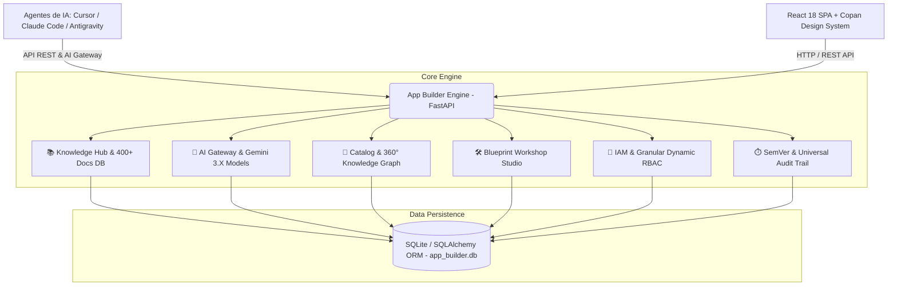

# 🚀 Olivelas SmartApp — App Builder Engine & Olivelas Platform

> **Plataforma de Engenharia de Software, Inteligência Arquitetural e Governança Orientada por IA (`olivelas-smartapp`)**  
> Repositório oficial: `https://github.com/pycriador/olivelas-smartapp.git`  
> Camada canônica entre agentes inteligentes de IA (*Cursor, Claude Code, Antigravity*) e a base estruturada de conhecimento técnico, especificações Copan, Golden Rules, arquiteturas canônicas, blueprints determinísticos, controle de acesso baseado em papéis (RBAC) e AI Gateway com persistência dedicada no **Supabase PostgreSQL (Schema Isolado `olivelas_smartapp`)** e publicação automatizada no **GitHub Pages**.

---

## 🗄️ Arquitetura Supabase (Schema Isolado `olivelas_smartapp`) & GitHub Pages

O projeto opera com isolamento completo de banco de dados no Supabase através do schema exclusivo **`olivelas_smartapp`**, separado do schema `public` e de outros projetos na mesma instância PostgreSQL.

### Variáveis de Ambiente e GitHub Secrets Configuradas
| Variável / Secret | Finalidade |
| :--- | :--- |
| `VITE_SUPABASE_URL` | URL da API/PostgREST do projeto no Supabase (Frontend & Backend) |
| `VITE_SUPABASE_KEY` | Chave publicável (`sb_publishable_...` / `anon`) para acesso do Frontend |
| `VITE_SUPABASE_SCHEMA` | Schema isolado do projeto (`olivelas_smartapp`) |
| `db_host` / `DB_HOST` | Host de conexão direta PostgreSQL do Supabase |
| `db_port` / `DB_PORT` | Porta PostgreSQL (`5432`) |
| `db` / `DB_NAME` | Nome do banco PostgreSQL (`postgres`) |
| `db_username` / `DB_USERNAME` | Usuário do banco (`postgres`) |
| `db_password` / `DB_PASSWORD` | Senha do banco PostgreSQL |
| `DB_SCHEMA` | Schema isolado utilizado pelo SQLAlchemy e scripts CLI (`olivelas_smartapp`) |

### 👑 Regra de Bootstrap: Primeiro Cadastro = `Global Admin`
- O banco de dados é inicializado **sem usuários e sem projetos pré-cadastrados** (`users = 0`, `projects = 0`), contendo apenas **configurações da plataforma, personalizações (`system_states`), matriz RBAC (5 papéis, 3 grupos, 64 permissões), catálogo de engenharia (183 componentes, 21 templates, 11 módulos), 32 Golden Rules, 10 especificações SDD, 5 arquiteturas e base de documentações**.
- **Primeiro Usuário = Global Admin**: Garantido em 3 camadas simultâneas:
  1. **Trigger PostgreSQL no Supabase** (`olivelas_smartapp.trg_first_user_is_global_admin` em `supabase/migrations/20261107000002_first_user_global_admin_and_postgrest.sql`): Se `COUNT(*) FROM olivelas_smartapp.users = 0`, o primeiro `INSERT` recebe automaticamente `role = 'Global Admin'`, `primary_group_id = 'grp_admin'`, vínculo em `user_groups` (`grp_admin`) e registro em `system_states` (`active_user_id`).
  2. **Backend FastAPI (`app/services/iam_service.py`)**: Endpoints `POST /api/v1/iam/auth/signup` e `POST /api/v1/iam/users` verificam `total_users == 0` e atribuem `Global Admin`.
  3. **Frontend Bridge (`src/services/supabase-bridge.ts` + `LoginPage.tsx`)**: Detecta automaticamente quando a plataforma aguarda o 1º cadastro e exibe o modo **"Primeiro Cadastro — Global Admin"**.

### 📦 Migrations do Supabase (`supabase/migrations/`)
1. `supabase/migrations/20261107000001_create_olivelas_smartapp_schema.sql`: Cria o schema isolado `olivelas_smartapp` e todas as 25 tabelas e índices da plataforma.
2. `supabase/migrations/20261107000002_first_user_global_admin_and_postgrest.sql`: Cria as triggers de *First User = Global Admin*, permissões de acesso ao schema e exposição no PostgREST (`pgrst.db_schemas`).
3. `supabase/migrations/20261107000003_seed_platform_config_and_catalog.sql`: Popula todas as configurações da plataforma, catálogo, regras, especificações, arquiteturas, matriz RBAC e personalizações (sem usuários ou projetos).

Para aplicar ou sincronizar as migrations diretamente no Supabase via CLI:
```bash
# Aplicar todas as migrations SQL e garantir base limpa de usuários/projetos para o 1º cadastro
python3 scripts/supabase_migrate.py --apply --reset-users-and-projects

# Apenas verificar contagens no schema olivelas_smartapp
python3 scripts/supabase_migrate.py --status
```

### 👤 Scripts CLI para Gerenciamento de Usuários no Supabase (`scripts/`)
Você pode gerenciar os usuários do schema `olivelas_smartapp` diretamente pelo terminal usando `scripts/supabase_users_cli.sh` (ou `python3 scripts/supabase_users_cli.py`):

```bash
# 1. Verificar status de bootstrap (se o próximo usuário será Global Admin)
./scripts/supabase_users_cli.sh status

# 2. Listar usuários cadastrados no schema olivelas_smartapp
./scripts/supabase_users_cli.sh list

# 3. Criar o primeiro usuário (automaticamente Global Admin se a base estiver vazia)
./scripts/supabase_users_cli.sh create \
  --email "admin@olivelas.com" \
  --name "Administrador Global" \
  --password "AdminPassword123"

# 4. Criar ou garantir um Global Admin explicitamente
./scripts/supabase_users_cli.sh create-first-admin \
  --email "admin@olivelas.com" \
  --name "Administrador Global" \
  --password "AdminPassword123"

# 5. Promover qualquer usuário existente para Global Admin
./scripts/supabase_users_cli.sh promote-admin --email "usuario@olivelas.com"

# 6. Alterar o papel (role) de um usuário ("Global Admin", "Admin", "Developer", "Editor", "Viewer")
./scripts/supabase_users_cli.sh set-role --email "usuario@olivelas.com" --role "Admin"

# 7. Redefinir a senha de um usuário
./scripts/supabase_users_cli.sh reset-password --email "usuario@olivelas.com" --password "NovaSenhaSegura123"

# 8. Desbloquear conta de usuário
./scripts/supabase_users_cli.sh unlock --email "usuario@olivelas.com"

# 9. Remover um usuário específico
./scripts/supabase_users_cli.sh delete --email "usuario@olivelas.com"

# 10. Limpar todos os usuários (reiniciar estado de 1º cadastro = Global Admin)
./scripts/supabase_users_cli.sh clear-all --yes
```

---

## 🏛️ Visão Geral da Arquitetura

O **App Builder Engine** centraliza a governança, especificações técnicas e o ciclo de vida completo de ativos de software através de pilares integrados:



---

## ✨ Principais Módulos da Plataforma

### 1. 📚 Central de Conhecimento & Documentações (`/knowledge/docs`)
- **400+ Especificações Técnicas e ADRs**: Indexação completa e persistência no banco de dados SQLite (`knowledge_documents`).
- **Navegação Inteligente em Accordion**: 7 agrupamentos canônicos e 12 categorias técnicas com contadores dinâmicos.
- **Busca em Tempo Real & Filtros Expansíveis**: Pesquisa instantânea por título, resumo, tags e conteúdo, com barra de filtros dinâmica e expansão de largura de menu lateral (`340px` / `450px`).
- **⭐ Sistema de Favoritos por Usuário**: Salve especificações favoritas com persistência na tabela `knowledge_doc_favorites` e filtro rápido `★ Favoritos (N)`.
- **Roteamento Deep-Linking**: Acesso direto a documentos por hash (`/knowledge/docs#doc-id`).

### 2. 🤖 AI Gateway & Modelos Gemini 3.X (`/ai/gateway`)
- **Suporte aos Modelos Gemini 3.X**: Execução de prompts com `gemini-3.1-pro-preview`, `gemini-3-flash-preview`, `gemini-3-pro-preview`, `gemini-2.5-pro` e `gemini-2.5-flash`.
- **Armazenamento e Criptografia de Chave**: Configuração segura da API Key no banco de dados com resolução automática para inferência.
- **Auditoria de Execuções & Modal de Inspeção**: Modal detalhado com abas para *System Prompt*, *User Prompt* e *Resposta LLM*, botões de cópia e exportação JSON.

### 3. 🌐 HTTP Client & API Tester (`/knowledge/http-client`)
- Cliente HTTP integrado para testar, inspecionar e disparar requisições em tempo real para qualquer endpoint da plataforma.

### 4. 🧩 Catálogo de Blocos de Construção & Grafo 360° (`/catalog`)
- **Componentes Copan**: Catálogo de UI e Backend com schema de props, preview e tokens.
- **Módulos de Domínio & 20 Templates**: Templates corporativos para scaffolding de microsserviços e frontends.
- **Grafo de Relações 360°**: Visualização de dependências, regras e documentações vinculadas.

### 5. 🛠️ Blueprint Workshop (`/ai/blueprint-composer`)
- Composição visual de arquiteturas, módulos e componentes com resolução de dependências e diagnóstico de conflitos.

### 6. 🔐 IAM & Matriz de Acesso RBAC Granular (`/settings`)
- Controle de privilégios em tempo real com perfis *Global Admin*, *Admin*, *Editor* e *Viewer* gravados no SQLite.

### 7. 🐍 SDK Python Oficial (`api_client/`)
- Biblioteca cliente tipada em Python para integração programática com o App Builder Engine.

---

## 🛠️ Pré-requisitos

Antes de iniciar, certifique-se de ter instalado em seu ambiente:

- **Python**: versão **3.11** ou superior (recomendado **3.12** ou **3.13**)
- **Node.js**: versão **18.x** ou **20.x** (com **npm**)
- **Git**

---

## 🚀 Como Iniciar a Aplicação Localmente

Você pode iniciar o projeto com um **único comando (`./start.sh`)**, em **Modo de Desenvolvimento Manual (com Hot Reload no Frontend e Backend)** ou no **Modo Integrado (FastAPI servindo a SPA compilada)**.

### ⚡ Opção Rápida: Script Unificado (`./start.sh`)

Na raiz do repositório, utilize o script `start.sh` (padrão compartilhado com Opsbase e OpsPages) para gerenciar o Backend (`:8000`) e o Frontend (`:5173`):

```bash
# Iniciar todos os serviços em foreground (Ctrl+C encerra ambos)
./start.sh

# Ou iniciar em background (modo daemon)
./start.sh --daemon

# Verificar saúde e status dos serviços
./start.sh status

# Acompanhar logs combinados em tempo real
./start.sh logs

# Parar todos os serviços e liberar as portas 8000 e 5173
./start.sh stop
```

---

### Opção A: Modo de Desenvolvimento Manual (Dois Terminais)

Neste modo, o backend FastAPI e o frontend Vite rodam simultaneamente com recarregamento automático a cada alteração de código.

#### 1️⃣ Iniciar o Backend (FastAPI)

Abra um terminal e execute:

```bash
# 1. Navegar até a pasta do backend
cd app_builder_engine

# 2. (Opcional, mas recomendado) Criar e ativar um ambiente virtual Python
python3 -m venv venv
source venv/bin/activate    # No Linux/macOS
# ou: .\venv\Scripts\activate   # No Windows (PowerShell)

# 3. Instalar as dependências do backend
pip install -r requirements.txt

# 4. Iniciar o servidor FastAPI (com detecção inteligente de porta livre e reload)
python3 start_server.py
# Ou via Uvicorn diretamente:
# python3 -m uvicorn app.main:app --host 127.0.0.1 --port 8000 --reload
```

> O backend iniciará em **`http://127.0.0.1:8000`** (ou na próxima porta livre caso 8000 esteja ocupada) e inicializará o banco SQLite local automaticamente.

---

#### 2️⃣ Iniciar o Frontend (React + Vite)

Abra um **segundo terminal** e execute:

```bash
# 1. Navegar até a pasta do frontend
cd app_builder_engine/frontend

# 2. Instalar os pacotes npm
npm install

# 3. Iniciar o servidor de desenvolvimento Vite
npm run dev
```

> O frontend estará acessível em **`http://localhost:5173`** (com proxy reverso e fallback de porta automáticos configurados para o backend).

---

### Opção B: Modo Integrado (Produção Local)

Neste modo, o frontend é compilado em arquivos estáticos que são servidos diretamente pelo FastAPI em uma única porta (`8000`).

```bash
# 1. Compilar o frontend
cd app_builder_engine/frontend
npm install
npm run build

# 2. Iniciar o backend
cd ..
python3 start_server.py
```

> Acesse a aplicação completa diretamente em **`http://localhost:8000/`**.

---

---

## 📍 Rotas e Serviços de Desenvolvimento Local

Abaixo estão os endereços padrão de acesso aos serviços em ambiente local e seus respectivos arquivos de log de execução:

| Serviço | Modo | Endereço de Acesso | Log de Execução |
| :--- | :--- | :--- | :--- |
| **Backend (FastAPI)** | Desenvolvimento | [http://127.0.0.1:8000](http://127.0.0.1:8000) | `task-746.log` |
| **Frontend (React + Vite)** | Desenvolvimento | [http://localhost:5173](http://localhost:5173) | `task-750.log` |
| **Documentação da API** | Swagger UI | [http://127.0.0.1:8000/docs](http://127.0.0.1:8000/docs) | — |
| **Documentação Técnica** | ReDoc | [http://127.0.0.1:8000/redoc](http://127.0.0.1:8000/redoc) | — |
| **Health Check** | Liveness & Readiness | [http://127.0.0.1:8000/health](http://127.0.0.1:8000/health) | — |
| **📚 Central de Documentações** | Hub SPA | [http://localhost:5173/knowledge/docs](http://localhost:5173/knowledge/docs) | — |
| **🤖 AI Gateway & Gemini 3.X** | Hub SPA | [http://localhost:5173/ai/gateway](http://localhost:5173/ai/gateway) | — |
| **🌐 HTTP Client & Tester** | Hub SPA | [http://localhost:5173/knowledge/http-client](http://localhost:5173/knowledge/http-client) | — |

---

## 🛡️ Segurança, Variáveis de Ambiente e Governança

> [!IMPORTANT]
> **Política de Zero Credenciais e Exclusão de Bancos de Dados do Repositório**:
> - Nenhum arquivo de banco de dados (`.db`, `.sqlite`, `.sqlite3`) nem arquivos com credenciais reais (`.env`) são versionados no Git.
> - O arquivo `.env.example` fornece o template seguro com placeholders para configuração em novos ambientes.
> - O banco de dados SQLite é gerado e populado deterministicamente em tempo de execução via `app/db/seed.py` na primeira inicialização.

Para customizar as configurações de ambiente, copie o template e defina suas credenciais locais:

```bash
cp .env.example app_builder_engine/.env
```

Exemplo de configuração (`.env.example`):

```env
# Configurações do Servidor
APP_ENV=development
API_PORT=8000
API_HOST=127.0.0.1
LOG_LEVEL=INFO

# Banco de Dados Relacional
DATABASE_URL=sqlite:///./app_builder.db

# Segredos de Criptografia e Autenticação IAM (Altere para produção)
JWT_SECRET_KEY=your-secure-random-jwt-secret-key-min-32-chars
ENCRYPTION_KEY=your-secure-encryption-key-for-credentials-32b

# Usuário e Senha Inicial para Seed Local
DEFAULT_ADMIN_USER=admin@olivelas.com.br
DEFAULT_ADMIN_PASSWORD=your-secure-admin-password
```

> **Nota sobre Chave do Gemini**: Você pode configurar a sua API Key do Google Gemini diretamente pela interface em **AI Gateway > Provedores / Configurações** ou via variável `GEMINI_API_KEY`. As credenciais inseridas na interface são criptografadas em repouso no SQLite local.

---

## 🤖 Integração para Agentes de IA (Roadmap, Python, Node.js e cURL)

A plataforma disponibiliza uma API RESTful de primeira classe projetada especificamente para permitir que **Agentes Autônomos de Inteligência Artificial** (*Cursor, Claude Code, Antigravity*) se conectem, componham blueprints, criem projetos, configurem conexões de banco de dados e gerenciem versões com controle estrito de RBAC.

> 📖 **Guia Completo e Especificação Detalhada**: Consulte [`docs/ai_agent_api_integration_guide.md`](docs/ai_agent_api_integration_guide.md).

### 🗺️ Ciclo de Vida da Integração (Roadmap em 7 Etapas)

```text
[1. Health Check] ➔ [2. Auth & JWT Bearer] ➔ [3. Catálogo & Regras] ➔ [4. AI Blueprint] ➔ [5. Criação do Projeto & Banco de Dados] ➔ [6. Validação] ➔ [7. Snapshot SemVer]
```

### 🚀 Scripts Executáveis Prontos para Uso

O repositório inclui 3 scripts de demonstração prontos e testados para executar o pipeline completo de ponta a ponta:

1. **Python (Requests / Standalone)**:
   ```bash
   python3 scripts/ai_agent_workflow.py
   ```
2. **Node.js (ESM / Native Fetch - Node 18+)**:
   ```bash
   node scripts/ai_agent_workflow.mjs
   ```
3. **cURL & Bash (POSIX Shell + jq)**:
   ```bash
   bash scripts/ai_agent_workflow.sh
   ```

---

## 🐍 Como Utilizar o SDK Python (`api_client`)

O projeto inclui um SDK Python completo (`api_client/`) para integração fluida e tipada:

```python
from api_client import AppBuilderClient

client = AppBuilderClient(base_url="http://127.0.0.1:8000")

# 1. Login e obtenção de token JWT
auth = client.auth.login("willian.jesus@olivelas.com.br", "admin_dev_pass")
print(f"Token: {auth.access_token[:20]}... (Role: {auth.user.get('role')})")

# 2. Composição de Blueprint via AI Gateway
blueprint = client.ai.compose_blueprint(
    name="Portal Fiança e Locação",
    description="Sistema imobiliário com banco de dados PostgreSQL",
    requirements=["Autenticação JWT", "PostgreSQL Connection Pooling", "Tabela de Propostas"]
)

# 3. Criação de Projeto com Banco de Dados e vínculo ao Blueprint
project = client.projects.create_project(
    name="Portal Fiança e Locação",
    description="Projeto imobiliário com PostgreSQL",
    blueprint_id=blueprint.blueprint.id,
    tags=["ai-generated", "database:postgresql"]
)
print(f"Projeto registrado: {project.id} (Arquitetura: {project.architecture_id})")
```

---

## 🔐 Contratos Canônicos de API, IAM, Segurança e Blueprints

> 📖 **Relatório Completo de Resolução das 18 Lacunas (Gaps) da API**: Consulte [`docs/api_gaps_resolution_report.md`](docs/api_gaps_resolution_report.md).

A API do **Olivelas App Builder Engine (`localhost:8000`)** segue rigorosamente os contratos canônicos da plataforma:

1. **Autenticação JWT Obrigatória (`401 AUTHENTICATION_FAILED`)**:
   - Todas as rotas protegidas (`/api/v1/projects*`, `/api/v1/blueprints*`, `/api/v1/audit/logs`, `/api/v1/iam/auth/me`, `/api/v1/components*`, `/api/v1/modules*`, `/api/v1/rules*`, `/api/v1/specifications*`, `/api/v1/architectures*`, etc.) exigem `Authorization: Bearer <jwt_token>`.
   - Headers de identidade forjáveis (`X-User-Role`, `X-User-Email`) não são aceitos nem expostos no OpenAPI.
   - Credenciais padrão sincronizadas com `.env` e primeiro cadastro automático como `Global Admin`.

2. **Contrato IAM para Aplicações (`/api/v1/iam/contract`)**:
   - **`GET /api/v1/iam/contract`**: Retorna a matriz oficial `role_permissions_matrix` (*Global Admin*, *Admin*, *Developer*, *Viewer*), `security_configuration` (TTL de Access Token 15min — `ACCESS_TOKEN_EXPIRE_MINUTES` em `app/core/security.py`, conforme Olivelas Backend Security Specification; Refresh Token 7d, algoritmo `HS256`, política de senha Argon2id / SHA-256, lockout e rate limit) e os endpoints de auto-cadastro e grupos.
   - **`POST /api/v1/iam/auth/signup`** (`201 Created`): Auto-cadastro público de usuários com atribuição automática ao papel `Viewer` e grupo `grp_viewers`.
   - **`GET / POST / DELETE /api/v1/iam/groups/{group_id}/members`**: Gestão completa de membros de grupos (`POST` retorna `201 Created`).
   - **Lockout de Conta (`423 ACCOUNT_LOCKED`)**: Após 5 tentativas falhas consecutivas de login, a conta é bloqueada por 15 minutos e retorna HTTP `423 Locked` com `error.code = "ACCOUNT_LOCKED"`.

3. **AI Blueprint Compose Determinístico e Validado (`POST /api/v1/ai/blueprints/compose`)**:
   - **Envelope Canônico**: Resposta envelopada em `{ "data": { ... }, "meta": { ... } }` (mantendo campos de topo por retrocompatibilidade).
   - **Persistência Respeitada**: Requisitos contendo PostgreSQL / Opsbase selecionam `arch_loft_postgres_opsbase_fullstack` (`PostgreSQL 16 via Olivelas Opsbase (SQLAlchemy 2.0 + Alembic)`) ou `arch_loft_standard_fullstack`, nunca arquiteturas stateless para aplicações com banco/login.
   - **Somente IDs Reais do Catálogo**: `identified_modules`, `identified_components` e `recommended_templates` contêm exclusivamente IDs reais do catálogo (`mod_*`, `cmp_*`, `tpl_*`) filtrados por domínio com `selection_rationale`, garantindo que `POST /api/v1/blueprints/validate-config` aprove com `0` erros (`status: "ready"`).
   - **Transparência de Status de IA**: Caso a chave do provedor LLM esteja indisponível ou inválida, a resposta expõe explicitamente `ai_status: "unavailable"` e `warnings[]`.

4. **Projetos, Vínculo Bidirecional com Blueprint, Versionamento SemVer e Auditoria (`/api/v1/projects` & `/api/v1/audit/logs`)**:
   - **`POST /api/v1/projects`** (`201 Created`) e **`PUT /api/v1/projects/{id}`** (`200 OK`): Usam `arch_loft_standard_fullstack` como `architecture_id` padrão e sincronizam bidirecionalmente `project.blueprint_id` ↔ `blueprint.project_id` (incluindo troca de blueprint e remoção de vínculo com `blueprint_id: null`), refletindo em `GET /api/v1/ai/blueprints/{id}`, `GET /api/v1/blueprints/{id}` e `GET /api/v1/projects/{id}/blueprint`.
   - **`POST /api/v1/projects/{id}/versions`** (`201 Created`) e **`GET /api/v1/projects/{id}/versions`** (`200 OK`): Criação e listagem de snapshots SemVer do projeto, registrando automaticamente o evento `VERSION_CREATED` na trilha de auditoria.
   - **`GET /api/v1/audit/logs`**: Suporta filtros combinados por `action`, `resource`, `entity_id` e `actor`.

5. **Validação de Blueprint (`POST /api/v1/blueprints/validate-config`) — Semântica HTTP `422` e Escopo de Conformidade Copan**:
   - **HTTP `422 (VALIDATION_ERROR)` em Erros Bloqueantes**: Quando há diagnósticos `CRITICAL`/`ERROR` ou `can_publish: false` (ex.: `architecture_id` inexistente ou ausência de regras Copan sem `ui_library` alternativa declarada), o endpoint responde HTTP `422 Unprocessable Entity` com `error.code = "VALIDATION_ERROR"`, mantendo `data.status`, `data.can_publish` e `diagnostics[]` no corpo. Configurações publicáveis (`can_publish: true`, com `status: "ready"` ou `"warning"`) respondem HTTP `200 OK`.
   - **Regras Copan Rebaixadas para `WARNING` Somente com `ui_library` Explícita**: Sem declaração de `ui_library` (`ui_library: null`), omitir `rul_copan_01_brand_orange` / `rul_copan_02_tokens_only` mantém os diagnósticos `CRITICAL` (`MISSING_ARCH_MANDATORY_RULE` e `MISSING_COPAN_MANDATE`, `can_publish: false`, HTTP `422`). Somente quando o projeto declara explicitamente uma biblioteca de UI não-Copan (ex.: `ui_library: "antd"`) a exigência é rebaixada para `WARNING` (`can_publish: true`, HTTP `200`).
   - **Escopo Declarativo vs. Auditoria Real de Código**: A resposta expõe `validation_scope` (`"declarative_manifest"` quando apenas IDs do manifesto são enviados, onde `status: "ready"` significa **"declaração consistente"**, e não **"código auditado"**; ou `"code_and_manifest_audited"` quando `ui_library`, `dependencies`, `package_json` ou `source_files` são fornecidos para inspeção real de imports, pacotes e tokens CSS `--copan-*`).

6. **Golden Rules, Especificações e Componentes Acionáveis**:
   - **`rul_loft_be_api_envelope`** e **`rul_loft_be_error_codes`**: Incluem `json_schema` completo, tabela `error_codes_table` (`401 AUTHENTICATION_FAILED`, `403 PERMISSION_DENIED`, `404 NOT_FOUND`, `409 CONFLICT`, `422 VALIDATION_ERROR`, `423 ACCOUNT_LOCKED`, `429 RATE_LIMITED`, `500 INTERNAL_ERROR`, `502 AI_SERVICE_ERROR`) e objeto `examples` preenchido.
   - **Componentes Backend (`cmp_be_*`) e Frontend (`cmp_fe_*`)**: Possuem contratos reais estruturados em `props_contract` (métodos, entradas, saídas, códigos de erro) e implementações completas de referência em `preview_code`.

7. **Navegação Padronizada, Paginação por URL + Server-Side, Sidebar Retrátil e Engine Status Real**:
   - **Paginação Sincronizada com a URL (`?page=X&page_size=Y`)**: Todas as páginas de listagem utilizam o hook `useUrlPagination` sincronizando `page` e `page_size` diretamente na query string da URL, com controles de paginação no padrão oficial (`showSizeChanger`, `showTotal` e `pageSizeOptions` em português).
   - **Paginação Server-Side nos Endpoints REST**: Todos os endpoints de listagem (`/api/v1/projects`, `/api/v1/blueprints`, `/api/v1/ai/blueprints`, `/api/v1/components`, `/api/v1/modules`, `/api/v1/templates`, `/api/v1/rules`, `/api/v1/specifications`, `/api/v1/architectures`, `/api/v1/audit/logs`, `/api/v1/iam/users`, `/api/v1/iam/groups`, `/api/v1/settings/users`, `/api/v1/settings/roles`, `/api/v1/settings/logs`, `/api/v1/ai/agents*`, `/api/v1/ai/gateway/*`) aceitam `page` e `page_size` e retornam apenas a fatia da página atual junto ao envelope `meta: { page, page_size, total }`. A página `/platform/library-updates` realiza a varredura sob demanda e pagina os resultados via URL no frontend.
   - **Bootstrap Automático de Sessão JWT (`GET /api/v1/rbac/session-token`)**: O cliente HTTP do frontend obtém e renova automaticamente o token JWT da sessão RBAC ativa (incluindo sincronização imediata ao alternar perfis em `/api/v1/rbac/switch-role`), eliminando erros `401 Unauthorized` ao acessar páginas autenticadas diretamente pela URL.
   - **Sidebar Fixa, Retrátil e com Engine Status ao Vivo (`GET /api/v1/dashboard/engine-status`)**: Menu lateral fixo (`h-screen`) com botão de expandir/recolher (`w-64` ↔ `w-[72px]`, persistido em `localStorage`), área de navegação com rolagem independente, tooltips no modo recolhido e rodapé fixo conectado em tempo real ao endpoint `/api/v1/dashboard/engine-status` exibindo saúde do banco, versão, ambiente e contadores vivos da plataforma.
   - **Isolamento de Camadas CSS (`@layer` + Ant Design `StyleProvider`)**: Uso de `<StyleProvider layer>` (`@ant-design/cssinjs`) com `@layer theme, base, antd, components, utilities;` para garantir espaçamento consistente e elegante (`gap-4` / `space-y-4`) entre cards e seções em todas as páginas (como `/knowledge/architectures`, `/knowledge/rules` e `/catalog/*`).

---

## 🧪 Execução de Testes Automatizados

Para rodar os testes automatizados da plataforma:

### Testes do Backend (Pytest)
```bash
cd app_builder_engine
PYTHONPATH=. python3 -m pytest tests -v

# Testes de persistência de favoritos de documentação
PYTHONPATH=. python3 /Users/willian.jesus/.gemini/antigravity/brain/2e07b8b8-21f5-4fc4-ba6c-91bd95fdf9a8/scratch/test_knowledge_favorites.py
```

### Validação e Build do Frontend
```bash
cd app_builder_engine/frontend
npm run build
```

---

## 📁 Estrutura do Repositório

```
olivelas-smartapp/
├── README.md                              # Documentação principal da plataforma Olivelas
├── start.sh                               # Script unificado de gerenciamento local (start/stop/status/logs)
├── supabase/migrations/                   # Migrations SQL do schema isolado olivelas_smartapp no Supabase
├── scripts/                               # Scripts CLI de gerenciamento de usuários e migrations no Supabase
├── docs/                                  # Relatórios técnicos e resolução de gaps de API
│   └── api_gaps_resolution_report.md      # Histórico de auditoria e contratos da API
├── api_client/                            # SDK Python oficial para agentes e automações
│   ├── client.py                          # Cliente principal OlivelasClient / AppBuilderClient
│   ├── http_client.py                     # Wrapper HTTP tipado
│   ├── models.py                          # Modelos de dados Pydantic
│   └── services/                          # Serviços de catálogo, IA, auditoria e docs
├── app_builder_engine/                    # Núcleo da aplicação (Backend + Frontend)
│   ├── pyproject.toml                     # Metadados do projeto Python
│   ├── requirements.txt                   # Dependências Python do backend
│   ├── app/                               # Backend FastAPI conectado ao Supabase (olivelas_smartapp)
│   │   ├── main.py                        # Ponto de entrada FastAPI e montagem de rotas
│   │   ├── api/v1/                        # Rotas REST (knowledge, ai_gateway, catalog, rbac, etc.)
│   │   ├── models/orm_models.py           # Modelos SQLAlchemy ORM
│   │   ├── services/                      # Regras de negócio, busca, favoritos e IA
│   │   ├── db/session.py                  # Conexão PostgreSQL Supabase (schema olivelas_smartapp)
│   │   └── static/dist/                   # Build de produção do frontend React
│   ├── frontend/                          # Aplicação React 18 + Vite + Ant Design
│   │   ├── src/
│   │   │   ├── features/knowledge/docs/   # Hub de Documentações, busca e favoritos
│   │   │   ├── features/ai/               # AI Gateway, Blueprints e Agentes
│   │   │   ├── features/catalog/          # Componentes, Módulos e Templates
│   │   │   ├── features/settings/         # IAM, RBAC e Matriz de Permissões
│   │   │   └── services/                  # Clientes HTTP e Supabase Bridge
│   │   ├── package.json                   # Dependências e scripts npm
│   │   └── vite.config.ts                 # Configuração do Vite e proxy reverso
│   └── knowledge_base/                    # Repositório de documentações técnicas Olivelas
└── copan_design_system/                   # Especificações canônicas Copan
```

---

## 📄 Licença e Governança

Desenvolvido e mantido sob as diretrizes de governança técnica e padrões de arquitetura da **Olivelas (`pycriador/olivelas-smartapp`)**.
