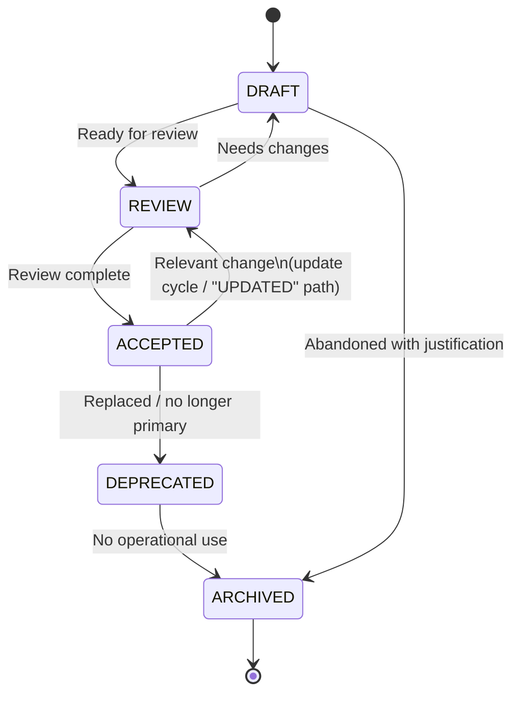

# Documentation Lifecycle

> Language: EN | [Português (pt-BR)](../pt-BR/lifecycle.md)
>
> Status: ACCEPTED
>
> Documentation Standard v1.0

Official lifecycle for documentation governed by this standard.

Status values are English machine tokens. Do not invent alternate statuses such as `FINAL`, `DONE`, `OK`, `GOOD`, `OLD`, or `TEMP`.

`UPDATED` is **not** a stored status token. Document updates follow the cycle `ACCEPTED → REVIEW → ACCEPTED` (see diagram note).

Beyond status tokens, accepted documentation is **Consumed** and **Validated** by humans and AI agents (see below). Consume/Validate are usage stages, not additional `status` values.

Structural validation is also enforced by in-repo automation and quality gates ([governance.md](governance.md), [automation.md](automation.md)) — distinct from semantic human review.

## Lifecycle Diagram



Text form:

```text
DRAFT ──► REVIEW ──► ACCEPTED ──► DEPRECATED ──► ARCHIVED
  │          │            │
  │          └──► DRAFT   └──► REVIEW  (update cycle; not a status named UPDATED)
  │
  └──────────────────────────────► ARCHIVED  (abandoned with justification)
```

Note: when an `ACCEPTED` document receives a relevant change, move it to `REVIEW` and back to `ACCEPTED` after review. That path is the update cycle sometimes called "UPDATED" in conversation — it is not a fifth stored status.

## Status Meanings (Summary)

| Status | Meaning |
| --- | --- |
| `DRAFT` | Work in progress; incomplete or not ready for review |
| `REVIEW` | Ready for or under review |
| `ACCEPTED` | Approved current documentation |
| `DEPRECATED` | Still visible, but superseded or no longer primary |
| `ARCHIVED` | Historical only; not active guidance |

Full policy: [status.md](status.md).

## Transition Matrix

| Current | Next | Condition |
| --- | --- | --- |
| `DRAFT` | `REVIEW` | Author considers the document ready for review: structure complete enough to evaluate, unknowns marked, no invented facts presented as confirmed |
| `REVIEW` | `ACCEPTED` | Review complete; findings addressed or accepted as follow-ups; content is accurate enough for current-state use |
| `REVIEW` | `DRAFT` | Review found material gaps, incorrect claims, or missing evidence; author must revise before another review |
| `ACCEPTED` | `REVIEW` | Relevant technical or operational change requires doc update (update cycle / "UPDATED" path); or a review trigger fires (see [review-policy.md](review-policy.md)) |
| `ACCEPTED` | `DEPRECATED` | Document is replaced or no longer the primary source for that topic |
| `DEPRECATED` | `ARCHIVED` | No remaining operational use; retained for history only |
| `DRAFT` | `ARCHIVED` | Work abandoned with a short justification (why it was stopped, what replaces it if anything) |

Transitions not listed are not allowed. In particular:

- Do not jump `DRAFT → ACCEPTED` without `REVIEW` for substantive docs.
- Do not invent statuses for "updated" or "stale".
- Restoration from `DEPRECATED` to `ACCEPTED` is out of scope of the normal matrix (rare; prefer a new document or a deliberate exception recorded in review notes).

## Metadata

Record status and related fields in YAML frontmatter when the document is substantive. See [standards.md](standards.md) — Document Metadata.

Minimum for governed docs:

- `status`
- `owner`
- `updated`

Deprecation and archive add:

- `replaced_by`, `deprecated_on`, `deprecation_reason` when applicable

Short or ephemeral docs may use the blockquote `> Status:` form; prefer YAML for templates and project substantive docs.

## Ownership and Review

Lifecycle transitions involve people, not only tokens:

| Concern | Document |
| --- | --- |
| Who owns and who reviews | [ownership.md](ownership.md) |
| When review is required | [review-policy.md](review-policy.md) |
| How to deprecate | [deprecation.md](deprecation.md) |
| How to archive | [archive-policy.md](archive-policy.md) |
| Status rules in detail | [status.md](status.md) |

## Consume and Validate

After a document is `ACCEPTED` (or while using any visible doc carefully), consumers **use** and **check** it:

```text
… → ACCEPTED → Consume → Validate → (feedback into REVIEW / debt / contradiction / gap)
```

| Stage | Meaning |
| --- | --- |
| **Consume** | Read and apply the document as context for a question, change, integration, operation, or review |
| **Validate** | Check that claims still match evidence (code, config, contracts, runtime) and that links/IDs remain coherent |

Validation failures become documentation updates, drift records, contradictions, or knowledge gaps — not silent invention.

## AI as Consumer (No Authority)

AI agents are first-class **consumers** of documentation. They may participate in these activities **without authority** to accept, own, or silently supersede Authoritative sources:

| Activity | Allowed for AI | Not allowed for AI |
| --- | --- | --- |
| **Discovery** | Find entry points, registries, related docs | Invent missing inventories as Confirmed |
| **Analysis** | Compare docs to evidence; classify claims | Promote Inferred to Confirmed without new evidence |
| **Validation** | Flag drift, contradictions, stale metadata | Close gaps by fabricating facts |
| **Generation** | Draft new or updated docs as `DRAFT` | Set `ACCEPTED` or reassign `owner` casually |
| **Maintenance** | Propose link fixes, claim updates, change records | Delete primary history or hide uncertainty |

Entry point: [ai-context.md](ai-context.md). Boundaries: [ai-task-boundaries.md](ai-task-boundaries.md). Generation rules: [ai-documentation.md](ai-documentation.md).

## Related Documents

- [status.md](status.md)
- [ownership.md](ownership.md)
- [review-policy.md](review-policy.md)
- [change-policy.md](change-policy.md)
- [deprecation.md](deprecation.md)
- [archive-policy.md](archive-policy.md)
- [standards.md](standards.md)
- [quality-model.md](quality-model.md)
- [ai-context.md](ai-context.md)
- [ai-documentation.md](ai-documentation.md)
