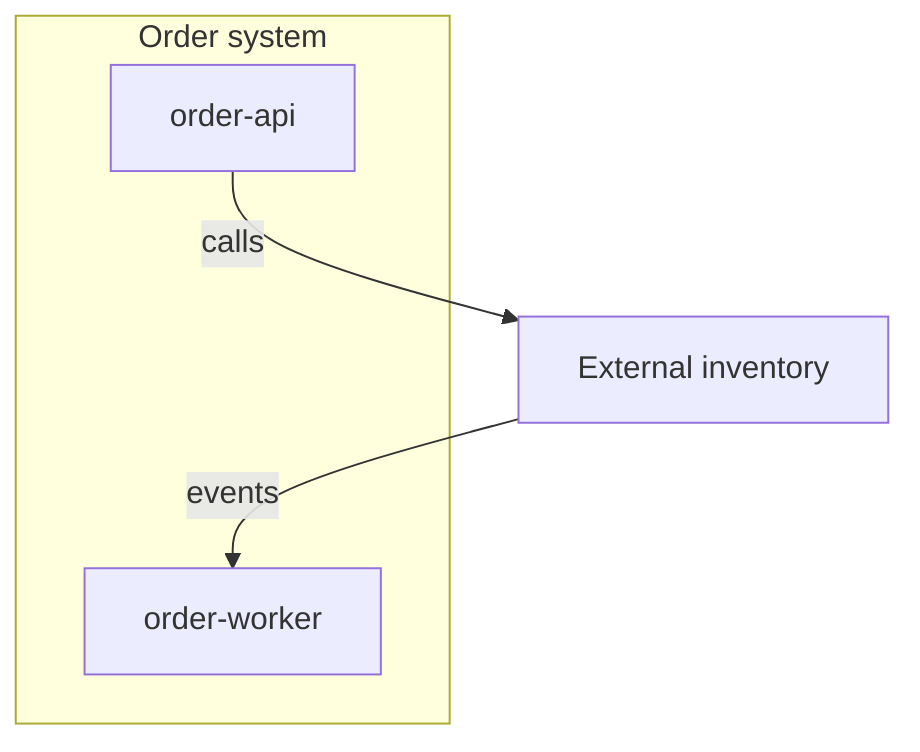

# Mermaid Standards

> Language: EN | [Português (pt-BR)](../pt-BR/mermaid-standards.md)
>
> Status: ACCEPTED
>
> Documentation Standard v1.0

Conventions for Mermaid diagrams used in architecture and related engineering documentation.

Mermaid is recommended when a text-versionable diagram improves understanding. It is not mandatory if another text-based format fits better — keep the same naming and labeling discipline.

## Naming

| Rule | Example |
| --- | --- |
| Use stable architectural names, not temporary code nicknames | `checkout-api`, not `svc2` |
| Match names to docs and contracts | Same spelling as component tables |
| Prefer short node IDs; put display labels in brackets/quotes | `api[checkout-api]` |
| Avoid spaces in node IDs | `order_events` or `orderEvents` as ID; display label can be readable |
| Do not encode secrets or real credentials in labels | Use placeholders |

## Direction

Pick a direction and keep it consistent within a diagram:

| Diagram kind | Typical direction |
| --- | --- |
| Context / dependency overview | `LR` (left → right) or `TB` |
| Nested structure | `TB` |
| Sequence | Built-in top-to-bottom time |
| State | Natural lifecycle order |

State the initiation or data direction with **edge labels**, not only layout.

```mermaid
flowchart LR
  a[checkout-api] -->|calls| b[payment-gateway]
  a -->|publishes to| c[order-events]
```

## Grouping

Use subgraphs for deployable units, trust zones, or failure domains — one grouping concern per diagram when possible.

Do not nest subgraphs deeply. If nesting exceeds two levels, split the diagram.

## Labels

- Label every meaningful edge with a relationship verb ([component-relationships.md](component-relationships.md)).
- Keep labels short (`calls`, `consumes from`, `reads from`).
- Put longer explanation in adjacent prose or a legend.
- Mark Proposed edges/nodes in the label or title (`Proposed: …`).

## Complexity

| Signal | Action |
| --- | --- |
| More than ~10–15 nodes for one purpose | Split by level or subsystem |
| Crossing lines dominate the figure | Split or switch to a table |
| Multiple audiences mixed | Separate Executive/System vs Technical diagrams |
| Sequence has many optional error paths | Main happy path + separate error sequence, or prose for rare paths |

Large diagrams that try to show everything become stale quickly and fail reviews. Prefer progressive disclosure ([architecture-model.md](architecture-model.md)).

## Consistency and Reuse

1. Reuse the same node names across related Mermaid blocks.
2. Keep one canonical diagram for a view; link from other docs instead of forking copies when possible.
3. When duplication is unavoidable, update all copies in the same change or open documentation debt.
4. Align Mermaid with written inventories — diagram and table must not contradict.

## Recommended Diagram Forms

| Need | Mermaid form |
| --- | --- |
| Context / components / data flow | `flowchart` |
| Interaction over time | `sequenceDiagram` |
| Lifecycle / states | `stateDiagram-v2` |
| Infrastructure topology | `flowchart` or `C4Context`/`C4Container` only if the project already standardizes on them |

Do not require C4 Mermaid syntax. Plain flowcharts are enough for most projects.

## Checklist

- [ ] Title and purpose are clear in the surrounding Markdown
- [ ] Names match architecture docs
- [ ] Edges are labeled
- [ ] Current vs Proposed is unambiguous
- [ ] Diagram is small enough to review in a PR
- [ ] No secrets or unnecessary sensitive data

## Related Documents

- [architecture-diagrams.md](architecture-diagrams.md)
- [diagram-selection.md](diagram-selection.md)
- [component-relationships.md](component-relationships.md)
- [templates/diagram.md](templates/diagram.md)
- [standards.md](standards.md)
