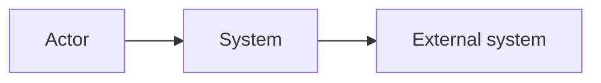

# System Boundaries

> Language: EN | [Português (pt-BR)](../pt-BR/system-boundaries.md)
>
> Status: ACCEPTED
>
> Documentation Standard v1.0

How to document what belongs to the system, what sits outside it, and what crosses the boundary.

A strong architecture document makes explicit what the system **does not control**.

## Purpose

The system boundary answers:

> Where does this system's responsibility end?

Without a clear boundary, diagrams inflate, ownership blurs, and failure/trust analysis becomes guesswork.

## What Belongs Inside

Document as in-scope when the adopting project owns or operates it as part of this system:

- deployable units and architectural components of this system;
- data stores that this system treats as its own persistence;
- workflows, jobs, and runtime processes under this system's ownership;
- configuration and contracts this system publishes.

Use stable names. Prefer current state. Mark Proposed separately.

## What Belongs Outside

Document as out-of-scope / external when another system, team, or platform owns it:

- users and human operators (as actors, not as "components" of your architecture);
- peer or upstream/downstream systems;
- shared platforms (identity, messaging, observability backends) when not owned here;
- third-party APIs and SaaS;
- data stores or queues owned by another system even if this system reads or writes them.

External does not mean "ignore". It means: document the interface and the failure impact, not the internal design of the other party.

## Internal vs External Responsibilities

| Side | Document | Avoid |
| --- | --- | --- |
| **Internal** | Responsibilities this system guarantees (or currently provides) | Claiming guarantees without evidence |
| **External** | Expectations on others (SLAs, contracts, assumed availability) | Pretending this team controls external behavior |

For each major external dependency, note:

- what this system expects;
- what happens when the expectation fails;
- whether the dependency is Confirmed, Inferred, or Unknown.

## Interfaces at the Boundary

Boundary interfaces are where the system exchanges information with the outside world:

| Concern | Capture |
| --- | --- |
| Direction | Inbound, outbound, or bidirectional |
| Style | Sync, async, batch, stream, file, CLI, other |
| Contract | Link to the canonical contract document |
| AuthN / AuthZ | How the crossing is controlled (summary; details in security docs) |
| Data | What crosses (categories, not secret values) |

Prefer linking contracts over duplicating schemas. See [architecture-traceability.md](architecture-traceability.md).

## What the System Does Not Control

Explicitly list non-control areas when useful. Examples of the *kind* of statement (adapt to the project):

- availability or schema of an upstream API you call;
- ordering guarantees of a shared bus you do not own;
- client retry behavior;
- infrastructure shared across many systems beyond your change authority;
- legal or compliance processes owned by another org unit.

Framing non-control reduces false confidence in architecture reviews and incident response.

## Relationship to Trust and Failure

- **Trust boundaries** often align with system boundaries but are not identical — see [trust-boundaries.md](trust-boundaries.md).
- **Failure domains** describe blast radius when parts fail — they may be smaller or larger than the system boundary — see [failure-domains.md](failure-domains.md).

## Diagram Guidance

A context diagram is usually enough to show the boundary:

Keep internal structure out of the context view. Deeper structure belongs in container/component diagrams — [architecture-diagrams.md](architecture-diagrams.md).

## Progressive Disclosure

| Project size | Minimum |
| --- | --- |
| Small | Short "In / Out / Does not control" lists in the architecture overview |
| Medium | Dedicated boundary section + context diagram |
| Large / multi-team | Boundary doc or section plus ownership links and contract inventory |

## Related Documents

- [architecture-model.md](architecture-model.md)
- [trust-boundaries.md](trust-boundaries.md)
- [failure-domains.md](failure-domains.md)
- [component-relationships.md](component-relationships.md)
- [architecture/README.md](architecture/README.md)
