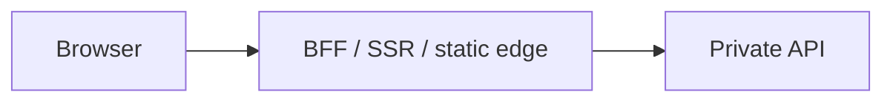

# BFF / edge presentation layer

> Language: EN | [Português (pt-BR)](../../pt-BR/templates/bff.md)
>
> Status: ACCEPTED
>
> Documentation Standard v1.0

<!-- Browser-facing Frontend or BFF at the trust boundary in front of private APIs. SSR is optional — describe what the project actually does. -->

## Purpose

<!-- Why this layer exists (public UI, API aggregation, same-origin proxy, SSR, …). -->

## Responsibilities

| In | Out |
| --- | --- |
| Serve UI / render / hydrate | Business rules owned by API |
| Proxy or call backend APIs | Direct database / secret access |

## Trust boundary

| Boundary | Notes | Classification |
| --- | --- | --- |
| Internet → edge | TLS, public hostname | |
| Edge → API | Private network / proxy target | |

## Configuration (names only)

| Variable / setting | Where | Purpose | Classification |
| --- | --- | --- | --- |
| | build / runtime | | |

## Auth posture

<!-- Where tokens live — evidenced only. Never document secret values. -->

## Related

- Architecture overview / system context
- Security overview
- HTTP contracts
- ADR if SSR vs CSR was a material decision
