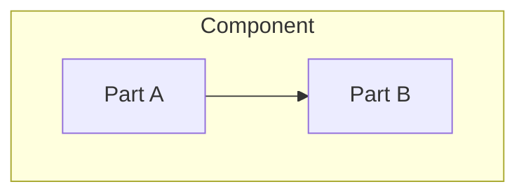

# Component Architecture

> Language: EN | [Português (pt-BR)](../../pt-BR/templates/component-architecture.md)
>
> Status: ACCEPTED
>
> Documentation Standard v1.0

<!-- Architectural component view. An architectural component is a meaningful unit of responsibility — not every class, file, or function. Prefer [component.md](component.md) for operational/implementation detail of a named unit when needed. Current state only unless labeled Proposed. -->

## Purpose

<!-- Why this architectural component exists. -->

## Responsibilities

| Responsibility | Notes |
| --- | --- |
| | |

## Non-Responsibilities

| Non-responsibility | Owner / elsewhere |
| --- | --- |
| | |

## Internal Structure

<!-- Sub-units only when they are architecturally relevant. Do not enumerate implementation files by default. -->

| Part | Role |
| --- | --- |
| | |

## Dependencies

| Dependency | Purpose | Required | Classification |
| --- | --- | --- | --- |
| | | yes / no | Confirmed / Inferred / Unknown |

## Interfaces

| Interface | Type | Contract document |
| --- | --- | --- |
| | API / event / file / command / other | |

## Inputs

| Input | Source | Format / contract |
| --- | --- | --- |
| | | |

## Outputs

| Output | Destination | Format / contract |
| --- | --- | --- |
| | | |

## Data

| Concern | Summary | Classification |
| --- | --- | --- |
| Owned data | | Confirmed / Inferred / Unknown / Not Applicable |
| Read data | | Confirmed / Inferred / Unknown / Not Applicable |
| Written data | | Confirmed / Inferred / Unknown / Not Applicable |
| Retention / lifecycle | | Confirmed / Inferred / Unknown / Not Applicable |

<!-- Do not assume persistence exists. Mark Not Applicable when there is no data concern. -->

## Security

| Topic | Summary |
| --- | --- |
| Trust boundary involvement | |
| Authentication | |
| Authorization | |
| Sensitive data handling | |
| Risks | |

<!-- Never document secret values. -->

## Failure Handling

| Failure | Detection | Response | Classification |
| --- | --- | --- | --- |
| | | | Confirmed / Inferred / Unknown |

## Observability

| Signal | Status | Notes |
| --- | --- | --- |
| Logging | Implemented / Partial / Not Applicable / Not Documented | |
| Metrics | Implemented / Partial / Not Applicable / Not Documented | |
| Tracing | Implemented / Partial / Not Applicable / Not Documented | |

## Scalability

<!-- Current scaling approach and constraints. Avoid unverified claims. Mark Unknown if not identified. -->

## Operational Considerations

| Topic | Notes |
| --- | --- |
| Deployment | |
| Configuration | |
| Migration / rollback | |
| Runbooks | |

## Related Components

| Component | Relationship | Documentation |
| --- | --- | --- |
| | depends on / calls / publishes / consumes / other | |

## Related Decisions

| ADR | Title | Status |
| --- | --- | --- |
| ADR-XXX | | |
