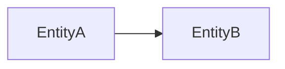

# Data model

> Language: EN | [Português (pt-BR)](../../pt-BR/templates/data-model.md)
>
> Status: ACCEPTED
>
> Documentation Standard v1.0

<!-- Logical / physical data view. Prefer schemas, ownership, and critical entities — not every column. Do not invent tables. -->

## Purpose

<!-- What readers learn from this document. -->

## Schemas / namespaces

| Schema / store | Purpose | Owner | Classification |
| --- | --- | --- | --- |
| | | | Confirmed / Inferred / Unknown / Proposed |

## Core entities

| Entity | Store | Responsibility | Classification |
| --- | --- | --- | --- |
| | | | |

## Relationships (high level)

## Cross-cutting data concerns

| Concern | Approach | Classification |
| --- | --- | --- |
| Multi-tenancy / isolation | | |
| Soft delete / archive | | |
| PII / retention | | Unknown if not evidenced |
| Encryption at rest (app-level) | | |

## Related

- Architecture overview
- Contracts that expose these entities
- Security assets for sensitive stores
