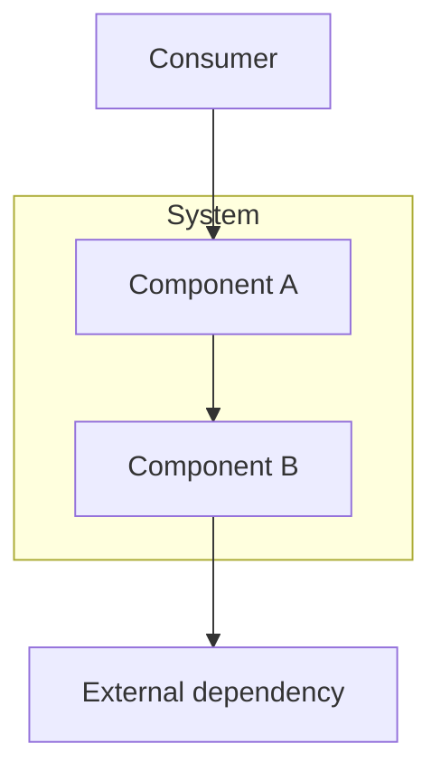
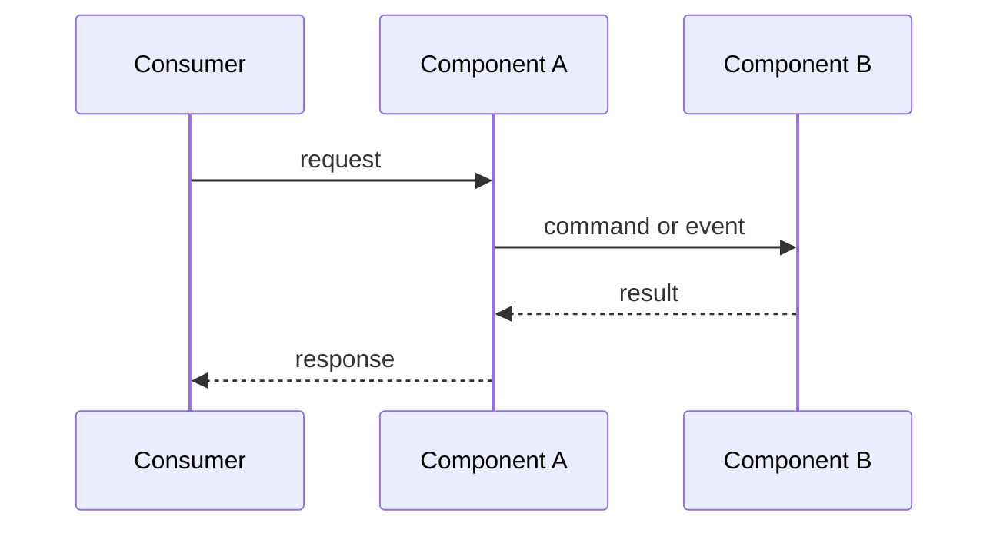
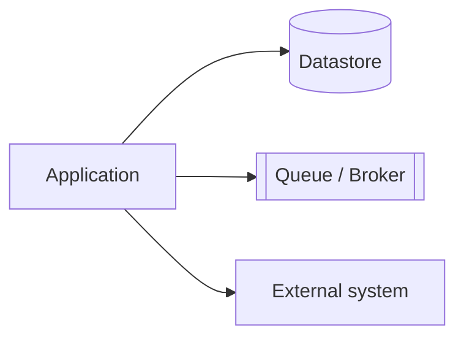
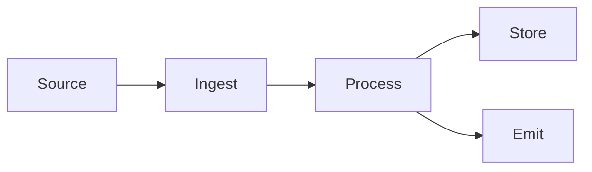
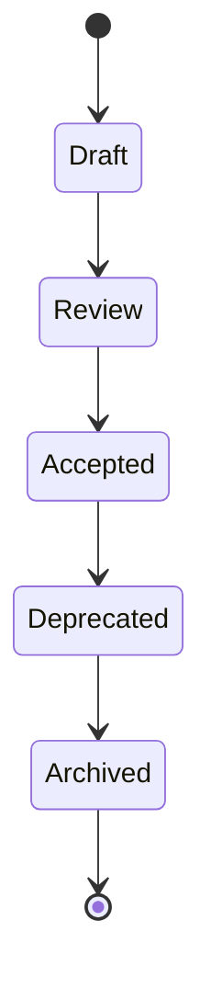
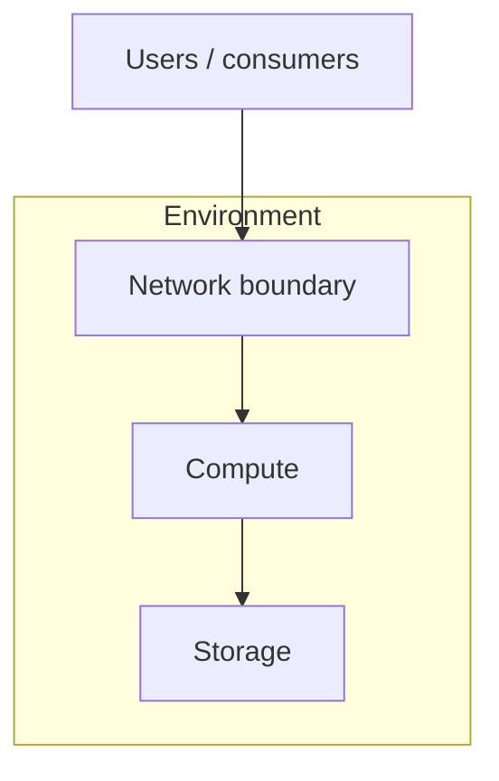

# Diagram Guide

> Language: EN | [Português (pt-BR)](../../pt-BR/templates/diagram.md)
>
> Status: ACCEPTED
>
> Documentation Standard v1.0

Policy and templates for diagrams in engineering documentation.

## Policy

- Prefer formats that are versionable as text.
- Use Mermaid when appropriate.
- Create a diagram only when it improves understanding.
- Label Proposed diagrams explicitly; default diagrams represent current state.
- Keep diagrams consistent with written documentation.
- Do not include secrets, credentials, or unnecessary sensitive data in labels.

## When to Add a Diagram

| Add a diagram when | Skip a diagram when |
| --- | --- |
| Relationships are hard to parse from prose | A short list is clearer |
| Multiple components collaborate in a flow | The flow has one obvious step |
| Boundaries or trust zones matter | No boundary discussion is needed |

Projects are **not** required to produce every diagram type below.

## Architecture Diagram

Shows major components and relationships.

## Sequence Diagram

Shows ordered interactions over time.

## Dependency Diagram

Shows dependency direction and criticality.

## Data Flow

Shows how data moves and transforms.

## State Machine

Shows allowed states and transitions.

## Infrastructure Diagram

Shows environments/resources without assuming a specific provider.

## Diagram Checklist

- [ ] Diagram matches current state or is labeled Proposed
- [ ] Names match documentation nomenclature
- [ ] No secrets or sensitive values
- [ ] Adjacent prose references the diagram
- [ ] Source is text-based and reviewable in pull requests

## Related Documents

- [../architecture-diagrams.md](../architecture-diagrams.md) — architecture diagram standards
- [../diagram-selection.md](../diagram-selection.md) — when to choose each diagram type
- [../mermaid-standards.md](../mermaid-standards.md) — Mermaid conventions
- [../standards.md](../standards.md)
- [../style-guide.md](../style-guide.md)
- [architecture.md](architecture.md)
- [sequence.md](sequence.md)
- [data-flow.md](data-flow.md)
- [dependency-map.md](dependency-map.md)
