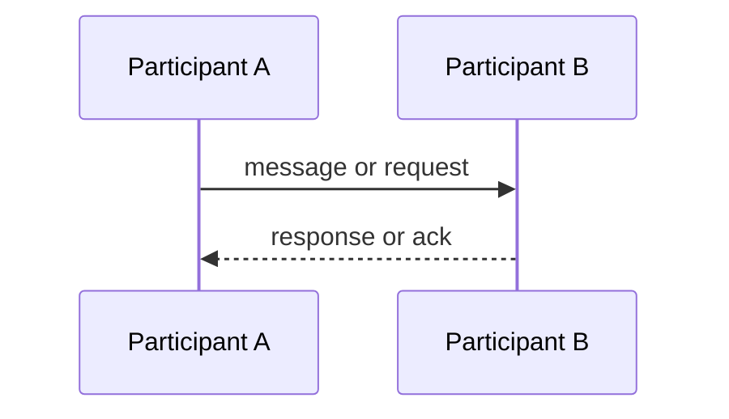

# Integration

> Language: EN | [Português (pt-BR)](../../pt-BR/templates/integration.md)
>
> Status: ACCEPTED
>
> Documentation Standard v1.0

## Overview

<!-- What systems/components are integrated and why. -->

## Participants

| Participant | Role |
| --- | --- |
| | producer / consumer / intermediary / other |

## Purpose

<!-- Business or technical purpose of the integration. -->

## Direction

- [ ] Inbound
- [ ] Outbound
- [ ] Bidirectional

## Contract

<!-- Link to the canonical contract document. Do not duplicate the full schema here. -->

- Contract: <!-- path or ID -->
- Version: <!-- if applicable -->

## Flow

## Data Exchanged

| Data | Sensitivity | Notes |
| --- | --- | --- |
| | public / internal / sensitive | |

## Reliability Expectations

| Topic | Expectation | Classification |
| --- | --- | --- |
| Delivery guarantee | | Confirmed / Inferred / Unknown |
| Ordering | | Confirmed / Inferred / Unknown |
| Retry | | Confirmed / Inferred / Unknown |
| Timeout | | Confirmed / Inferred / Unknown |
| Idempotency | | Confirmed / Inferred / Unknown |

## Failure Modes

| Failure | Impact | Mitigation |
| --- | --- | --- |
| | | |

## Security

| Topic | Summary |
| --- | --- |
| Authentication | |
| Authorization | |
| Encryption in transit | |
| Secrets referenced | <!-- names only --> |

## Observability

| Signal | What to watch |
| --- | --- |
| | |

## Operational Considerations

| Topic | Notes |
| --- | --- |
| Onboarding a new consumer/producer | |
| Version migration | |
| Runbooks | |

## Related Documentation

| Document | Path |
| --- | --- |
| Contract | |
| Components | |
| Architecture | |
| ADRs | |
