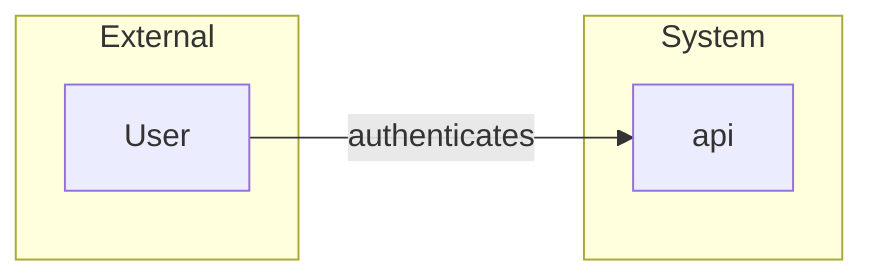

# Trust Boundaries

> Language: EN | [Português (pt-BR)](../pt-BR/trust-boundaries.md)
>
> Status: ACCEPTED
>
> Documentation Standard v1.0

How to document architectural trust boundaries — where trust changes and what controls the crossing.

This document is the **architecture-facing** view of trust edges. Deep security methodology (threat modeling depth, control catalogs, risk scoring) lives in the security docs linked below. Here the goal is to make trust edges visible in the architecture story and to distinguish related concepts.

## Architecture Boundary vs Trust Boundary vs Security Controls

These terms are related but not interchangeable.

| Concept | Question | Primary docs |
| --- | --- | --- |
| **Architecture / system boundary** | What is inside this system vs outside it? What does the system own? | [system-boundaries.md](system-boundaries.md), [architecture-model.md](architecture-model.md) |
| **Trust boundary** | Where does the *level of trust* change for data or control, and what must happen to cross? | This document |
| **Security controls** | What concrete measures enforce requirements or reduce risk at (or behind) a crossing? | [security-controls.md](security-controls.md), [security-model.md](security-model.md) |

A system boundary may contain multiple trust boundaries (e.g. public edge vs admin plane vs tenant isolation). A trust boundary should name the **control class** used at the crossing; the full control inventory, effectiveness evidence, and threat scenarios belong in security documentation — avoid duplicating control catalogs in architecture overviews.

```text
System boundary
      │
      ├── Trust boundary (edge)
      │         └── Controls (authn, authz, …)  → detail in security docs
      ├── Trust boundary (tenant / privilege)
      └── …
```

For end-to-end security analysis, start from [security-model.md](security-model.md) and [threat-modeling.md](threat-modeling.md). For placement of identity, access, and exposure in the architecture, see [security-architecture.md](security-architecture.md).

## Purpose

A trust boundary answers:

> Where does the level of trust change, and what must happen for data or control to cross?

Conceptual shape:

```text
Trusted zone
      │
      │  Authentication / Authorization / other controls
      ▼
Less-trusted or external zone
```

Zones are relative to the system under documentation — not a universal security rating.

## What to Document

For each material trust boundary:

| Field | Meaning |
| --- | --- |
| **Origin** | Side that initiates or holds the data/control before the crossing |
| **Destination** | Side after the crossing |
| **Trust** | How trust differs (internal service mesh vs public internet; authenticated user vs anonymous; admin vs tenant) |
| **Control mechanism** | How the crossing is governed (authn, authz, network policy, mutual auth, signed assertions, allowlists, …) — summary only |
| **Data crossing** | Categories of data that cross (classification, secrets *references*, business payloads) — never secret values |

## Examples of Boundary Kinds (Non-Exhaustive)

- Public client → system edge
- System → external third party
- Tenant A data path vs Tenant B
- Privileged admin plane vs normal application plane
- CI/CD or operator access vs runtime data plane
- Less-trusted network segment → more-trusted segment

Only document boundaries that matter for understanding this architecture. Do not invent a full enterprise zoning model if the project is a single internal library.

## Architecture vs Security Detail

| In architecture docs | In security docs |
| --- | --- |
| Where boundaries are | Threat scenarios, control effectiveness |
| What crosses and why | Encryption algorithms, key custody detail |
| Which control class is used | Full auth matrix, exception process |
| Relation to system boundary | Asset/threat/risk chain — [security-model.md](security-model.md) |
| Diagram-friendly trust zones | Attack surface inventory, residual risk |

Link from architecture to the security document when depth is needed. Prefer links over copying control catalogs.

Related security methodology:

- [security-model.md](security-model.md)
- [threat-modeling.md](threat-modeling.md)
- [security-architecture.md](security-architecture.md)
- [attack-surface.md](attack-surface.md)
- [identity.md](identity.md)
- [authentication.md](authentication.md)
- [authorization.md](authorization.md)

## Diagram Tips

- Show trust zones as subgraphs or annotated edges.
- Keep context diagrams readable; detailed trust views can be separate.
- Label crossings (`authenticates`, `authorizes`) per [component-relationships.md](component-relationships.md).



## Progressive Disclosure

| Project size | Minimum |
| --- | --- |
| Small / internal-only | Short note if all access shares one trust model |
| Service with external clients | Edge boundary + authn/authz summary |
| Multi-tenant or regulated | Explicit boundaries for tenant and privileged paths |

Do not invent regulatory claims. If a project is multi-tenant, document tenant boundaries because they are architectural facts — not because of an assumed certification.

## Related Documents

- [system-boundaries.md](system-boundaries.md)
- [failure-domains.md](failure-domains.md)
- [component-relationships.md](component-relationships.md)
- [security-model.md](security-model.md)
- [threat-modeling.md](threat-modeling.md)
- [security-architecture.md](security-architecture.md)
- [security/README.md](security/README.md)
- [architecture-checklist.md](architecture-checklist.md)
- [standards.md](standards.md) — Document Security (no secrets in docs)
