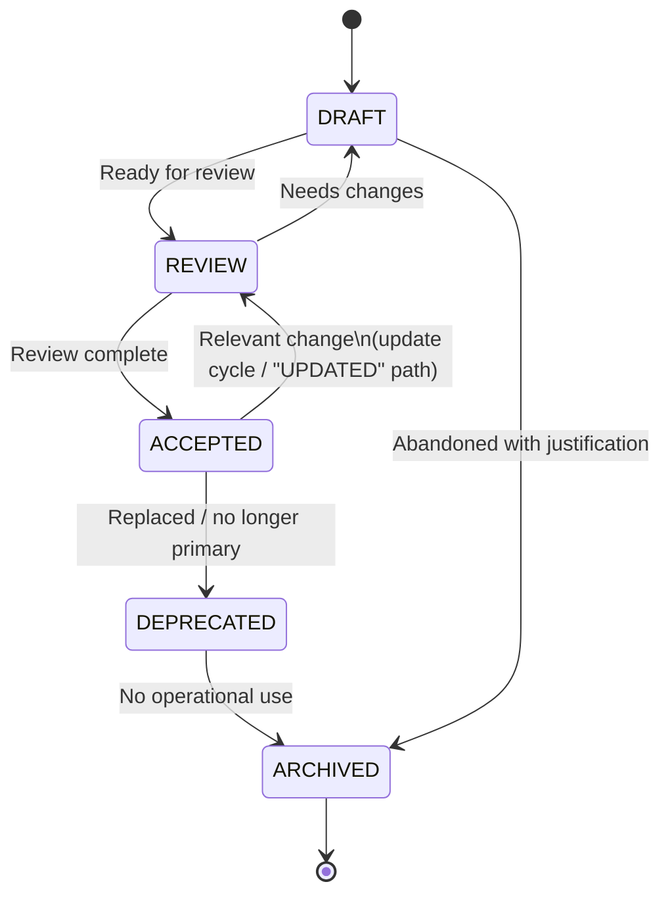

# Ciclo de Vida da Documentação

> Language: pt-BR | [English](../en/lifecycle.md)
>
> Status: ACCEPTED
>
> Documentation Standard v1.0

Ciclo de vida oficial da documentação regida por este padrão.

Os valores de status são tokens de máquina em inglês. Não invente status alternativos como `FINAL`, `DONE`, `OK`, `GOOD`, `OLD` ou `TEMP`.

`UPDATED` **não** é um token de status armazenado. Atualizações de documento seguem o ciclo `ACCEPTED → REVIEW → ACCEPTED` (veja a nota do diagrama).

Além dos tokens de status, a documentação aceita é **Consumed** e **Validated** por humanos e agentes de IA (veja abaixo). Consume/Validate são estágios de uso, não valores adicionais de `status`.

A validação estrutural também é aplicada pela automação no repositório e pelos quality gates ([governance.md](governance.md), [automation.md](automation.md)) — distinta da revisão semântica humana.

## Diagrama do ciclo de vida



Forma textual:

```text
DRAFT ──► REVIEW ──► ACCEPTED ──► DEPRECATED ──► ARCHIVED
  │          │            │
  │          └──► DRAFT   └──► REVIEW  (update cycle; not a status named UPDATED)
  │
  └──────────────────────────────► ARCHIVED  (abandoned with justification)
```

Nota: quando um documento `ACCEPTED` recebe uma mudança relevante, mova-o para `REVIEW` e de volta para `ACCEPTED` após a revisão. Esse caminho é o ciclo de atualização às vezes chamado de "UPDATED" na conversa — não é um quinto status armazenado.

## Significados dos status (resumo)

| Status | Significado |
| --- | --- |
| `DRAFT` | Trabalho em andamento; incompleto ou ainda não pronto para revisão |
| `REVIEW` | Pronto para revisão ou em revisão |
| `ACCEPTED` | Documentação atual aprovada |
| `DEPRECATED` | Ainda visível, mas substituído ou não mais primário |
| `ARCHIVED` | Apenas histórico; não é orientação ativa |

Política completa: [status.md](status.md).

## Matriz de transições

| Atual | Próximo | Condição |
| --- | --- | --- |
| `DRAFT` | `REVIEW` | O autor considera o documento pronto para revisão: estrutura completa o suficiente para avaliar, unknowns marcados, sem fatos inventados apresentados como confirmados |
| `REVIEW` | `ACCEPTED` | Revisão concluída; achados tratados ou aceitos como follow-ups; conteúdo preciso o bastante para uso como estado atual |
| `REVIEW` | `DRAFT` | A revisão encontrou lacunas materiais, afirmações incorretas ou evidência ausente; o autor deve revisar antes de outra revisão |
| `ACCEPTED` | `REVIEW` | Mudança técnica ou operacional relevante exige atualização do doc (ciclo de atualização / caminho "UPDATED"); ou um gatilho de revisão dispara (veja [review-policy.md](review-policy.md)) |
| `ACCEPTED` | `DEPRECATED` | O documento foi substituído ou não é mais a fonte primária daquele tópico |
| `DEPRECATED` | `ARCHIVED` | Sem uso operacional remanescente; retido apenas para histórico |
| `DRAFT` | `ARCHIVED` | Trabalho abandonado com justificativa curta (por que parou, o que o substitui se houver) |

Transições não listadas não são permitidas. Em particular:

- Não pule de `DRAFT → ACCEPTED` sem `REVIEW` em docs substantivos.
- Não invente status para "atualizado" ou "stale".
- Restauração de `DEPRECATED` para `ACCEPTED` está fora do escopo da matriz normal (raro; prefira um novo documento ou uma exceção deliberada registrada nas notas de revisão).

## Metadados

Registre status e campos relacionados no frontmatter YAML quando o documento for substantivo. Veja [standards.md](standards.md) — Metadados do documento.

Mínimo para docs regidos:

- `status`
- `owner`
- `updated`

Deprecação e arquivamento adicionam:

- `replaced_by`, `deprecated_on`, `deprecation_reason` quando aplicável

Docs curtos ou efêmeros podem usar a forma em blockquote `> Status:`; prefira YAML para templates e docs substantivos do projeto.

## Ownership e revisão

Transições de ciclo de vida envolvem pessoas, não apenas tokens:

| Preocupação | Documento |
| --- | --- |
| Quem é owner e quem revisa | [ownership.md](ownership.md) |
| Quando a revisão é obrigatória | [review-policy.md](review-policy.md) |
| Como deprecar | [deprecation.md](deprecation.md) |
| Como arquivar | [archive-policy.md](archive-policy.md) |
| Regras de status em detalhe | [status.md](status.md) |


## Consumir e validar

Depois que um documento está `ACCEPTED` (ou ao usar qualquer doc visível com cuidado), consumidores **usam** e **checam** ele:

```text
… → ACCEPTED → Consume → Validate → (feedback into REVIEW / debt / contradiction / gap)
```

| Stage | Meaning |
| --- | --- |
| **Consume** | Ler e aplicar o documento como contexto para uma pergunta, mudança, integração, operação ou revisão |
| **Validate** | Verificar que claims ainda correspondem à evidência (código, config, contratos, runtime) e que links/IDs permanecem coerentes |

Falhas de validação tornam-se atualizações de documentação, registros de drift, contradições ou knowledge gaps — não invenção silenciosa.

## IA como consumidora (sem autoridade)

Agentes de IA são **consumidores** de primeira classe da documentação. Eles podem participar destas atividades **sem autoridade** para aceitar, possuir ou superseder silenciosamente fontes Authoritative:

| Activity | Allowed for AI | Not allowed for AI |
| --- | --- | --- |
| **Discovery** | Encontrar entry points, registries, docs relacionados | Inventar inventários ausentes como Confirmed |
| **Analysis** | Comparar docs com evidência; classificar claims | Promover Inferred a Confirmed sem nova evidência |
| **Validation** | Sinalizar drift, contradições, metadados stale | Fechar gaps fabricando fatos |
| **Generation** | Redigir docs novos ou atualizados como `DRAFT` | Definir `ACCEPTED` ou reatribuir `owner` casualmente |
| **Maintenance** | Propor correções de links, atualizações de claims, change records | Apagar histórico primário ou esconder incerteza |

Ponto de entrada: [ai-context.md](ai-context.md). Limites: [ai-task-boundaries.md](ai-task-boundaries.md). Regras de geração: [ai-documentation.md](ai-documentation.md).

## Documentos relacionados


- [status.md](status.md)
- [ownership.md](ownership.md)
- [review-policy.md](review-policy.md)
- [change-policy.md](change-policy.md)
- [deprecation.md](deprecation.md)
- [archive-policy.md](archive-policy.md)
- [standards.md](standards.md)
- [quality-model.md](quality-model.md)
- [ai-context.md](ai-context.md)
- [ai-documentation.md](ai-documentation.md)
