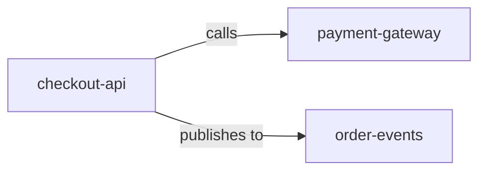
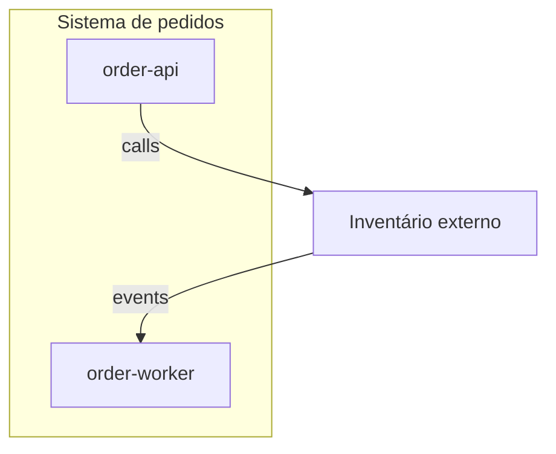

# Padrões Mermaid

> Language: pt-BR | [English](../en/mermaid-standards.md)
>
> Status: ACCEPTED
>
> Documentation Standard v1.0

Convenções para diagramas Mermaid usados em documentação de arquitetura e engenharia relacionada.

Mermaid é recomendado quando um diagrama versionável como texto melhora a compreensão. Não é obrigatório se outro formato baseado em texto servir melhor — mantenha a mesma disciplina de nomes e rótulos.

## Nomenclatura

| Regra | Exemplo |
| --- | --- |
| Use nomes arquiteturais estáveis, não apelidos temporários de código | `checkout-api`, não `svc2` |
| Faça nomes baterem com docs e contratos | Mesma grafia das tabelas de componentes |
| Prefira IDs de nó curtos; coloque rótulos de exibição em colchetes/aspas | `api[checkout-api]` |
| Evite espaços em IDs de nó | `order_events` ou `orderEvents` como ID; o rótulo de exibição pode ser legível |
| Não codifique segredos ou credenciais reais em rótulos | Use placeholders |

## Direção

Escolha uma direção e mantenha-a consistente dentro de um diagrama:

| Tipo de diagrama | Direção típica |
| --- | --- |
| Context / overview de dependências | `LR` (esquerda → direita) ou `TB` |
| Estrutura aninhada | `TB` |
| Sequence | Tempo embutido de cima para baixo |
| State | Ordem natural do ciclo de vida |

Declare a direção de iniciação ou de dados com **rótulos de aresta**, não apenas com o layout.

## Agrupamento

Use subgraphs para unidades implantáveis, zonas de confiança ou domínios de falha — uma preocupação de agrupamento por diagrama quando possível.

Não aninhe subgraphs profundamente. Se o aninhamento passar de dois níveis, divida o diagrama.

## Rótulos

- Rotule toda aresta significativa com um verbo de relacionamento ([component-relationships.md](component-relationships.md)).
- Mantenha rótulos curtos (`calls`, `consumes from`, `reads from`).
- Coloque explicação mais longa na prosa adjacente ou em uma legenda.
- Marque arestas/nós Proposed no rótulo ou no título (`Proposed: …`).

## Complexidade

| Sinal | Ação |
| --- | --- |
| Mais de ~10–15 nós para um propósito | Divida por nível ou subsystem |
| Linhas cruzadas dominam a figura | Divida ou troque para uma tabela |
| Múltiplas audiências misturadas | Separe diagramas Executive/System vs Technical |
| Sequência com muitos caminhos opcionais de erro | Happy path principal + sequência de erro separada, ou prosa para caminhos raros |

Diagramas grandes que tentam mostrar tudo ficam obsoletos rápido e falham em reviews. Prefira progressive disclosure ([architecture-model.md](architecture-model.md)).

## Consistência e reuso

1. Reutilize os mesmos nomes de nó entre blocos Mermaid relacionados.
2. Mantenha um diagrama canônico por visão; linke de outros docs em vez de forkar cópias quando possível.
3. Quando a duplicação for inevitável, atualize todas as cópias na mesma mudança ou abra documentation debt.
4. Alinhe Mermaid com inventários escritos — diagrama e tabela não devem se contradizer.

## Formas de diagrama recomendadas

| Necessidade | Forma Mermaid |
| --- | --- |
| Context / components / data flow | `flowchart` |
| Interação ao longo do tempo | `sequenceDiagram` |
| Ciclo de vida / estados | `stateDiagram-v2` |
| Topologia de infraestrutura | `flowchart` ou `C4Context`/`C4Container` apenas se o projeto já padronizar neles |

Não exija sintaxe C4 Mermaid. Flowcharts simples bastam para a maioria dos projetos.

## Checklist

- [ ] Título e propósito estão claros no Markdown ao redor
- [ ] Nomes batem com docs de arquitetura
- [ ] Arestas estão rotuladas
- [ ] Current vs Proposed está inequívoco
- [ ] O diagrama é pequeno o bastante para revisar em um PR
- [ ] Sem segredos ou dados sensíveis desnecessários

## Documentos relacionados

- [architecture-diagrams.md](architecture-diagrams.md)
- [diagram-selection.md](diagram-selection.md)
- [component-relationships.md](component-relationships.md)
- [templates/diagram.md](templates/diagram.md)
- [standards.md](standards.md)
