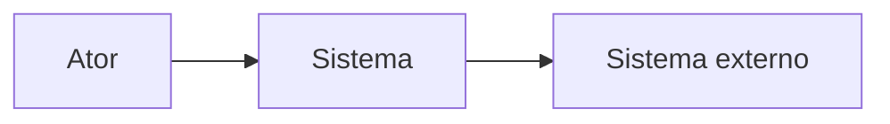

# Fronteiras do Sistema

> Language: pt-BR | [English](../en/system-boundaries.md)
>
> Status: ACCEPTED
>
> Documentation Standard v1.0

Como documentar o que pertence ao sistema, o que fica fora dele e o que atravessa a fronteira.

Um documento de arquitetura forte deixa explícito o que o sistema **não controla**.

## Propósito

A fronteira do sistema responde:

> Onde termina a responsabilidade deste sistema?

Sem uma fronteira clara, diagramas incham, ownership fica nebuloso e a análise de falha/confiança vira chute.

## O que fica dentro

Documente como in-scope quando o projeto em adoção possui ou opera como parte deste sistema:

- unidades implantáveis e componentes arquiteturais deste sistema;
- data stores que este sistema trata como sua própria persistência;
- workflows, jobs e processos de runtime sob ownership deste sistema;
- configuração e contratos que este sistema publica.

Use nomes estáveis. Prefira o estado atual. Marque Proposed separadamente.

## O que fica fora

Documente como out-of-scope / externo quando outro sistema, time ou plataforma o possui:

- usuários e operadores humanos (como atores, não como "componentes" da sua arquitetura);
- sistemas peer ou upstream/downstream;
- plataformas compartilhadas (identidade, messaging, backends de observabilidade) quando não forem ownership daqui;
- APIs de terceiros e SaaS;
- data stores ou filas ownership de outro sistema, mesmo que este sistema leia ou escreva neles.

Externo não significa "ignorar". Significa: documente a interface e o impacto da falha, não o design interno da outra parte.

## Responsabilidades internas vs externas

| Lado | Documente | Evite |
| --- | --- | --- |
| **Internal** | Responsabilidades que este sistema garante (ou atualmente fornece) | Alegar garantias sem evidência |
| **External** | Expectativas sobre outros (SLAs, contratos, disponibilidade assumida) | Fingir que este time controla o comportamento externo |

Para cada dependência externa material, anote:

- o que este sistema espera;
- o que acontece quando a expectativa falha;
- se a dependência é Confirmed, Inferred ou Unknown.

## Interfaces na fronteira

Interfaces de fronteira são onde o sistema troca informação com o mundo externo:

| Preocupação | Capture |
| --- | --- |
| Direction | Inbound, outbound ou bidirectional |
| Style | Sync, async, batch, stream, file, CLI, other |
| Contract | Link para o documento de contrato canônico |
| AuthN / AuthZ | Como o cruzamento é controlado (resumo; detalhes em docs de security) |
| Data | O que atravessa (categorias, não valores secretos) |

Prefira linkar contratos a duplicar schemas. Veja [architecture-traceability.md](architecture-traceability.md).

## O que o sistema não controla

Liste explicitamente áreas de não-controle quando útil. Exemplos do *tipo* de afirmação (adapte ao projeto):

- disponibilidade ou schema de uma API upstream que você chama;
- garantias de ordenação de um bus compartilhado que você não possui;
- comportamento de retry do cliente;
- infraestrutura compartilhada entre muitos sistemas além da sua autoridade de mudança;
- processos legais ou de compliance ownership de outra unidade organizacional.

Explicitar não-controle reduz falsa confiança em revisões de arquitetura e resposta a incidentes.

## Relação com confiança e falha

- **Trust boundaries** frequentemente alinham com fronteiras do sistema, mas não são idênticas — veja [trust-boundaries.md](trust-boundaries.md).
- **Failure domains** descrevem o blast radius quando partes falham — podem ser menores ou maiores que a fronteira do sistema — veja [failure-domains.md](failure-domains.md).

## Orientação de diagrama

Um diagrama de contexto geralmente basta para mostrar a fronteira:

Mantenha a estrutura interna fora da visão de contexto. Estrutura mais profunda pertence a diagramas de container/component — [architecture-diagrams.md](architecture-diagrams.md).

## Progressive disclosure

| Tamanho do projeto | Mínimo |
| --- | --- |
| Small | Listas curtas "In / Out / Does not control" no overview de arquitetura |
| Medium | Seção dedicada de fronteira + diagrama de contexto |
| Large / multi-team | Doc ou seção de fronteira mais links de ownership e inventário de contratos |

## Documentos relacionados

- [architecture-model.md](architecture-model.md)
- [trust-boundaries.md](trust-boundaries.md)
- [failure-domains.md](failure-domains.md)
- [component-relationships.md](component-relationships.md)
- [architecture/README.md](architecture/README.md)
