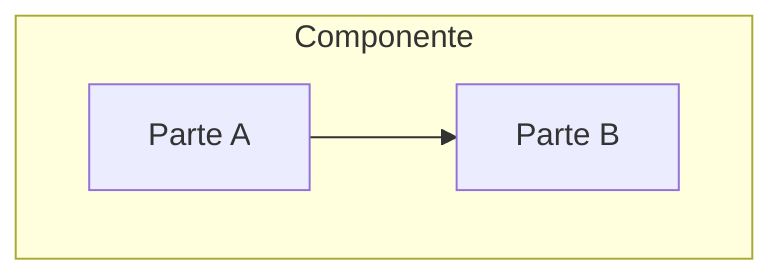

# Arquitetura de Componente

> Language: pt-BR | [English](../../en/templates/component-architecture.md)
>
> Status: ACCEPTED
>
> Documentation Standard v1.0

<!-- Visão de componente arquitetural. Um componente arquitetural é uma unidade significativa de responsabilidade — não toda classe, arquivo ou função. Prefira [component.md](component.md) para detalhe operacional/de implementação de uma unidade nomeada quando necessário. Apenas estado atual, salvo se rotulado Proposed. -->

## Propósito

<!-- Por que este componente arquitetural existe. -->

## Responsabilidades

| Responsabilidade | Notas |
| --- | --- |
| | |

## Não-responsabilidades

| Não-responsabilidade | Owner / em outro lugar |
| --- | --- |
| | |

## Estrutura interna

<!-- Subunidades apenas quando forem arquiteturalmente relevantes. Não enumere arquivos de implementação por padrão. -->

| Parte | Papel |
| --- | --- |
| | |

## Dependências

| Dependência | Propósito | Obrigatória | Classificação |
| --- | --- | --- | --- |
| | | yes / no | Confirmed / Inferred / Unknown |

## Interfaces

| Interface | Tipo | Documento de contrato |
| --- | --- | --- |
| | API / event / file / command / other | |

## Entradas

| Entrada | Origem | Formato / contrato |
| --- | --- | --- |
| | | |

## Saídas

| Saída | Destino | Formato / contrato |
| --- | --- | --- |
| | | |

## Dados

| Preocupação | Resumo | Classificação |
| --- | --- | --- |
| Owned data | | Confirmed / Inferred / Unknown / Not Applicable |
| Read data | | Confirmed / Inferred / Unknown / Not Applicable |
| Written data | | Confirmed / Inferred / Unknown / Not Applicable |
| Retention / lifecycle | | Confirmed / Inferred / Unknown / Not Applicable |

<!-- Não assuma que persistência existe. Marque Not Applicable quando não houver preocupação de dados. -->

## Segurança

| Tópico | Resumo |
| --- | --- |
| Trust boundary involvement | |
| Authentication | |
| Authorization | |
| Sensitive data handling | |
| Risks | |

<!-- Nunca documente valores secretos. -->

## Tratamento de falhas

| Falha | Detecção | Resposta | Classificação |
| --- | --- | --- | --- |
| | | | Confirmed / Inferred / Unknown |

## Observabilidade

| Sinal | Status | Notas |
| --- | --- | --- |
| Logging | Implemented / Partial / Not Applicable / Not Documented | |
| Metrics | Implemented / Partial / Not Applicable / Not Documented | |
| Tracing | Implemented / Partial / Not Applicable / Not Documented | |

## Escalabilidade

<!-- Abordagem atual de scaling e restrições. Evite afirmações não verificadas. Marque Unknown se não identificada. -->

## Considerações operacionais

| Tópico | Notas |
| --- | --- |
| Deployment | |
| Configuration | |
| Migration / rollback | |
| Runbooks | |

## Componentes relacionados

| Componente | Relacionamento | Documentação |
| --- | --- | --- |
| | depends on / calls / publishes / consumes / other | |

## Decisões relacionadas

| ADR | Título | Status |
| --- | --- | --- |
| ADR-XXX | | |
