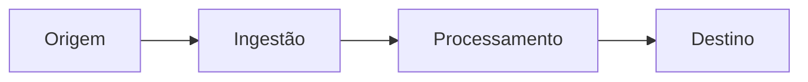

# Fluxo de Dados

> Language: pt-BR | [English](../../en/templates/data-flow.md)
>
> Status: ACCEPTED
>
> Documentation Standard v1.0

<!-- Documente como os dados se movem em um fluxo significativo. Não assuma persistência ou processamento assíncrono. Marque seções Not Applicable quando não se aplicarem. Apenas estado atual, salvo se rotulado Proposed. -->

## Propósito

<!-- O que este fluxo realiza e quando ele roda. -->

## Origem

| Campo | Valor | Classificação |
| --- | --- | --- |
| Origin | | Confirmed / Inferred / Unknown |
| Producer / actor | | |
| Trigger | | |

## Entrada

| Campo / parte | Tipo | Obrigatório | Descrição |
| --- | --- | --- | --- |
| | | yes / no | |

## Validação

| Verificação | Quando | Em falha |
| --- | --- | --- |
| | | |

<!-- Marque Not Applicable se não existir passo de validação. -->

## Transformação

| Passo | Forma de entrada | Forma de saída | Notas |
| --- | --- | --- | --- |
| | | | |

<!-- Marque Not Applicable se os dados passam sem alteração. -->

## Processamento

| Passo | Componente | Sync / async / other | Notas |
| --- | --- | --- | --- |
| | | | |

<!-- Não assuma async. Use o estilo de interação que realmente se aplica, ou Not Applicable. -->

## Persistência

| Store / sink | O que é armazenado | Ciclo de vida | Classificação |
| --- | --- | --- | --- |
| | | | Confirmed / Inferred / Unknown / Not Applicable |

<!-- Not Applicable quando o fluxo não persiste dados. -->

## Transporte

| Hop | Mecanismo | Contrato | Classificação |
| --- | --- | --- | --- |
| | | | Confirmed / Inferred / Unknown / Not Applicable |

## Destino

| Destino | Consumidor | Resultado |
| --- | --- | --- |
| | | |

## Tratamento de falhas

| Falha | Detecção | Resposta | Classificação |
| --- | --- | --- | --- |
| | | | Confirmed / Inferred / Unknown / Not Applicable |

## Considerações de segurança

| Tópico | Resumo |
| --- | --- |
| Sensitivity | |
| Controls crossing boundaries | |
| Risks | |

<!-- Nunca documente valores secretos. -->

## Observabilidade

| Sinal | Status | Notas |
| --- | --- | --- |
| Logging | Implemented / Partial / Not Applicable / Not Documented | |
| Metrics | Implemented / Partial / Not Applicable / Not Documented | |
| Tracing | Implemented / Partial / Not Applicable / Not Documented | |

## Diagrama do fluxo

<!-- Adapte nós ao fluxo real. Omita hops de persistência ou async quando Not Applicable. -->

## Componentes relacionados

| Componente | Papel neste fluxo |
| --- | --- |
| | |

## Contratos relacionados

| Contrato | Papel |
| --- | --- |
| | |
