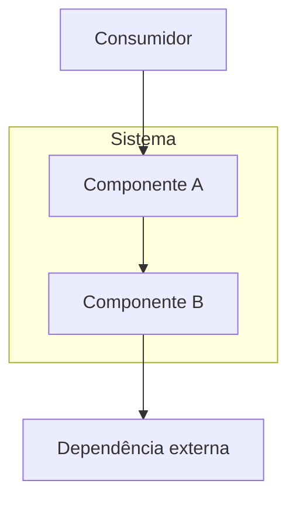
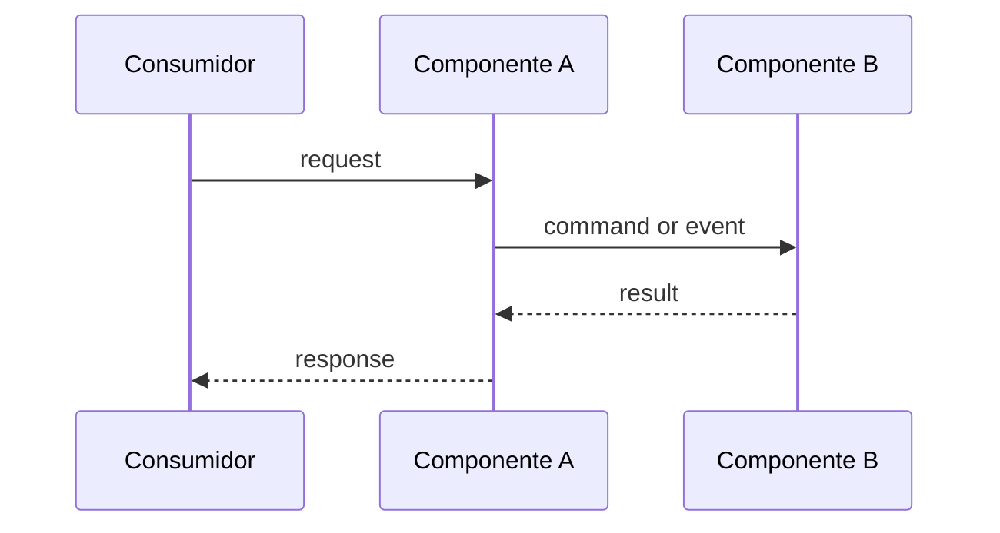
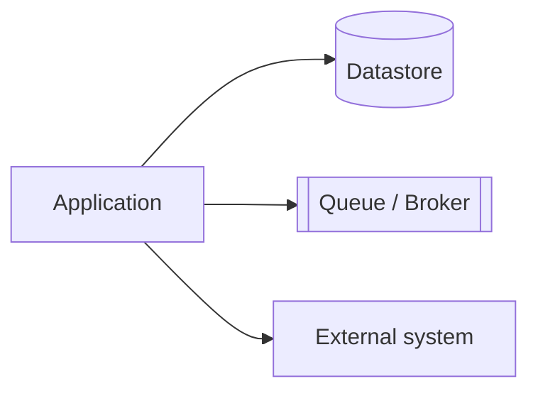
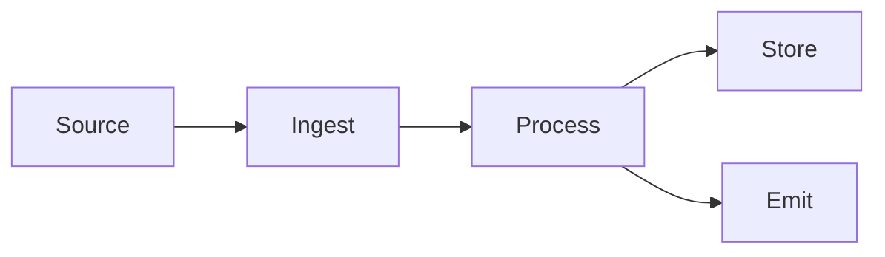
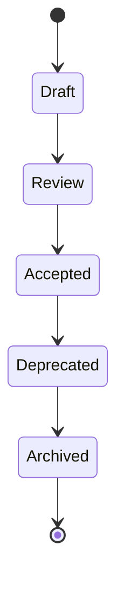
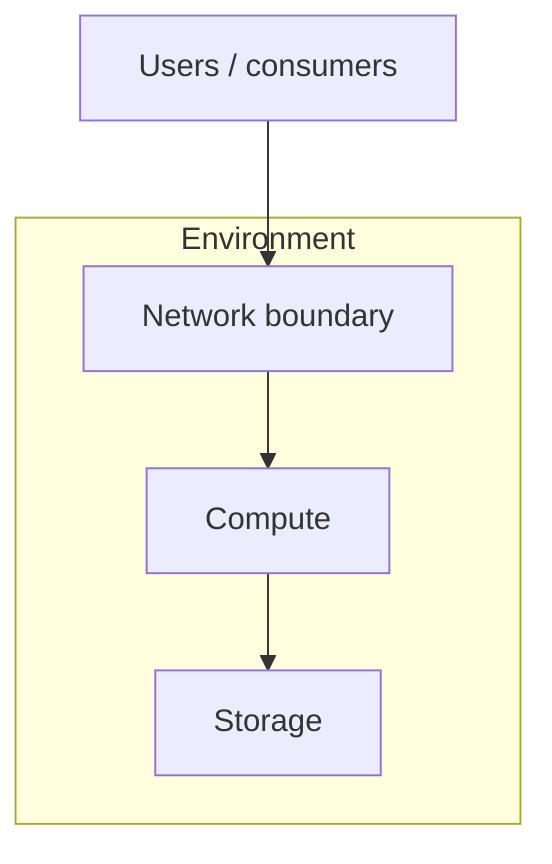

# Guia de Diagramas

> Language: pt-BR | [English](../../en/templates/diagram.md)
>
> Status: ACCEPTED
>
> Documentation Standard v1.0

Política e templates para diagramas em documentação de engenharia.

## Política

- Prefira formatos versionáveis como texto.
- Use Mermaid quando apropriado.
- Crie um diagrama apenas quando melhorar a compreensão.
- Rotule diagramas Proposed explicitamente; diagramas padrão representam o estado atual.
- Mantenha diagramas consistentes com a documentação escrita.
- Não inclua segredos, credenciais ou dados sensíveis desnecessários em rótulos.

## Quando adicionar um diagrama

| Adicione um diagrama quando | Pule um diagrama quando |
| --- | --- |
| Relacionamentos são difíceis de parsear na prosa | Uma lista curta é mais clara |
| Múltiplos componentes colaboram em um fluxo | O fluxo tem um passo óbvio |
| Fronteiras ou zonas de confiança importam | Nenhuma discussão de fronteira é necessária |

Projetos **não** são obrigados a produzir todo tipo de diagrama abaixo.

## Diagrama de arquitetura

Mostra componentes principais e relacionamentos.

## Diagrama de sequência

Mostra interações ordenadas ao longo do tempo.

## Diagrama de dependências

Mostra direção e criticidade das dependências.

## Fluxo de dados

Mostra como os dados se movem e se transformam.

## Máquina de estados

Mostra estados e transições permitidos.

## Diagrama de infraestrutura

Mostra ambientes/recursos sem assumir um provedor específico.

## Checklist de diagrama

- [ ] Diagrama corresponde ao estado atual ou está rotulado Proposed
- [ ] Nomes batem com a nomenclatura da documentação
- [ ] Sem segredos ou valores sensíveis
- [ ] A prosa adjacente referencia o diagrama
- [ ] A fonte é baseada em texto e revisável em pull requests

## Documentos relacionados

- [../architecture-diagrams.md](../architecture-diagrams.md) — padrões de diagramas de arquitetura
- [../diagram-selection.md](../diagram-selection.md) — quando escolher cada tipo de diagrama
- [../mermaid-standards.md](../mermaid-standards.md) — convenções Mermaid
- [../standards.md](../standards.md)
- [../style-guide.md](../style-guide.md)
- [architecture.md](architecture.md)
- [sequence.md](sequence.md)
- [data-flow.md](data-flow.md)
- [dependency-map.md](dependency-map.md)
