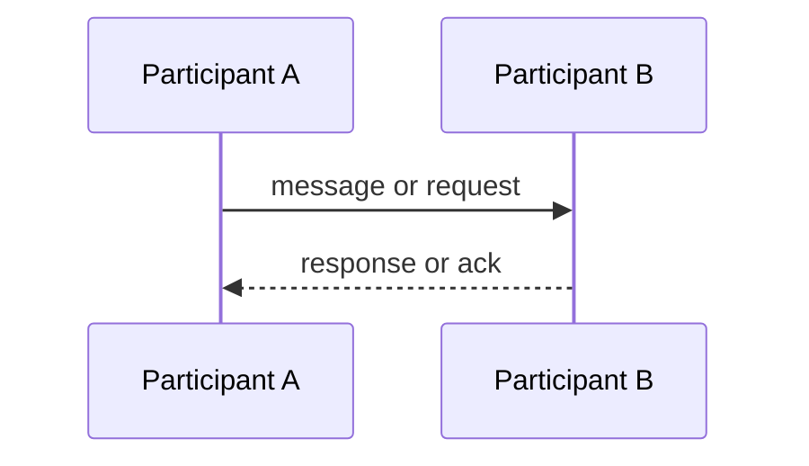

# Integração

> Language: pt-BR | [English](../../en/templates/integration.md)
>
> Status: ACCEPTED
>
> Documentation Standard v1.0

## Visão geral

<!-- Quais sistemas/componentes estão integrados e por quê. -->

## Participantes

| Participante | Papel |
| --- | --- |
| | producer / consumer / intermediary / other |

## Propósito

<!-- Propósito de negócio ou técnico da integração. -->

## Direção

- [ ] Inbound
- [ ] Outbound
- [ ] Bidirectional

## Contrato

<!-- Link para o documento canônico do contrato. Não duplique o schema completo aqui. -->

- Contract: <!-- path or ID -->
- Version: <!-- if applicable -->

## Fluxo

## Dados trocados

| Dado | Sensibilidade | Notas |
| --- | --- | --- |
| | public / internal / sensitive | |

## Expectativas de confiabilidade

| Tópico | Expectativa | Classificação |
| --- | --- | --- |
| Delivery guarantee | | Confirmed / Inferred / Unknown |
| Ordering | | Confirmed / Inferred / Unknown |
| Retry | | Confirmed / Inferred / Unknown |
| Timeout | | Confirmed / Inferred / Unknown |
| Idempotency | | Confirmed / Inferred / Unknown |

## Modos de falha

| Falha | Impacto | Mitigação |
| --- | --- | --- |
| | | |

## Segurança

| Tópico | Resumo |
| --- | --- |
| Authentication | |
| Authorization | |
| Encryption in transit | |
| Secrets referenced | <!-- names only --> |

## Observabilidade

| Sinal | O que observar |
| --- | --- |
| | |

## Considerações operacionais

| Tópico | Notas |
| --- | --- |
| Onboarding a new consumer/producer | |
| Version migration | |
| Runbooks | |

## Documentação relacionada

| Documento | Caminho |
| --- | --- |
| Contract | |
| Components | |
| Arquitetura | |
| ADRs | |
