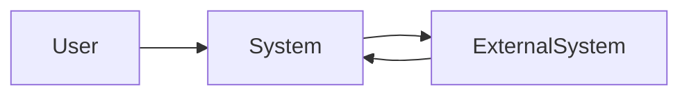

# Contexto do Sistema

> Language: pt-BR | [English](../../en/templates/system-context.md)
>
> Status: ACCEPTED
>
> Documentation Standard v1.0

<!-- Onde este sistema se encaixa no ecossistema. Apenas estado atual, salvo se rotulado Proposed. Use nomes reais do projeto; não invente atores fictícios para sistemas reais. -->

## Propósito

<!-- Responda: onde este sistema se encaixa no ecossistema? -->

## Sistema

| Campo | Valor |
| --- | --- |
| Nome | |
| Purpose | |
| Owner | |
| Boundary summary | |

## Usuários

| Usuário | Necessidade | Interação |
| --- | --- | --- |
| | | |

## Consumidores

| Consumidor | O que consomem | Contrato |
| --- | --- | --- |
| | | |

## Sistemas externos

| Sistema externo | Papel | Direção | Classificação |
| --- | --- | --- | --- |
| | | inbound / outbound / bidirectional | Confirmed / Inferred / Unknown |

## Dependências

| Dependência | Tipo | Propósito | Classificação |
| --- | --- | --- | --- |
| | runtime / data / operational / other | | Confirmed / Inferred / Unknown |

## Entradas

| Entrada | Origem | Formato / contrato |
| --- | --- | --- |
| | | |

## Saídas

| Saída | Destino | Formato / contrato |
| --- | --- | --- |
| | | |

## Relações relevantes

| De | Para | Relação | Notas |
| --- | --- | --- | --- |
| | | depends on / calls / publishes / consumes / other | |

## Diagrama de contexto

<!-- Substitua rótulos genéricos (User, System, ExternalSystem) por nomes do projeto ao documentar um sistema real. Mantenha a semântica de direção explícita na prosa ou em rótulos de aresta. -->

## Documentação relacionada

| Documento | Caminho |
| --- | --- |
| Arquitetura overview | |
| Arquitetura | |
| Dependencies | |
| Contratos | |
