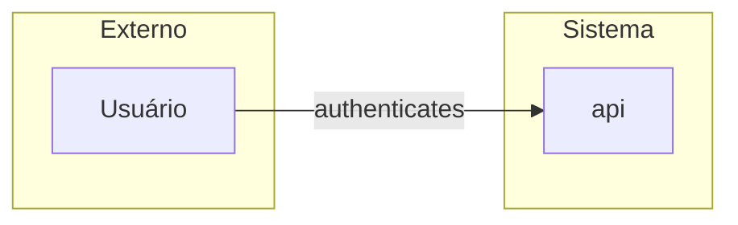

# Fronteiras de Confiança

> Language: pt-BR | [English](../en/trust-boundaries.md)
>
> Status: ACCEPTED
>
> Documentation Standard v1.0

Como documentar fronteiras de confiança arquiteturais — onde a confiança muda e o que controla o cruzamento.

Este documento é a visão **voltada à arquitetura** das arestas de confiança. Metodologia profunda de segurança (profundidade de threat modeling, catálogos de controls, scoring de risk) vive nos docs de segurança linkados abaixo. Aqui o objetivo é tornar as arestas de confiança visíveis na história de arquitetura e distinguir conceitos relacionados.

## Arquitetura Boundary vs Trust Boundary vs Segurança Controls

Estes termos são relacionados, mas não intercambiáveis.

| Concept | Question | Primary docs |
| --- | --- | --- |
| **Arquitetura / system boundary** | O que está dentro deste sistema vs fora? O que o sistema owns? | [system-boundaries.md](system-boundaries.md), [architecture-model.md](architecture-model.md) |
| **Trust boundary** | Onde o *nível de confiança* muda para dados ou controle, e o que deve acontecer para atravessar? | Este documento |
| **Segurança controls** | Quais medidas concretas enforce requirements ou reduzem risk no (ou atrás do) crossing? | [security-controls.md](security-controls.md), [security-model.md](security-model.md) |

Uma system boundary pode conter múltiplas trust boundaries (ex.: public edge vs admin plane vs isolamento de tenant). Uma trust boundary deve nomear a **control class** usada no crossing; o inventário completo de controls, evidência de effectiveness e cenários de threat pertencem à documentação de segurança — evite duplicar catálogos de controls em overviews de arquitetura.

```text
System boundary
      │
      ├── Trust boundary (edge)
      │         └── Controls (authn, authz, …)  → detail in security docs
      ├── Trust boundary (tenant / privilege)
      └── …
```

Para análise de segurança end-to-end, comece em [security-model.md](security-model.md) e [threat-modeling.md](threat-modeling.md). Para placement de identity, access e exposure na arquitetura, veja [security-architecture.md](security-architecture.md).

## Propósito

Uma fronteira de confiança responde:

> Onde o nível de confiança muda e o que deve acontecer para dados ou controle atravessarem?

Forma conceitual:

```text
Trusted zone
      │
      │  Authentication / Authorization / other controls
      ▼
Less-trusted or external zone
```

Zonas são relativas ao sistema sob documentação — não uma classificação universal de segurança.

## O que documentar

Para cada fronteira de confiança material:

| Campo | Significado |
| --- | --- |
| **Origin** | Lado que inicia ou detém os dados/controle antes do cruzamento |
| **Destination** | Lado depois do cruzamento |
| **Trust** | Como a confiança difere (service mesh interno vs internet pública; usuário autenticado vs anônimo; admin vs tenant) |
| **Control mechanism** | Como o cruzamento é governado (authn, authz, network policy, mutual auth, signed assertions, allowlists, …) — apenas resumo |
| **Data crossing** | Categorias de dados que atravessam (classification, referências a secrets, payloads de negócio) — nunca valores secretos |

## Exemplos de tipos de fronteira (não exaustivo)

- Cliente público → edge do sistema
- Sistema → terceiro externo
- Caminho de dados do Tenant A vs Tenant B
- Plano privilegiado de admin vs plano normal da aplicação
- Acesso de CI/CD ou operador vs data plane de runtime
- Segmento de rede less-trusted → segmento more-trusted

Documente apenas fronteiras que importam para entender esta arquitetura. Não invente um modelo completo de zoning empresarial se o projeto for uma única library interna.

## Arquitetura vs detalhe de security

| Em docs de arquitetura | Em docs de security |
| --- | --- |
| Onde as fronteiras estão | Cenários de ameaça, efetividade dos controls |
| O que atravessa e por quê | Algoritmos de criptografia, detalhe de custódia de keys |
| Qual classe de control é usada | Matriz completa de auth, processo de exception |
| Relação com system boundary | Cadeia asset/threat/risk — [security-model.md](security-model.md) |
| Trust zones amigáveis a diagrama | Inventário de attack surface, residual risk |

Linke da arquitetura para o documento de security quando for necessária profundidade. Prefira links a copiar catálogos de controls.

Metodologia de segurança relacionada:

- [security-model.md](security-model.md)
- [threat-modeling.md](threat-modeling.md)
- [security-architecture.md](security-architecture.md)
- [attack-surface.md](attack-surface.md)
- [identity.md](identity.md)
- [authentication.md](authentication.md)
- [authorization.md](authorization.md)

## Dicas de diagrama

- Mostre zonas de confiança como subgraphs ou arestas anotadas.
- Mantenha diagramas de contexto legíveis; visões detalhadas de confiança podem ser separadas.
- Rotule cruzamentos (`authenticates`, `authorizes`) conforme [component-relationships.md](component-relationships.md).



## Progressive Disclosure

| Project size | Minimum |
| --- | --- |
| Small / internal-only | Nota curta se todo acesso compartilha um modelo de confiança |
| Serviço com clientes externos | Fronteira de edge + resumo de authn/authz |
| Multi-tenant ou regulado | Fronteiras explícitas para caminhos de tenant e privilegiados |

Não invente claims regulatórios. Se um projeto for multi-tenant, documente fronteiras de tenant porque são fatos arquiteturais — não por causa de uma certificação assumida.

## Documentos relacionados

- [system-boundaries.md](system-boundaries.md)
- [failure-domains.md](failure-domains.md)
- [component-relationships.md](component-relationships.md)
- [security-model.md](security-model.md)
- [threat-modeling.md](threat-modeling.md)
- [security-architecture.md](security-architecture.md)
- [security/README.md](security/README.md)
- [architecture-checklist.md](architecture-checklist.md)
- [standards.md](standards.md) — Document Segurança (sem secrets em docs)
