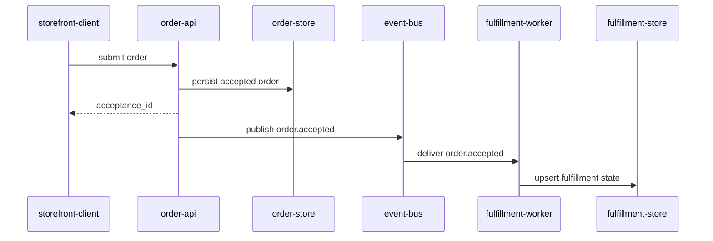

# Data Flow

> Language: EN | [Português (pt-BR)](../../../pt-BR/docs/architecture/data-flow.md)
>
> Status: ACCEPTED
>
> Documentation Standard v1.0
> Owner: example-team
> Last reviewed: 2026-08-07
>
> **Fictional example — not a real project.**

## Purpose

Describe the primary data path from order submission to fulfillment progress in the fictional distributed system.

## Primary Flow

1. `storefront-client` submits an order to `order-api`.
2. `order-api` validates the payload and persists an accepted order in `order-store`.
3. `order-api` returns an acceptance ID to the client (sync path ends).
4. `order-api` publishes `order.accepted` to the event bus.
5. `fulfillment-worker` consumes the event.
6. `fulfillment-worker` upserts fulfillment state in `fulfillment-store` idempotently.

## Diagram

## Data Ownership

| Data | Owner | Notes |
| --- | --- | --- |
| Accepted order record | order-api / order-store | Source of acceptance truth |
| `order.accepted` event | order-api (publisher) | Contract: [../contracts/order-accepted.md](../contracts/order-accepted.md) |
| Fulfillment state | fulfillment-worker / fulfillment-store | Derived progress; eventually consistent |

## Failure Notes

| Step | Failure | Effect |
| --- | --- | --- |
| Persist order | order-store down | Client receives error; no event |
| Publish event | bus unavailable | Acceptance may succeed; fulfillment delayed (example) |
| Apply fulfillment | store or worker error | Retry; idempotent apply required |

## Related Documentation

| Document | Path |
| --- | --- |
| Architecture | [overview.md](overview.md) |
| Contract | [../contracts/order-accepted.md](../contracts/order-accepted.md) |
| ADR | [../decisions/adr-001-async-fulfillment.md](../decisions/adr-001-async-fulfillment.md) |
