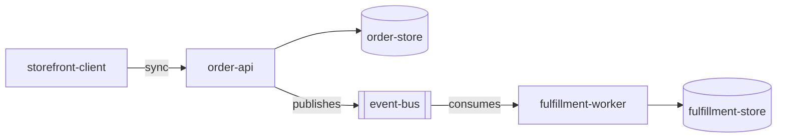

# Architecture

> Language: EN | [Português (pt-BR)](../../../pt-BR/docs/architecture/overview.md)
>
> Status: ACCEPTED
> Owner: example-team
> Last reviewed: 2026-08-07
>
> **Fictional example — not a real project.**
>
> Documentation Standard v1.0 (architecture methodology — light reference)

## Purpose

Describe the current architecture of a fictional multi-service order fulfillment system: system boundary, services, trust edges, and failure domains.

## Context

Clients submit orders to `order-api`. After persistence, the API publishes `order.accepted`. `fulfillment-worker` consumes the event and updates fulfillment state independently of the acceptance path.

## Goals

| Goal | Notes |
| --- | --- |
| Fast order acceptance | Sync path stays small |
| Isolate fulfillment failures | Worker outages do not block acceptance |
| Explicit async contract | Shared event schema |

## Non-Goals

| Non-goal | Rationale |
| --- | --- |
| Exactly-once fulfillment everywhere | At-least-once assumed |
| Cross-service distributed transactions | Explicitly avoided |

## System Boundary

| Inside the system | Outside the system |
| --- | --- |
| order-api, order-store | storefront-client |
| event-bus (as transport used by the system) | payment provider (fictional, out of scope) |
| fulfillment-worker, fulfillment-store | shipping carriers (fictional, out of scope) |

## Architecture Overview

## Main Components / Services

| Service | Responsibility | Documentation |
| --- | --- | --- |
| order-api | Validate, persist, accept, publish | [../application/order-api.md](../application/order-api.md) |
| fulfillment-worker | Consume acceptance, drive fulfillment | [../application/fulfillment-worker.md](../application/fulfillment-worker.md) |

## Component Relationships

| From | To | Relationship | Contract |
| --- | --- | --- | --- |
| storefront-client | order-api | calls (sync) | internal accept API (example) |
| order-api | order-store | depends on | internal |
| order-api | event-bus | publishes | [../contracts/order-accepted.md](../contracts/order-accepted.md) |
| fulfillment-worker | event-bus | consumes | [../contracts/order-accepted.md](../contracts/order-accepted.md) |
| fulfillment-worker | fulfillment-store | depends on | internal |

## Communication

| From | To | Style | Contract |
| --- | --- | --- | --- |
| Client | order-api | sync | accept-order (illustrative) |
| order-api | fulfillment-worker | async | [../contracts/order-accepted.md](../contracts/order-accepted.md) |

## Data Flow

Primary path summarized in [data-flow.md](data-flow.md).

## Dependencies

| Dependency | Purpose | Failure impact | Classification |
| --- | --- | --- | --- |
| order-store | Persist accepted orders | Acceptance fails | Confirmed (example) |
| event-bus | Async handoff | Fulfillment stalls; acceptance may still succeed | Confirmed (example) |
| fulfillment-store | Persist fulfillment state | Worker applies fail / retry | Confirmed (example) |

## Trust Boundaries

| Boundary | What is protected | Controls summary |
| --- | --- | --- |
| API edge | Order acceptance operations | Client authentication (example) |
| Event channel | Who may publish/consume `order.accepted` | Bus ACLs (example) |
| Service-to-store | Datastore access | Network / credential isolation (example) |

## Failure Domains

| Domain | Includes | Failure effect |
| --- | --- | --- |
| Acceptance domain | order-api + order-store | New orders cannot be accepted |
| Transport domain | event-bus | Fulfillment lag; acceptance may continue |
| Fulfillment domain | fulfillment-worker + fulfillment-store | Accepted orders not progressed |

## Trade-offs

| Decision / approach | Benefit | Cost |
| --- | --- | --- |
| Async fulfillment after accept | Isolates blast radius | Eventual consistency; duplicate handling needed |

## Known Limitations

| Limitation | Impact | Classification |
| --- | --- | --- |
| At-least-once delivery | Worker must be idempotent | Confirmed (example) |

## Related Decisions

| ADR | Title | Status |
| --- | --- | --- |
| ADR-001 | Use asynchronous fulfillment after order acceptance | Accepted |

## Related Documentation

| Document | Path |
| --- | --- |
| Project overview | [../project-overview.md](../project-overview.md) |
| Data flow | [data-flow.md](data-flow.md) |
| Contract | [../contracts/order-accepted.md](../contracts/order-accepted.md) |
