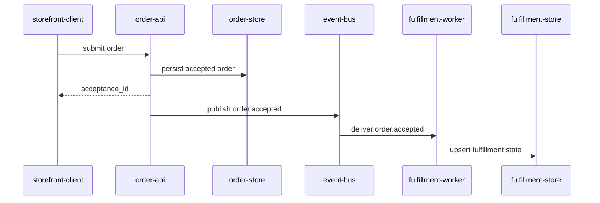

# Fluxo de Dados

> Language: pt-BR | [English](../../../en/docs/architecture/data-flow.md)
>
> Status: ACCEPTED
>
> Documentation Standard v1.0
> Owner: example-team
> Last reviewed: 2026-08-07
>
> **Exemplo ficcional — não é um projeto real.**

## Propósito

Descrever o caminho principal de dados da submissão do pedido até o progresso de fulfillment no sistema distribuído ficcional.

## Fluxo principal

1. `storefront-client` submete um pedido a `order-api`.
2. `order-api` valida o payload e persiste um pedido aceito em `order-store`.
3. `order-api` retorna um ID de aceitação ao cliente (caminho sync termina).
4. `order-api` publica `order.accepted` no event bus.
5. `fulfillment-worker` consome o evento.
6. `fulfillment-worker` faz upsert do estado de fulfillment em `fulfillment-store` de forma idempotente.

## Diagrama

## Propriedade dos dados

| Dado | Owner | Notas |
| --- | --- | --- |
| Registro de pedido aceito | order-api / order-store | Fonte da verdade de aceitação |
| Evento `order.accepted` | order-api (publisher) | Contrato: [../contracts/order-accepted.md](../contracts/order-accepted.md) |
| Estado de fulfillment | fulfillment-worker / fulfillment-store | Progresso derivado; eventualmente consistente |

## Notas de falha

| Passo | Falha | Efeito |
| --- | --- | --- |
| Persistir pedido | order-store indisponível | Cliente recebe erro; sem evento |
| Publicar evento | bus indisponível | Aceitação pode ter sucesso; fulfillment atrasado (exemplo) |
| Aplicar fulfillment | erro de store ou worker | Retry; apply idempotente obrigatório |

## Documentação relacionada

| Documento | Caminho |
| --- | --- |
| Arquitetura | [overview.md](overview.md) |
| Contrato | [../contracts/order-accepted.md](../contracts/order-accepted.md) |
| ADR | [../decisions/adr-001-async-fulfillment.md](../decisions/adr-001-async-fulfillment.md) |
