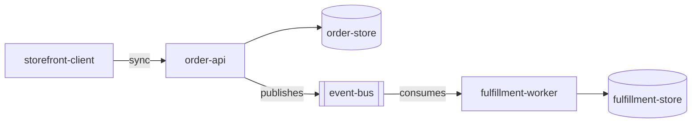

# Arquitetura

> Language: pt-BR | [English](../../../en/docs/architecture/overview.md)
>
> Status: ACCEPTED
> Owner: example-team
> Last reviewed: 2026-08-07
>
> **Exemplo ficcional — não é um projeto real.**
>
> Documentation Standard v1.0 (metodologia de arquitetura — referência leve)

## Propósito

Descrever a arquitetura atual de um sistema ficcional multi-serviço de fulfillment de pedidos: limite do sistema, serviços, limites de confiança e domínios de falha.

## Contexto

Clientes submetem pedidos a `order-api`. Após a persistência, a API publica `order.accepted`. `fulfillment-worker` consome o evento e atualiza o estado de fulfillment de forma independente do caminho de aceitação.

## Objetivos

| Objetivo | Notas |
| --- | --- |
| Aceitação rápida de pedidos | Caminho sync permanece pequeno |
| Isolar falhas de fulfillment | Outages do worker não bloqueiam aceitação |
| Contrato async explícito | Schema de evento compartilhado |

## Não-objetivos

| Não-objetivo | Justificativa |
| --- | --- |
| Fulfillment exactly-once em todo lugar | At-least-once assumido |
| Transações distribuídas entre serviços | Explicitamente evitadas |

## Limite do sistema

| Dentro do sistema | Fora do sistema |
| --- | --- |
| order-api, order-store | storefront-client |
| event-bus (como transporte usado pelo sistema) | provedor de pagamento (ficcional, fora do escopo) |
| fulfillment-worker, fulfillment-store | transportadoras (ficcional, fora do escopo) |

## Visão geral da arquitetura

## Componentes / serviços principais

| Serviço | Responsabilidade | Documentação |
| --- | --- | --- |
| order-api | Validar, persistir, aceitar, publicar | [../application/order-api.md](../application/order-api.md) |
| fulfillment-worker | Consumir aceitação, conduzir fulfillment | [../application/fulfillment-worker.md](../application/fulfillment-worker.md) |

## Relacionamentos entre componentes

| De | Para | Relacionamento | Contrato |
| --- | --- | --- | --- |
| storefront-client | order-api | calls (sync) | API de aceitação interna (exemplo) |
| order-api | order-store | depends on | interno |
| order-api | event-bus | publishes | [../contracts/order-accepted.md](../contracts/order-accepted.md) |
| fulfillment-worker | event-bus | consumes | [../contracts/order-accepted.md](../contracts/order-accepted.md) |
| fulfillment-worker | fulfillment-store | depends on | interno |

## Comunicação

| De | Para | Estilo | Contrato |
| --- | --- | --- | --- |
| Cliente | order-api | sync | accept-order (ilustrativo) |
| order-api | fulfillment-worker | async | [../contracts/order-accepted.md](../contracts/order-accepted.md) |

## Fluxo de dados

Caminho principal resumido em [data-flow.md](data-flow.md).

## Dependências

| Dependência | Propósito | Impacto da falha | Classification |
| --- | --- | --- | --- |
| order-store | Persistir pedidos aceitos | Aceitação falha | Confirmed (example) |
| event-bus | Handoff assíncrono | Fulfillment estagna; aceitação pode continuar | Confirmed (example) |
| fulfillment-store | Persistir estado de fulfillment | Applies do worker falham / retry | Confirmed (example) |

## Limites de confiança

| Limite | O que é protegido | Resumo dos controles |
| --- | --- | --- |
| Borda da API | Operações de aceitação de pedidos | Autenticação do cliente (exemplo) |
| Canal de eventos | Quem pode publicar/consumir `order.accepted` | ACLs do bus (exemplo) |
| Serviço-para-store | Acesso ao datastore | Isolamento de rede / credenciais (exemplo) |

## Domínios de falha

| Domínio | Inclui | Efeito da falha |
| --- | --- | --- |
| Domínio de aceitação | order-api + order-store | Novos pedidos não podem ser aceitos |
| Domínio de transporte | event-bus | Lag de fulfillment; aceitação pode continuar |
| Domínio de fulfillment | fulfillment-worker + fulfillment-store | Pedidos aceitos não avançam |

## Trade-offs

| Decisão / abordagem | Benefício | Custo |
| --- | --- | --- |
| Fulfillment async após aceitação | Isola blast radius | Consistência eventual; handling de duplicatas necessário |

## Limitações conhecidas

| Limitação | Impacto | Classification |
| --- | --- | --- |
| Entrega at-least-once | Worker deve ser idempotente | Confirmed (example) |

## Decisões relacionadas

| ADR | Título | Status |
| --- | --- | --- |
| ADR-001 | Usar fulfillment assíncrono após aceitação do pedido | Accepted |

## Documentação relacionada

| Documento | Caminho |
| --- | --- |
| Visão geral do projeto | [../project-overview.md](../project-overview.md) |
| Fluxo de dados | [data-flow.md](data-flow.md) |
| Contrato | [../contracts/order-accepted.md](../contracts/order-accepted.md) |
