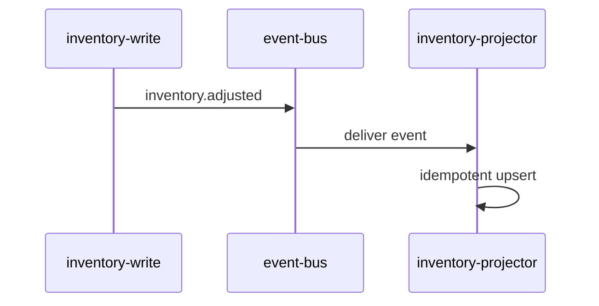

# Integration: inventory.adjusted

> Language: EN | [Português (pt-BR)](../../../pt-BR/docs/application/integration-inventory-adjusted.md)
>
> Status: ACCEPTED
>
> Documentation Standard v1.0
> Owner: example-team
> Last reviewed: 2026-08-07
>
> **Fictional example — not a real project.**

## Overview

Connects the inventory write model to the inventory projector through an asynchronous event.

## Participants

| Participant | Role |
| --- | --- |
| inventory-write | producer |
| event-bus | intermediary |
| inventory-projector | consumer |

## Purpose

Propagate inventory changes to a read-optimized projection without synchronous coupling.

## Direction

- [x] Inbound
- [ ] Outbound
- [ ] Bidirectional

(From the projector perspective.)

## Contract

- Contract: [../contracts/inventory-adjusted.md](../contracts/inventory-adjusted.md)
- Version: v1

## Flow

## Data Exchanged

| Data | Sensitivity | Notes |
| --- | --- | --- |
| sku, quantity_delta, version | internal | Example assumes non-sensitive identifiers |

## Reliability Expectations

| Topic | Expectation | Classification |
| --- | --- | --- |
| Delivery guarantee | at-least-once | Confirmed (example) |
| Ordering | per-SKU ordering preferred | Inferred (example) |
| Retry | consumer retries transient failures | Confirmed (example) |
| Timeout | 30s processing timeout | Confirmed (example) |
| Idempotency | required | Confirmed (example) |

## Failure Modes

| Failure | Impact | Mitigation |
| --- | --- | --- |
| Bus unavailable | projection lag | alert; resume when bus recovers |
| Poison event | consumer stall risk | dead-letter + alert |
| Store outage | retries accumulate | backoff; escalate |

## Security

| Topic | Summary |
| --- | --- |
| Authentication | Bus credentials by reference |
| Authorization | Produce/consume ACLs |
| Encryption in transit | Assumed by platform capability; details Unknown |
| Secrets referenced | `EVENT_BUS_CREDENTIALS`, `PROJECTION_STORE_DSN` |

## Observability

| Signal | What to watch |
| --- | --- |
| consumer lag | growth over time |
| dead-letter count | non-zero spikes |
| apply error rate | sustained increase |

## Operational Considerations

| Topic | Notes |
| --- | --- |
| Onboarding a new consumer/producer | Follow contract compatibility rules |
| Version migration | Dual-publish during major changes |
| Runbooks | [../operations/troubleshooting.md](../operations/troubleshooting.md) |

## Related Documentation

| Document | Path |
| --- | --- |
| Contract | [../contracts/inventory-adjusted.md](../contracts/inventory-adjusted.md) |
| Component | [inventory-projector.md](inventory-projector.md) |
| Architecture | [../architecture/overview.md](../architecture/overview.md) |
| ADR | [../decisions/adr-001-async-projection.md](../decisions/adr-001-async-projection.md) |
