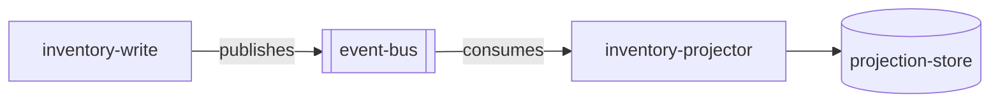

# Architecture

> Language: EN | [Português (pt-BR)](../../../pt-BR/docs/architecture/overview.md)
>
> Status: ACCEPTED
> Owner: example-team
> Last reviewed: 2026-08-07
>
> **Fictional example — not a real project.**
>
> Documentation Standard v1.0 (architecture methodology — light reference)

## Purpose

Describe the current event-driven architecture of the fictional inventory projector: producers, consumers, events, sequence, and projection state.

## Context

`inventory-write` emits `inventory.adjusted` events. `inventory-projector` consumes those events and updates `projection-store`. Readers of the projection observe eventually consistent inventory quantities.

## Goals

| Goal | Notes |
| --- | --- |
| Decouple read model updates from write path | Async boundary |
| Idempotent projection updates | Safe retries |

## Non-Goals

| Non-goal | Rationale |
| --- | --- |
| Exactly-once delivery everywhere | Not assumed |

## System Boundary

| Inside the system | Outside the system |
| --- | --- |
| inventory-projector, projection-store | inventory-write (producer; adjacent) |
| Consumption of `inventory.adjusted` | Reporting readers of the store (out of doc focus) |

## Producers and Consumers

| Role | Component | Event / contract |
| --- | --- | --- |
| Producer | inventory-write (fictional) | [../contracts/inventory-adjusted.md](../contracts/inventory-adjusted.md) |
| Consumer | inventory-projector | [../contracts/inventory-adjusted.md](../contracts/inventory-adjusted.md) |

## Architecture Overview

## Main Components

| Component | Responsibility | Documentation |
| --- | --- | --- |
| inventory-projector | Event consumption and projection updates | [../application/inventory-projector.md](../application/inventory-projector.md) |

## Component Relationships

| From | To | Relationship | Contract |
| --- | --- | --- | --- |
| inventory-write | event-bus | publishes | [../contracts/inventory-adjusted.md](../contracts/inventory-adjusted.md) |
| inventory-projector | event-bus | consumes | [../contracts/inventory-adjusted.md](../contracts/inventory-adjusted.md) |
| inventory-projector | projection-store | depends on | internal |

## Communication

| From | To | Style | Contract |
| --- | --- | --- | --- |
| inventory-write | inventory-projector | async | [../contracts/inventory-adjusted.md](../contracts/inventory-adjusted.md) |

## Data Flow

1. Write model commits an inventory change.
2. Write model publishes `inventory.adjusted`.
3. Projector consumes the event.
4. Projector upserts projection state idempotently.

Sequence detail: [sequence-inventory-adjust.md](sequence-inventory-adjust.md).  
Projection apply state: [state-projection.md](state-projection.md).

## Dependencies

| Dependency | Purpose | Failure impact | Classification |
| --- | --- | --- | --- |
| event-bus | Transport | Projection stalls | Confirmed (example) |
| projection-store | Persistence | Applies fail / retry | Confirmed (example) |

## Security Boundaries / Trust Boundaries

| Boundary | What is protected | Controls summary |
| --- | --- | --- |
| Event channel | Event publication/consumption | Bus ACLs (example) |

## Failure Domains

| Domain | Includes | Failure effect |
| --- | --- | --- |
| Consumption path | bus + projector + store | Projection lag increases |
| Write path (adjacent) | inventory-write | New adjustments stop; existing lag may remain |

## Scalability

Scale projector consumers; partition/ordering semantics depend on bus configuration. <!-- Classification: Inferred (example) -->

## Availability

Projection freshness depends on bus and consumer health. Hard availability target: Unknown.

## Trade-offs

| Decision / approach | Benefit | Cost |
| --- | --- | --- |
| Async projection | Write path isolation | Eventual consistency |

## Known Limitations

| Limitation | Impact | Classification |
| --- | --- | --- |
| At-least-once delivery assumed | Duplicate events possible | Confirmed (example) |

## Related Decisions

| ADR | Title | Status |
| --- | --- | --- |
| ADR-001 | Use asynchronous projection for inventory reads | Accepted |

## Related Documentation

| Document | Path |
| --- | --- |
| Project overview | [../project-overview.md](../project-overview.md) |
| Sequence | [sequence-inventory-adjust.md](sequence-inventory-adjust.md) |
| Projection state | [state-projection.md](state-projection.md) |
| Contract | [../contracts/inventory-adjusted.md](../contracts/inventory-adjusted.md) |
| Integration | [../application/integration-inventory-adjusted.md](../application/integration-inventory-adjusted.md) |
