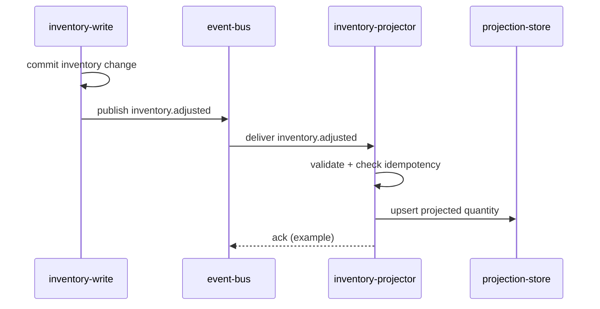

# Sequence: Inventory Adjust

> Language: EN | [Português (pt-BR)](../../../pt-BR/docs/architecture/sequence-inventory-adjust.md)
>
> Status: ACCEPTED
>
> Documentation Standard v1.0
> Owner: example-team
> Last reviewed: 2026-08-07
>
> **Fictional example — not a real project.**

## Purpose

Show the runtime sequence from an inventory write through event publication to projection apply.

## Actors

| Actor | Role |
| --- | --- |
| inventory-write | Producer of `inventory.adjusted` |
| event-bus | Transport |
| inventory-projector | Consumer / applier |
| projection-store | Projection persistence |

## Sequence

## Notes

| Topic | Value | Classification |
| --- | --- | --- |
| Ordering | Per-SKU version used for stale detection | Confirmed (example) |
| Delivery | at-least-once | Confirmed (example) |
| Ack semantics | Technology-specific; example only | Unknown beyond example |

## Related Documentation

| Document | Path |
| --- | --- |
| Architecture overview | [overview.md](overview.md) |
| Projection state | [state-projection.md](state-projection.md) |
| Contract | [../contracts/inventory-adjusted.md](../contracts/inventory-adjusted.md) |
