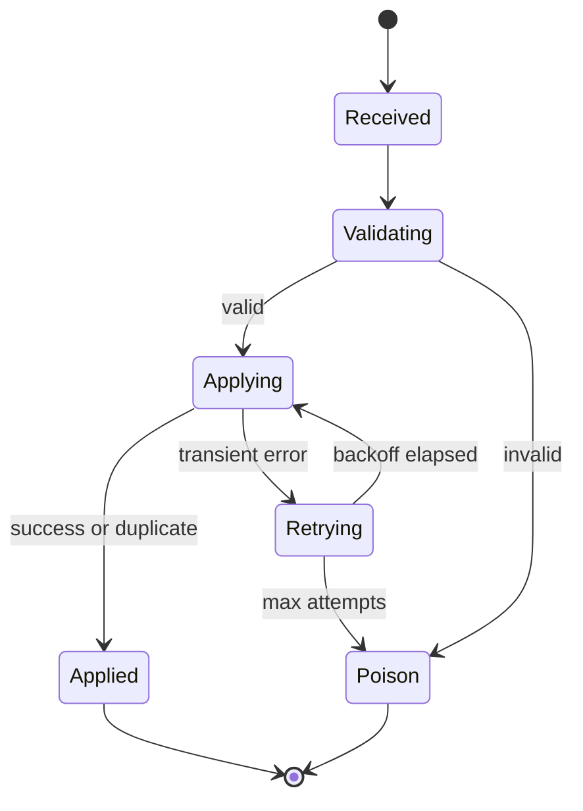

# State: Projection Apply

> Language: EN | [Português (pt-BR)](../../../pt-BR/docs/architecture/state-projection.md)
>
> Status: ACCEPTED
>
> Documentation Standard v1.0
> Owner: example-team
> Last reviewed: 2026-08-07
>
> **Fictional example — not a real project.**

## Purpose

Describe the apply lifecycle for a single `inventory.adjusted` event inside `inventory-projector`.

## States

| State | Meaning |
| --- | --- |
| Received | Event delivered to the consumer |
| Validating | Schema / required fields checked |
| Applying | Projection upsert in progress |
| Applied | Projection updated (or duplicate skipped) |
| Retrying | Transient failure; will retry |
| Poison | Permanent failure; stop automatic apply |

## State Diagram

## Apply Rules

| Rule | Notes | Classification |
| --- | --- | --- |
| Idempotency by `event_id` | Duplicate delivery → Applied without double-count | Confirmed (example) |
| Stale version skip | Lower `version` than stored → Applied (no-op) | Confirmed (example) |
| Quantity update | Apply `quantity_delta` when version advances | Confirmed (example) |

## Related Documentation

| Document | Path |
| --- | --- |
| Architecture overview | [overview.md](overview.md) |
| Sequence | [sequence-inventory-adjust.md](sequence-inventory-adjust.md) |
| Component | [../application/inventory-projector.md](../application/inventory-projector.md) |
| Contract | [../contracts/inventory-adjusted.md](../contracts/inventory-adjusted.md) |
