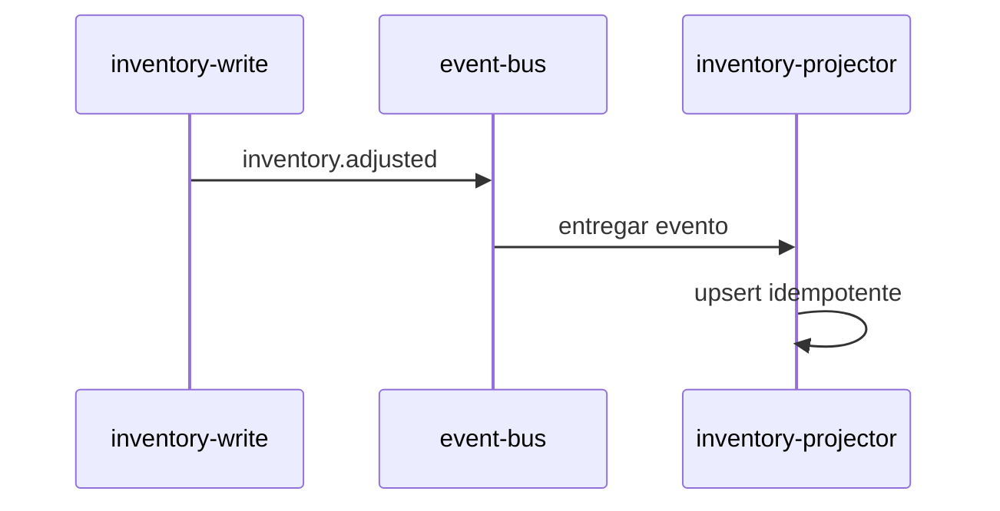

# Integração: inventory.adjusted

> Language: pt-BR | [English](../../../en/docs/application/integration-inventory-adjusted.md)
>
> Status: ACCEPTED
>
> Documentation Standard v1.0
> Owner: example-team
> Last reviewed: 2026-08-07
>
> **Exemplo ficcional — não é um projeto real.**

## Visão geral

Conecta o write model de inventário ao inventory projector por meio de um evento assíncrono.

## Participantes

| Participante | Papel |
| --- | --- |
| inventory-write | producer |
| event-bus | intermediary |
| inventory-projector | consumer |

## Propósito

Propagar mudanças de inventário para uma projeção otimizada para leitura sem acoplamento síncrono.

## Direção

- [x] Inbound
- [ ] Outbound
- [ ] Bidirectional

(Da perspectiva do projector.)

## Contrato

- Contract: [../contracts/inventory-adjusted.md](../contracts/inventory-adjusted.md)
- Version: v1

## Fluxo

## Dados trocados

| Dado | Sensibilidade | Notas |
| --- | --- | --- |
| sku, quantity_delta, version | internal | Exemplo assume identificadores não sensíveis |

## Expectativas de confiabilidade

| Tópico | Expectativa | Classification |
| --- | --- | --- |
| Delivery guarantee | at-least-once | Confirmed (example) |
| Ordering | ordenação por SKU preferida | Inferred (example) |
| Retry | consumer faz retry de falhas transitórias | Confirmed (example) |
| Timeout | timeout de processamento de 30s | Confirmed (example) |
| Idempotency | required | Confirmed (example) |

## Modos de falha

| Falha | Impacto | Mitigação |
| --- | --- | --- |
| Bus indisponível | lag de projeção | alertar; retomar quando o bus recuperar |
| Evento poison | risco de stall do consumer | dead-letter + alert |
| Outage do store | retries acumulam | backoff; escalar |

## Segurança

| Tópico | Resumo |
| --- | --- |
| Authentication | Credenciais do bus por referência |
| Authorization | ACLs de produce/consume |
| Encryption in transit | Assumido pela capacidade da plataforma; detalhes Unknown |
| Secrets referenced | `EVENT_BUS_CREDENTIALS`, `PROJECTION_STORE_DSN` |

## Observabilidade

| Sinal | O que observar |
| --- | --- |
| consumer lag | crescimento ao longo do tempo |
| dead-letter count | picos diferentes de zero |
| apply error rate | aumento sustentado |

## Considerações operacionais

| Tópico | Notas |
| --- | --- |
| Onboarding de novo consumer/producer | Seguir regras de compatibilidade do contrato |
| Version migration | Dual-publish durante mudanças major |
| Runbooks | [../operations/troubleshooting.md](../operations/troubleshooting.md) |

## Documentação relacionada

| Documento | Caminho |
| --- | --- |
| Contract | [../contracts/inventory-adjusted.md](../contracts/inventory-adjusted.md) |
| Component | [inventory-projector.md](inventory-projector.md) |
| Architecture | [../architecture/overview.md](../architecture/overview.md) |
| ADR | [../decisions/adr-001-async-projection.md](../decisions/adr-001-async-projection.md) |
