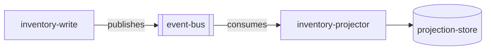

# Arquitetura

> Language: pt-BR | [English](../../../en/docs/architecture/overview.md)
>
> Status: ACCEPTED
> Owner: example-team
> Last reviewed: 2026-08-07
>
> **Exemplo ficcional — não é um projeto real.**
>
> Documentation Standard v1.0 (metodologia de arquitetura — referência leve)

## Propósito

Descrever a arquitetura event-driven atual do inventory projector ficcional: producers, consumers, eventos, sequência e estado da projeção.

## Contexto

`inventory-write` emite eventos `inventory.adjusted`. `inventory-projector` consome esses eventos e atualiza `projection-store`. Leitores da projeção observam quantidades de inventário eventualmente consistentes.

## Objetivos

| Objetivo | Notas |
| --- | --- |
| Desacoplar atualizações do read model do write path | Limite async |
| Atualizações de projeção idempotentes | Retries seguros |

## Não-objetivos

| Não-objetivo | Justificativa |
| --- | --- |
| Entrega exactly-once em todo lugar | Não assumido |

## Limite do sistema

| Dentro do sistema | Fora do sistema |
| --- | --- |
| inventory-projector, projection-store | inventory-write (producer; adjacente) |
| Consumo de `inventory.adjusted` | Leitores de reporting do store (fora do foco deste doc) |

## Producers e consumers

| Papel | Componente | Evento / contrato |
| --- | --- | --- |
| Producer | inventory-write (ficcional) | [../contracts/inventory-adjusted.md](../contracts/inventory-adjusted.md) |
| Consumer | inventory-projector | [../contracts/inventory-adjusted.md](../contracts/inventory-adjusted.md) |

## Visão geral da arquitetura

## Componentes principais

| Componente | Responsabilidade | Documentação |
| --- | --- | --- |
| inventory-projector | Consumo de eventos e atualizações de projeção | [../application/inventory-projector.md](../application/inventory-projector.md) |

## Relacionamentos entre componentes

| De | Para | Relacionamento | Contrato |
| --- | --- | --- | --- |
| inventory-write | event-bus | publishes | [../contracts/inventory-adjusted.md](../contracts/inventory-adjusted.md) |
| inventory-projector | event-bus | consumes | [../contracts/inventory-adjusted.md](../contracts/inventory-adjusted.md) |
| inventory-projector | projection-store | depends on | interno |

## Comunicação

| De | Para | Estilo | Contrato |
| --- | --- | --- | --- |
| inventory-write | inventory-projector | async | [../contracts/inventory-adjusted.md](../contracts/inventory-adjusted.md) |

## Fluxo de dados

1. O write model confirma uma mudança de inventário.
2. O write model publica `inventory.adjusted`.
3. O projector consome o evento.
4. O projector faz upsert do estado da projeção de forma idempotente.

Detalhe de sequência: [sequence-inventory-adjust.md](sequence-inventory-adjust.md).  
Estado do apply da projeção: [state-projection.md](state-projection.md).

## Dependências

| Dependência | Propósito | Impacto da falha | Classification |
| --- | --- | --- | --- |
| event-bus | Transporte | Projeção estagna | Confirmed (example) |
| projection-store | Persistência | Applies falham / retry | Confirmed (example) |

## Limites de segurança / confiança

| Limite | O que é protegido | Resumo dos controles |
| --- | --- | --- |
| Canal de eventos | Publicação/consumo de eventos | ACLs do bus (exemplo) |

## Domínios de falha

| Domínio | Inclui | Efeito da falha |
| --- | --- | --- |
| Caminho de consumo | bus + projector + store | Lag de projeção aumenta |
| Write path (adjacente) | inventory-write | Novos ajustes param; lag existente pode permanecer |

## Escalabilidade

Escalar consumers do projector; semântica de partição/ordenação depende da configuração do bus. <!-- Classification: Inferred (example) -->

## Disponibilidade

A atualidade da projeção depende da saúde do bus e do consumer. Meta rígida de disponibilidade: Unknown.

## Trade-offs

| Decisão / abordagem | Benefício | Custo |
| --- | --- | --- |
| Projeção async | Isolamento do write path | Consistência eventual |

## Limitações conhecidas

| Limitação | Impacto | Classification |
| --- | --- | --- |
| Entrega at-least-once assumida | Eventos duplicados possíveis | Confirmed (example) |

## Decisões relacionadas

| ADR | Título | Status |
| --- | --- | --- |
| ADR-001 | Usar projeção assíncrona para leituras de inventário | Accepted |

## Documentação relacionada

| Documento | Caminho |
| --- | --- |
| Visão geral do projeto | [../project-overview.md](../project-overview.md) |
| Sequência | [sequence-inventory-adjust.md](sequence-inventory-adjust.md) |
| Estado da projeção | [state-projection.md](state-projection.md) |
| Contrato | [../contracts/inventory-adjusted.md](../contracts/inventory-adjusted.md) |
| Integração | [../application/integration-inventory-adjusted.md](../application/integration-inventory-adjusted.md) |
