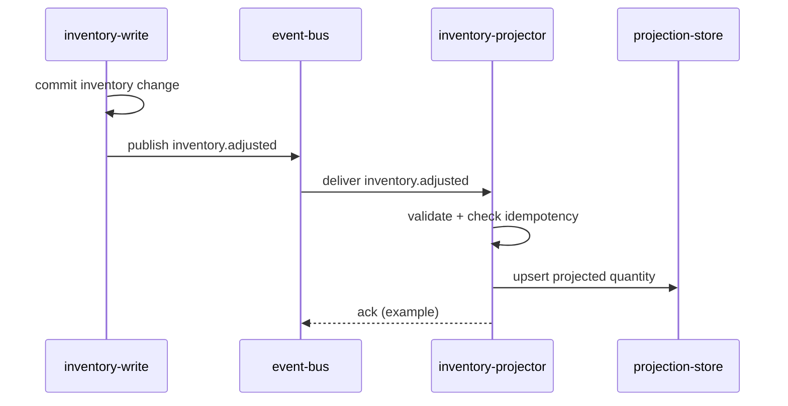

# Sequência: Inventory Adjust

> Language: pt-BR | [English](../../../en/docs/architecture/sequence-inventory-adjust.md)
>
> Status: ACCEPTED
>
> Documentation Standard v1.0
> Owner: example-team
> Last reviewed: 2026-08-07
>
> **Exemplo ficcional — não é um projeto real.**

## Propósito

Mostrar a sequência em runtime de um write de inventário até a publicação do evento e o apply da projeção.

## Atores

| Ator | Papel |
| --- | --- |
| inventory-write | Producer de `inventory.adjusted` |
| event-bus | Transporte |
| inventory-projector | Consumer / applier |
| projection-store | Persistência da projeção |

## Sequência

## Notas

| Tópico | Valor | Classification |
| --- | --- | --- |
| Ordenação | Version por SKU usada para detectar stale | Confirmed (example) |
| Entrega | at-least-once | Confirmed (example) |
| Semântica de ack | Específica da tecnologia; apenas exemplo | Unknown além do exemplo |

## Documentação relacionada

| Documento | Caminho |
| --- | --- |
| Visão geral da arquitetura | [overview.md](overview.md) |
| Estado da projeção | [state-projection.md](state-projection.md) |
| Contrato | [../contracts/inventory-adjusted.md](../contracts/inventory-adjusted.md) |
