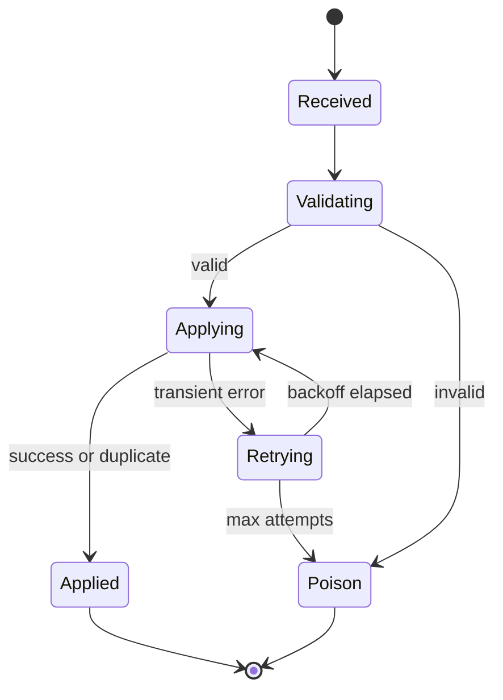

# Estado: Apply da Projeção

> Language: pt-BR | [English](../../../en/docs/architecture/state-projection.md)
>
> Status: ACCEPTED
>
> Documentation Standard v1.0
> Owner: example-team
> Last reviewed: 2026-08-07
>
> **Exemplo ficcional — não é um projeto real.**

## Propósito

Descrever o ciclo de vida do apply de um único evento `inventory.adjusted` dentro de `inventory-projector`.

## Estados

| Estado | Significado |
| --- | --- |
| Received | Evento entregue ao consumer |
| Validating | Schema / campos obrigatórios verificados |
| Applying | Upsert da projeção em andamento |
| Applied | Projeção atualizada (ou duplicata ignorada) |
| Retrying | Falha transitória; fará retry |
| Poison | Falha permanente; interrompe apply automático |

## Diagrama de estados

## Regras de apply

| Regra | Notas | Classification |
| --- | --- | --- |
| Idempotência por `event_id` | Entrega duplicada → Applied sem double-count | Confirmed (example) |
| Skip de version stale | `version` menor que a armazenada → Applied (no-op) | Confirmed (example) |
| Atualização de quantidade | Aplicar `quantity_delta` quando a version avança | Confirmed (example) |

## Documentação relacionada

| Documento | Caminho |
| --- | --- |
| Visão geral da arquitetura | [overview.md](overview.md) |
| Sequência | [sequence-inventory-adjust.md](sequence-inventory-adjust.md) |
| Componente | [../application/inventory-projector.md](../application/inventory-projector.md) |
| Contrato | [../contracts/inventory-adjusted.md](../contracts/inventory-adjusted.md) |
