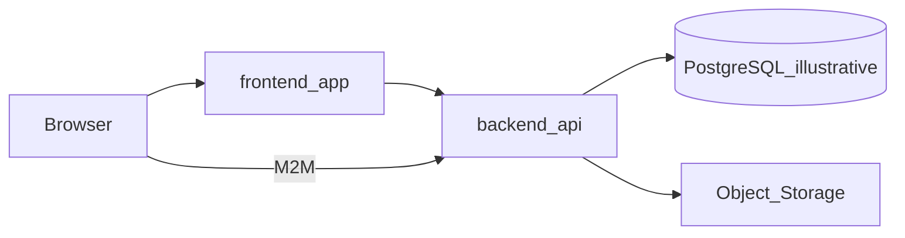

# Architecture overview

> Language: EN | [Português (pt-BR)](../../../pt-BR/docs/architecture/overview.md)
>
> Status: ACCEPTED
>
> Documentation Standard v1.0
> Owner: example-team
>
> **Fictional example.** The illustrative stack is **not** the framework standard nor a definitive adoption guide.

## Purpose

Document the **Monolith + Frontend** shape: UI and API in one repository, shared persistence, and edge integrations. This overview is the depth-2 map before `application/` deep-dives.

## Context

Fictional corporate product for spreadsheet pipelines. Combines Monolith and Frontend guidance in [architecture-by-project-type](../../../../../docs/en/architecture-by-project-type.md).

## Goals

| Goal | Notes | Classification |
| --- | --- | --- |
| Govern spreadsheet ingest and export | Projects, rules, canonicals | Confirmed (within example) |
| Expose versioned API with RBAC and audit | Illustrative `/api` and `/api/v1` | Confirmed (within example) |
| Allow offline demo (Sandbox) | Client execution boundary | Confirmed (within example) |

## Non-goals

| Non-goal | Rationale |
| --- | --- |
| Mandate a stack for the standard | The standard is technology-agnostic |
| Microservices / brokers | Outside this monolith shape |
| Invent numeric SLOs | Unknown in this example |

## System boundary

| Inside | Outside |
| --- | --- |
| frontend-app, backend-api, illustrative PostgreSQL | External object storage, M2M clients, HTTP targets |

## Main components

| Component | Responsibility | Doc |
| --- | --- | --- |
| frontend-app | UI, routes, Live/Sandbox | [../application/frontend-app.md](../application/frontend-app.md) |
| backend-api | HTTP API, auth, health | [../application/backend-api.md](../application/backend-api.md) |
| project-pipeline | Import/export/rules | [../application/project-pipeline.md](../application/project-pipeline.md) |
| storage-and-files | Evidence | [../application/storage-and-files.md](../application/storage-and-files.md) |
| data-ops | Comparison/reconciliation | [../application/data-ops.md](../application/data-ops.md) |

## Diagram

## Observable decisions (in the example)

| Decision | Notes | Classification |
| --- | --- | --- |
| Dual-schema core/data | Metadata vs typed-row ownership | Proposed (example only) |
| Live vs Sandbox on client | See [ADR-001](../decisions/adr-001-live-sandbox.md) | Confirmed (within example) |
| Rewrite `/api/v1` → `/api` | Illustrative versioning compatibility | Proposed (example only) |
| S3 listed but not implemented | Proposed stub | Proposed |

## Quality and risks

| Item | Status | Classification |
| --- | --- | --- |
| Per-user rate limit | Implemented (illustrative) | Confirmed (within example) |
| Datadog / tracing | Absent — gap vs optional org convention | Confirmed gap (optional org) |
| Encrypted storage credentials | Implemented (illustrative) | Confirmed (within example) |

## Related

- [system-context.md](system-context.md)
- [../contracts/rest-api.md](../contracts/rest-api.md)
- [../security/overview.md](../security/overview.md)
- [../knowledge-gaps.md](../knowledge-gaps.md)
