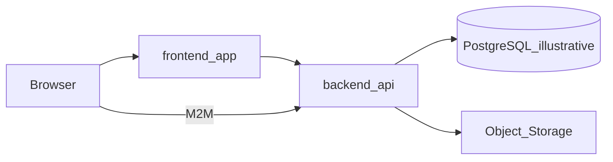

# Visão geral de arquitetura

> Language: pt-BR | [English](../../../en/docs/architecture/overview.md)
>
> Status: ACCEPTED
>
> Documentation Standard v1.0
> Owner: example-team
>
> **Exemplo ficcional.** A stack ilustrativa **não** é o padrão do framework nem guia definitivo de adoção.

## Propósito

Documentar a forma **Monolith + Frontend**: UI e API no mesmo repositório, persistência compartilhada e integrações na edge. Este overview é o mapa de depth 2 antes dos deep-dives em `application/`.

## Contexto

Produto ficcional corporativo para pipelines de planilhas. Combina as orientações de Monolith e Frontend em [architecture-by-project-type](../../../../../docs/pt-BR/architecture-by-project-type.md).

## Objetivos

| Objetivo | Notas | Classification |
| --- | --- | --- |
| Governar ingestão e export de planilhas | Projetos, regras, canônicos | Confirmed (within example) |
| Expor API versionada com RBAC e auditoria | `/api` e `/api/v1` ilustrativos | Confirmed (within example) |
| Permitir demo offline (Sandbox) | Fronteira de execução no cliente | Confirmed (within example) |

## Não-objetivos

| Não-objetivo | Justificativa |
| --- | --- |
| Mandatar stack do padrão | Padrão é agnóstico de tecnologia |
| Microsserviços / brokers | Fora desta forma monólito |
| Inventar SLOs numéricos | Unknown neste exemplo |

## Fronteira do sistema

| Dentro | Fora |
| --- | --- |
| frontend-app, backend-api, PostgreSQL ilustrativo | Object storage externo, clientes M2M, destinos HTTP |

## Componentes principais

| Componente | Responsabilidade | Doc |
| --- | --- | --- |
| frontend-app | UI, rotas, Live/Sandbox | [../application/frontend-app.md](../application/frontend-app.md) |
| backend-api | HTTP API, auth, health | [../application/backend-api.md](../application/backend-api.md) |
| project-pipeline | Import/export/regras | [../application/project-pipeline.md](../application/project-pipeline.md) |
| storage-and-files | Evidências | [../application/storage-and-files.md](../application/storage-and-files.md) |
| data-ops | Comparação/conciliação | [../application/data-ops.md](../application/data-ops.md) |

## Diagrama

## Decisões observáveis (no exemplo)

| Decisão | Notas | Classification |
| --- | --- | --- |
| Dual-schema core/data | Ownership de metadados vs linhas tipadas | Proposed (example only) |
| Live vs Sandbox no cliente | Ver [ADR-001](../decisions/adr-001-live-sandbox.md) | Confirmed (within example) |
| Rewrite `/api/v1` → `/api` | Compatibilidade de versionamento ilustrativa | Proposed (example only) |
| S3 listado mas não implementado | Stub Proposed | Proposed |

## Qualidade e riscos

| Item | Status | Classification |
| --- | --- | --- |
| Rate limit por usuário | Implemented (ilustrativo) | Confirmed (within example) |
| Datadog / tracing | Ausente — gap vs convenção org opcional | Confirmed gap (optional org) |
| Credenciais de storage criptografadas | Implemented (ilustrativo) | Confirmed (within example) |

## Relacionados

- [system-context.md](system-context.md)
- [../contracts/rest-api.md](../contracts/rest-api.md)
- [../security/overview.md](../security/overview.md)
- [../knowledge-gaps.md](../knowledge-gaps.md)
