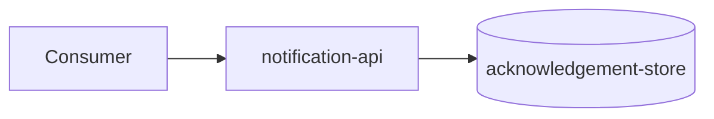

# Architecture

> Language: EN | [Português (pt-BR)](../../../pt-BR/docs/architecture/overview.md)
>
> Status: ACCEPTED
> Owner: example-team
> Last reviewed: 2026-08-07
>
> **Fictional example — not a real project.**
>
> Documentation Standard v1.0 (architecture methodology — light reference)

## Purpose

Describe the current architecture of the fictional Notification API: context, system boundary, main components, dependencies, and failure/trust edges.

## Context

Consumers send notification requests to `notification-api`. The service validates input, stores an acknowledgement, and returns an acceptance ID. Delivery to end users is outside this system.

Dedicated context view: [system-context.md](system-context.md).

## System

| Field | Value |
| --- | --- |
| Name | Notification API (fictional) |
| Purpose | Accept notification requests and return acceptance |
| Owner | example-team |
| Boundary summary | API + acknowledgement-store; no delivery workers |

## Goals

| Goal | Notes |
| --- | --- |
| Low-complexity integration | Synchronous contract |
| Clear acceptance semantics | Acceptance is not delivery confirmation |

## Non-Goals

| Non-goal | Rationale |
| --- | --- |
| Guaranteed end-user delivery tracking | Out of scope |

## System Boundary

| Inside the system | Outside the system |
| --- | --- |
| notification-api | Ordering system, support tooling (consumers) |
| acknowledgement-store | End-user delivery channels / workers |

## Architecture Overview

## Main Components

| Component | Responsibility | Documentation |
| --- | --- | --- |
| notification-api | Request validation, acceptance, persistence | [../application/notification-api.md](../application/notification-api.md) |

## Component Relationships

| From | To | Relationship | Contract |
| --- | --- | --- | --- |
| Consumer | notification-api | calls (sync) | [../contracts/send-notification.md](../contracts/send-notification.md) |
| notification-api | acknowledgement-store | depends on | internal |

## Communication

| From | To | Style | Contract |
| --- | --- | --- | --- |
| Consumer | notification-api | sync | [../contracts/send-notification.md](../contracts/send-notification.md) |

## Data Flow

1. Consumer sends a notification request.
2. API validates the payload.
3. API stores an acknowledgement record.
4. API returns an acceptance ID.

## Dependencies

| Dependency | Purpose | Failure impact | Classification |
| --- | --- | --- | --- |
| acknowledgement-store | Persist acceptance | Requests fail | Confirmed (example) |

## Security Boundaries / Trust Boundaries

| Boundary | What is protected | Controls summary |
| --- | --- | --- |
| API edge | Service operations | Authentication required (example) |

## Failure Domains

| Domain | Includes | Failure effect |
| --- | --- | --- |
| API + store | notification-api, acknowledgement-store | Notification acceptance unavailable |

## Scalability

Horizontal scaling of the API instances; store capacity is a limiting factor. <!-- Classification: Inferred (example) -->

## Availability

Target not defined in this fictional example. <!-- Classification: Unknown -->

## Trade-offs

| Decision / approach | Benefit | Cost |
| --- | --- | --- |
| Synchronous acceptance | Simple consumer integration | No delivery lifecycle in this API |

## Known Limitations

| Limitation | Impact | Classification |
| --- | --- | --- |
| Acceptance ≠ delivery | Consumers may over-interpret success | Confirmed (example) |

## Related Decisions

| ADR | Title | Status |
| --- | --- | --- |
| ADR-001 | Prefer synchronous request/response for acceptance | Accepted |

## Related Documentation

| Document | Path |
| --- | --- |
| Project overview | [../project-overview.md](../project-overview.md) |
| System context | [system-context.md](system-context.md) |
| Contract | [../contracts/send-notification.md](../contracts/send-notification.md) |
