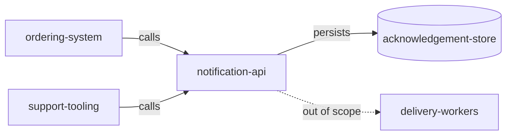

# System Context

> Language: EN | [Português (pt-BR)](../../../pt-BR/docs/architecture/system-context.md)
>
> Status: ACCEPTED
>
> Documentation Standard v1.0
> Owner: example-team
> Last reviewed: 2026-08-07
>
> **Fictional example — not a real project.**

## Purpose

Show where the fictional Notification API sits in its ecosystem: who calls it, what it depends on, and what remains outside the boundary.

## System

| Field | Value |
| --- | --- |
| Name | Notification API (fictional) |
| Purpose | Accept notification requests and return acceptance IDs |
| Owner | example-team |
| Boundary summary | Sync API + acknowledgement-store |

## Users

| User | Need | Interaction |
| --- | --- | --- |
| End user (recipient) | Receive notifications | Indirect — not via this API |

## Consumers

| Consumer | What they consume | Contract |
| --- | --- | --- |
| ordering-system (fictional) | send-notification acceptance | [../contracts/send-notification.md](../contracts/send-notification.md) |
| support-tooling (fictional) | send-notification acceptance | [../contracts/send-notification.md](../contracts/send-notification.md) |

## External Systems

| External system | Role | Direction | Classification |
| --- | --- | --- | --- |
| Delivery workers (fictional) | Deliver messages after acceptance | outbound (out of scope) | Confirmed (example) |

## Dependencies

| Dependency | Type | Purpose | Classification |
| --- | --- | --- | --- |
| acknowledgement-store | runtime | Persist acceptance records | Confirmed (example) |

## Inputs

| Input | Source | Format / contract |
| --- | --- | --- |
| Notification request | Consumer | [../contracts/send-notification.md](../contracts/send-notification.md) |

## Outputs

| Output | Destination | Format / contract |
| --- | --- | --- |
| Acceptance response | Consumer | [../contracts/send-notification.md](../contracts/send-notification.md) |
| Acceptance record | acknowledgement-store | internal |

## Relevant Relations

| From | To | Relation | Notes |
| --- | --- | --- | --- |
| ordering-system | notification-api | calls | Sync acceptance |
| support-tooling | notification-api | calls | Manual triggers |
| notification-api | acknowledgement-store | depends on | Persist acceptance |

## Context Diagram

## Related Documentation

| Document | Path |
| --- | --- |
| Architecture overview | [overview.md](overview.md) |
| Project overview | [../project-overview.md](../project-overview.md) |
| Contract | [../contracts/send-notification.md](../contracts/send-notification.md) |
