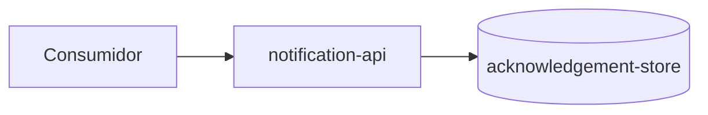

# Arquitetura

> Language: pt-BR | [English](../../../en/docs/architecture/overview.md)
>
> Status: ACCEPTED
> Owner: example-team
> Last reviewed: 2026-08-07
>
> **Exemplo ficcional — não é um projeto real.**
>
> Documentation Standard v1.0 (metodologia de arquitetura — referência leve)

## Propósito

Descrever a arquitetura atual da Notification API ficcional: contexto, limite do sistema, componentes principais, dependências e limites de falha/confiança.

## Contexto

Consumidores enviam solicitações de notificação para `notification-api`. O serviço valida a entrada, armazena um acknowledgement e retorna um ID de aceitação. A entrega ao usuário final fica fora deste sistema.

Visão de contexto dedicada: [system-context.md](system-context.md).

## Sistema

| Campo | Valor |
| --- | --- |
| Nome | Notification API (ficcional) |
| Propósito | Aceitar solicitações de notificação e retornar aceitação |
| Owner | example-team |
| Resumo do limite | API + acknowledgement-store; sem workers de entrega |

## Objetivos

| Objetivo | Notas |
| --- | --- |
| Integração de baixa complexidade | Contrato síncrono |
| Semântica clara de aceitação | Aceitação não é confirmação de entrega |

## Não-objetivos

| Não-objetivo | Justificativa |
| --- | --- |
| Rastreamento garantido de entrega ao usuário final | Fora do escopo |

## Limite do sistema

| Dentro do sistema | Fora do sistema |
| --- | --- |
| notification-api | Ordering system, support tooling (consumidores) |
| acknowledgement-store | Canais / workers de entrega ao usuário final |

## Visão geral da arquitetura

## Componentes principais

| Componente | Responsabilidade | Documentação |
| --- | --- | --- |
| notification-api | Validação de request, aceitação, persistência | [../application/notification-api.md](../application/notification-api.md) |

## Relacionamentos entre componentes

| De | Para | Relacionamento | Contrato |
| --- | --- | --- | --- |
| Consumidor | notification-api | calls (sync) | [../contracts/send-notification.md](../contracts/send-notification.md) |
| notification-api | acknowledgement-store | depends on | interno |

## Comunicação

| De | Para | Estilo | Contrato |
| --- | --- | --- | --- |
| Consumidor | notification-api | sync | [../contracts/send-notification.md](../contracts/send-notification.md) |

## Fluxo de dados

1. O consumidor envia uma solicitação de notificação.
2. A API valida o payload.
3. A API armazena um registro de acknowledgement.
4. A API retorna um ID de aceitação.

## Dependências

| Dependência | Propósito | Impacto da falha | Classification |
| --- | --- | --- | --- |
| acknowledgement-store | Persistir aceitação | Solicitações falham | Confirmed (example) |

## Limites de segurança / confiança

| Limite | O que é protegido | Resumo dos controles |
| --- | --- | --- |
| Borda da API | Operações do serviço | Autenticação obrigatória (exemplo) |

## Domínios de falha

| Domínio | Inclui | Efeito da falha |
| --- | --- | --- |
| API + store | notification-api, acknowledgement-store | Aceitação de notificação indisponível |

## Escalabilidade

Escalonamento horizontal das instâncias da API; a capacidade do store é um fator limitante. <!-- Classification: Inferred (example) -->

## Disponibilidade

Meta não definida neste exemplo ficcional. <!-- Classification: Unknown -->

## Trade-offs

| Decisão / abordagem | Benefício | Custo |
| --- | --- | --- |
| Aceitação síncrona | Integração simples do consumidor | Sem ciclo de vida de entrega nesta API |

## Limitações conhecidas

| Limitação | Impacto | Classification |
| --- | --- | --- |
| Aceitação ≠ entrega | Consumidores podem interpretar sucesso em excesso | Confirmed (example) |

## Decisões relacionadas

| ADR | Título | Status |
| --- | --- | --- |
| ADR-001 | Preferir request/response síncrono para aceitação | Accepted |

## Documentação relacionada

| Documento | Caminho |
| --- | --- |
| Visão geral do projeto | [../project-overview.md](../project-overview.md) |
| Contexto do sistema | [system-context.md](system-context.md) |
| Contrato | [../contracts/send-notification.md](../contracts/send-notification.md) |
