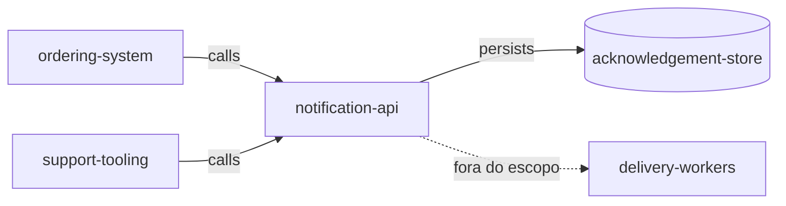

# Contexto do Sistema

> Language: pt-BR | [English](../../../en/docs/architecture/system-context.md)
>
> Status: ACCEPTED
>
> Documentation Standard v1.0
> Owner: example-team
> Last reviewed: 2026-08-07
>
> **Exemplo ficcional — não é um projeto real.**

## Propósito

Mostrar onde a Notification API ficcional se encaixa no ecossistema: quem a chama, do que depende e o que permanece fora do limite.

## Sistema

| Campo | Valor |
| --- | --- |
| Nome | Notification API (ficcional) |
| Propósito | Aceitar solicitações de notificação e retornar IDs de aceitação |
| Owner | example-team |
| Resumo do limite | API síncrona + acknowledgement-store |

## Usuários

| Usuário | Necessidade | Interação |
| --- | --- | --- |
| Usuário final (destinatário) | Receber notificações | Indireta — não via esta API |

## Consumidores

| Consumidor | O que consome | Contrato |
| --- | --- | --- |
| ordering-system (ficcional) | Aceitação de send-notification | [../contracts/send-notification.md](../contracts/send-notification.md) |
| support-tooling (ficcional) | Aceitação de send-notification | [../contracts/send-notification.md](../contracts/send-notification.md) |

## Sistemas externos

| Sistema externo | Papel | Direção | Classification |
| --- | --- | --- | --- |
| Delivery workers (ficcional) | Entregar mensagens após aceitação | outbound (fora do escopo) | Confirmed (example) |

## Dependências

| Dependência | Tipo | Propósito | Classification |
| --- | --- | --- | --- |
| acknowledgement-store | runtime | Persistir registros de aceitação | Confirmed (example) |

## Entradas

| Entrada | Origem | Formato / contrato |
| --- | --- | --- |
| Solicitação de notificação | Consumidor | [../contracts/send-notification.md](../contracts/send-notification.md) |

## Saídas

| Saída | Destino | Formato / contrato |
| --- | --- | --- |
| Resposta de aceitação | Consumidor | [../contracts/send-notification.md](../contracts/send-notification.md) |
| Registro de aceitação | acknowledgement-store | interno |

## Relações relevantes

| De | Para | Relação | Notas |
| --- | --- | --- | --- |
| ordering-system | notification-api | calls | Aceitação síncrona |
| support-tooling | notification-api | calls | Disparos manuais |
| notification-api | acknowledgement-store | depends on | Persistir aceitação |

## Diagrama de contexto

## Documentação relacionada

| Documento | Caminho |
| --- | --- |
| Visão geral da arquitetura | [overview.md](overview.md) |
| Visão geral do projeto | [../project-overview.md](../project-overview.md) |
| Contrato | [../contracts/send-notification.md](../contracts/send-notification.md) |
