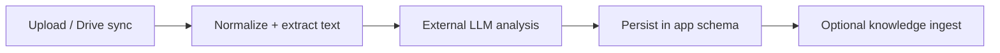

# Document analysis (illustrative)

> Language: EN | [Português](../../../pt-BR/docs/application/document-analysis.md)
>
> Status: ACCEPTED · Owner: example-team
>
> Documentation Standard v1.0
>
> **SUGGESTED / ILLUSTRATIVE** — pipeline shape; tools and vendors are example-only.

## Responsibility

Accept uploaded or drive-synced documents, normalize to text (OCR/conversion as needed), call an external LLM for structured analysis, persist results under the caller’s group, and optionally publish artifacts into the knowledge schema for RAG.

## Pipeline (high level)

## Inputs / outputs

| Item | Description | Classification |
| --- | --- | --- |
| Input formats | PDF, Office-like binaries | Confirmed (within example) |
| Job record | Status, model id, summary, errors | Confirmed (within example) |
| Side effect | Knowledge document + chunks | Proposed (example only) |
| Map-reduce for large docs | Split → map → reduce | Inferred |

## Failure modes

| Failure | Handling sketch | Classification |
| --- | --- | --- |
| LLM timeout | Retry with backoff; mark failed | Proposed (example only) |
| Unreadable file | User-visible error; no silent success | Confirmed (within example) |
| Group quota | Unknown | Unknown |

## Related

- [flask-api.md](flask-api.md)
- [knowledge-platform.md](knowledge-platform.md)
- [scheduler.md](scheduler.md)
