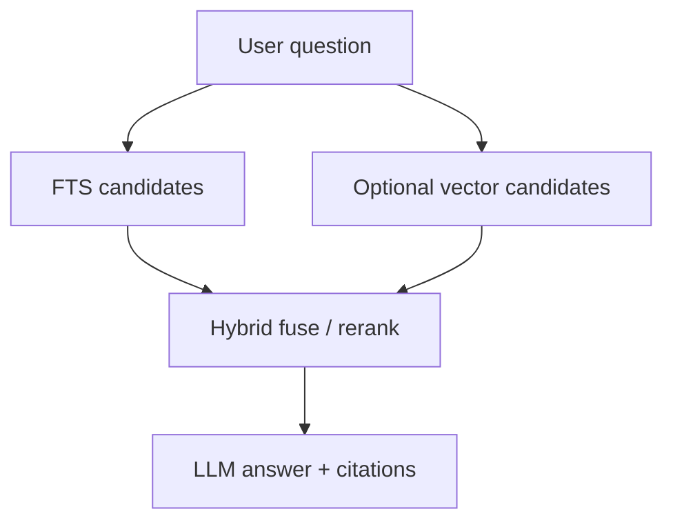

# Knowledge platform (illustrative)

> Language: EN | [Português](../../../pt-BR/docs/application/knowledge-platform.md)
>
> Status: ACCEPTED · Owner: example-team
>
> Documentation Standard v1.0
>
> **SUGGESTED / ILLUSTRATIVE** — RAG / KOC shape; FTS + optional vector is **example-only**.

## Responsibility

Governed corporate knowledge: ingest documents into `knowledge`, chunk and index for retrieval, manage prompts/skills, and feed citations into chat. Baseline search is full-text; vector similarity is optional behind a feature flag.

## Capabilities

| Capability | Notes | Classification |
| --- | --- | --- |
| Ingest / reclassify | From analyses or direct upload | Confirmed (within example) |
| Chunking | Retrieval units | Confirmed (within example) |
| FTS | Always-on baseline | Confirmed (within example) |
| Vector search | Optional extension | Proposed (example only) |
| Hybrid ranking | Fuse FTS + vector scores | Proposed (example only) |
| Prompt / skill governance | Versioned assets | Inferred |

## Retrieval sketch

## Related

- [architecture/data-model.md](../architecture/data-model.md)
- [operations/rb-hybrid-search.md](../operations/rb-hybrid-search.md)
- [document-analysis.md](document-analysis.md)
