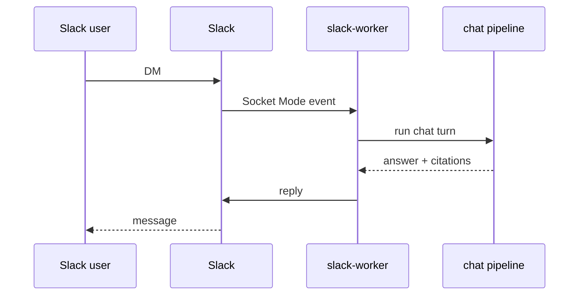

# Slack bridge (illustrative)

> Language: EN | [Português](../../../pt-BR/docs/application/slack-bridge.md)
>
> Status: ACCEPTED · Owner: example-team
>
> Documentation Standard v1.0
>
> **SUGGESTED / ILLUSTRATIVE** — Slack Socket Mode worker is **example-only**.

## Responsibility

Run a long-lived **Socket Mode** worker (same API image) that receives DMs, maps Slack users to Northstar identities when possible, invokes the shared chat pipeline, and posts replies — without exposing Flask HTTP to Slack’s public webhook model as the primary path.

## Why a separate process

| Concern | Choice | Classification |
| --- | --- | --- |
| Persistent websocket | Dedicated worker replica | Confirmed (within example) |
| Horizontal API scale | API pods stay request-scoped | Confirmed (within example) |
| Secret isolation | Slack app tokens only on worker | Proposed (example only) |

## Flow

## Configuration (placeholders)

| Secret / env | Purpose | Classification |
| --- | --- | --- |
| `SLACK_APP_TOKEN` | Socket Mode | Proposed (example only) |
| `SLACK_BOT_TOKEN` | Post messages | Proposed (example only) |
| Vault path | `secrets/path/example` | Proposed (example only) |

## Related

- [adr-002-slack-socket-worker.md](../decisions/adr-002-slack-socket-worker.md)
- [flask-api.md](flask-api.md)
