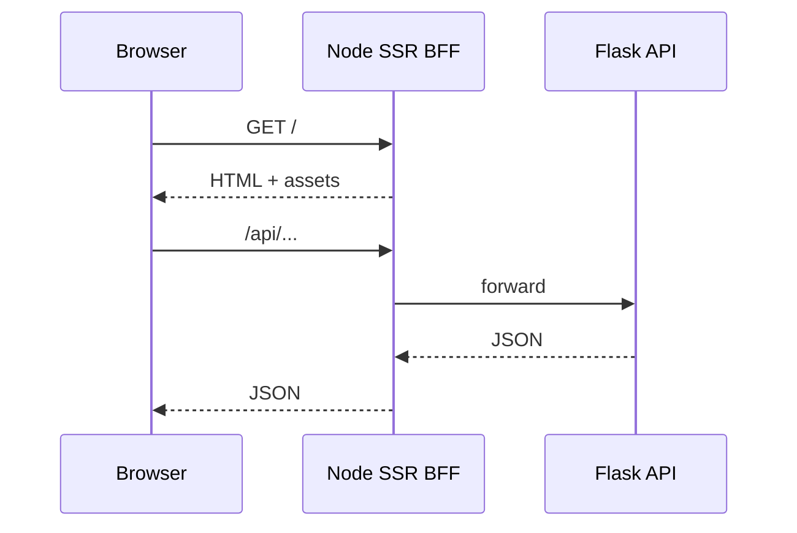

# SSR BFF (illustrative)

> Language: EN | [Português](../../../pt-BR/docs/application/ssr-bff.md)
>
> Status: ACCEPTED · Owner: example-team
>
> Documentation Standard v1.0
>
> **SUGGESTED / ILLUSTRATIVE** — React + Node SSR is **example-only**, not a framework mandate.

## Responsibility

Serve the Northstar web UI (Brazilian Portuguese copy), perform server-side rendering when useful, and **proxy** `/api` and `/external` to the Flask API so the browser never needs private API hostnames or secrets.

## Boundaries

| Does | Does not |
| --- | --- |
| Render React routes | Call PostgreSQL |
| Proxy authenticated API traffic | Hold LLM / Drive / Vault credentials |
| Attach public config (URL placeholders) | Run Slack Socket Mode |

## Request flow

## Configuration (placeholders)

| Variable | Purpose | Classification |
| --- | --- | --- |
| `PUBLIC_APP_URL` | `https://docs.example.com` | Proposed (example only) |
| `API_PROXY_TARGET` | Internal API base | Proposed (example only) |
| `NODE_ENV` | Runtime mode | Confirmed (within example) |

## Related

- [adr-001-ssr-bff.md](../decisions/adr-001-ssr-bff.md)
- [flask-api.md](flask-api.md)
