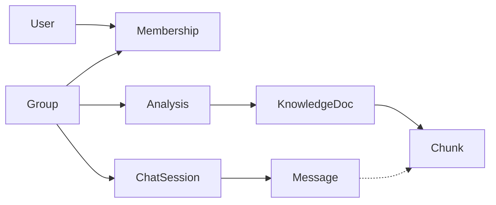

# Data model

> Language: EN | [Português](../../../pt-BR/docs/architecture/data-model.md)
>
> Status: ACCEPTED · Owner: example-team
>
> Documentation Standard v1.0
>
> **SUGGESTED / ILLUSTRATIVE** — logical/physical view in the spirit of the data-model template. Fictional schemas.

## Purpose

Describe schema ownership, core entities, and cross-cutting data concerns for Northstar — not every column.

## Schemas / namespaces

| Schema / store | Purpose | Owner | Classification |
| --- | --- | --- | --- |
| `app` | Users, groups, RBAC, analyses, chat sessions, API tokens, schedules | API team (example) | Confirmed (within example) |
| `knowledge` | Documents, chunks, embeddings (optional), prompts, skills, search metadata | Knowledge subsystem (example) | Confirmed (within example) |
| Object / drive store | Source binary files | Integration adapters | Proposed (example only) |

## Core entities

| Entity | Store | Responsibility | Classification |
| --- | --- | --- | --- |
| User | `app` | Identity, lockout, profile prefs | Confirmed (within example) |
| Group | `app` | Tenant-like boundary; encrypted shared settings | Confirmed (within example) |
| Membership / role | `app` | RBAC bindings | Confirmed (within example) |
| Document analysis | `app` | Job status, extracted summary, model used | Confirmed (within example) |
| Chat session / message | `app` | Conversational history + citation refs | Confirmed (within example) |
| API token | `app` | Scoped external access (`tk_ex_…` style) | Confirmed (within example) |
| Knowledge document | `knowledge` | Canonical ingested unit | Confirmed (within example) |
| Chunk | `knowledge` | Retrieval unit; FTS index; optional vector | Confirmed (within example) |
| Prompt / skill | `knowledge` | Governed prompt assets | Proposed (example only) |

## Relationships (high level)

## Cross-cutting data concerns

| Concern | Approach | Classification |
| --- | --- | --- |
| Multi-tenancy / group isolation | All queries scoped by group membership | Confirmed (within example) |
| Soft delete / archive | Soft flags on sessions and docs | Inferred |
| PII / retention | Email on users; retention policy | Unknown |
| Encryption at rest (app-level) | Group LLM keys encrypted before persist | Confirmed (within example) |
| Vector columns | Optional; gated by feature flag | Proposed (example only) |

## Related

- [overview.md](overview.md)
- [../application/knowledge-platform.md](../application/knowledge-platform.md)
- [../contracts/http-api.md](../contracts/http-api.md)
- [../security/overview.md](../security/overview.md)
