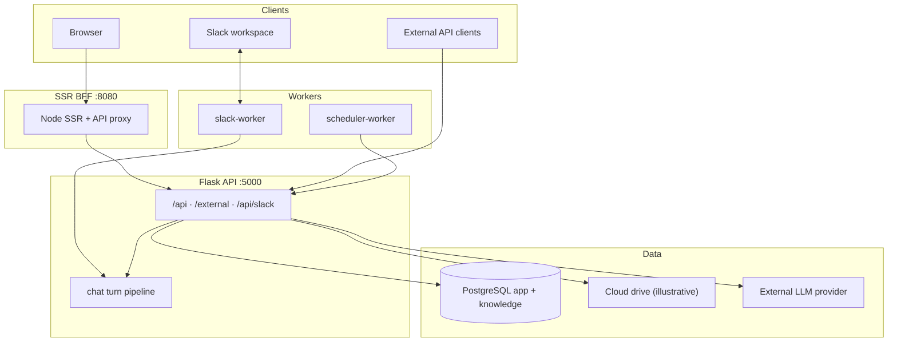

# Architecture overview

> Language: EN | [Português](../../../pt-BR/docs/architecture/overview.md)
>
> Status: ACCEPTED · Owner: example-team
>
> Documentation Standard v1.0
>
> **SUGGESTED / ILLUSTRATIVE** — **NOT** the Olivelas Documentation Standard · **NOT** a platform mandate.

## Summary

The Northstar Document Platform (fictional) separates a public **SSR BFF** (React + Node) from a private **Flask API**. Optional workers reuse the API image for Slack Socket Mode and an internal scheduler. Persistence is PostgreSQL with schemas `app` (operational) and `knowledge` (RAG).

**Classification:** Confirmed only within this illustrative example.

## Rule

The React frontend never connects to PostgreSQL, Drive/object stores, or the LLM provider. It only calls HTTP (`/api/*`, `/external/*` via the BFF proxy or the public API URL). Secrets live in environment variables or Vault placeholders such as `secrets/path/example`.

## Runtime topology

## Containers (illustrative)

| Container | Role | Classification |
| --- | --- | --- |
| `northstar-web` | SSR + assets + `/api` proxy | Proposed (example only) |
| `northstar-api` | Flask HTTP API | Proposed (example only) |
| `northstar-slack` | Socket Mode worker (same image) | Proposed (example only) |
| `northstar-scheduler` | Jobs worker (same image) | Proposed (example only) |
| `postgres` | Dual schema | Proposed (example only) |

## Quality attributes (example targets)

| Attribute | Approach | Classification |
| --- | --- | --- |
| Confidentiality | Secrets on server; encrypted group secrets | Confirmed (within example) |
| Isolation | Multi-group RBAC | Confirmed (within example) |
| Operability | Health + worker process modes | Confirmed (within example) |
| Search relevance | FTS + optional vector | Proposed (example only) |
| Availability SLO | — | Unknown |

## Related

- [system-context.md](system-context.md)
- [data-model.md](data-model.md)
- [adr-001-ssr-bff.md](../decisions/adr-001-ssr-bff.md)
