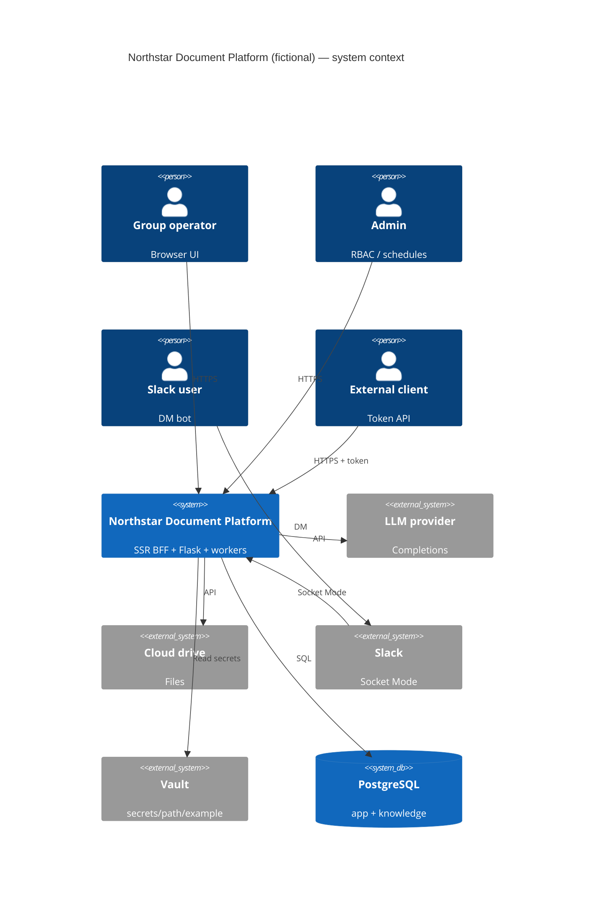

# System context

> Language: EN | [Português](../../../pt-BR/docs/architecture/system-context.md)
>
> Status: ACCEPTED · Owner: example-team
>
> Documentation Standard v1.0
>
> **SUGGESTED / ILLUSTRATIVE** example — fictional product **Northstar Document Platform**.

## Purpose

Describe actors, external systems, and trust boundaries for the illustrative Northstar system.

## Actors

| Actor | Need | Classification |
| --- | --- | --- |
| Group operator (PT-BR UI) | Upload/analysis, chat with sources | Confirmed (within example) |
| Group / global admin | RBAC, schedules, model catalog, knowledge ops | Confirmed (within example) |
| Slack user | DM the bot → same chat pipeline | Confirmed (within example) |
| External integrator | `/external/*` with scoped tokens | Confirmed (within example) |
| Engineer / AI agent | Docs in this example tree | Confirmed (within example) |

## External systems

| System | Interaction | Classification |
| --- | --- | --- |
| External LLM provider | Analysis + chat completions | Proposed (example only) |
| Cloud drive | Folder sync/fetch | Proposed (example only) |
| Slack API (Socket Mode) | Events + replies | Proposed (example only) |
| Vault / secret store | Secrets at `secrets/path/example` | Proposed (example only) |
| Identity IdP | Optional SSO | Unknown |

## Context diagram

## Trust boundaries

| Boundary | Inside | Outside | Classification |
| --- | --- | --- | --- |
| Browser ↔ BFF | Session cookie / auth header | Untrusted browser | Confirmed (within example) |
| BFF ↔ API | Private network or cluster DNS | Optional public internet | Inferred |
| API ↔ LLM / Drive | Credentials only on server | Vendor networks | Confirmed (within example) |
| Worker ↔ Slack | App token / socket | Slack cloud | Proposed (example only) |

## Related

- [overview.md](overview.md)
- [../security/overview.md](../security/overview.md)
