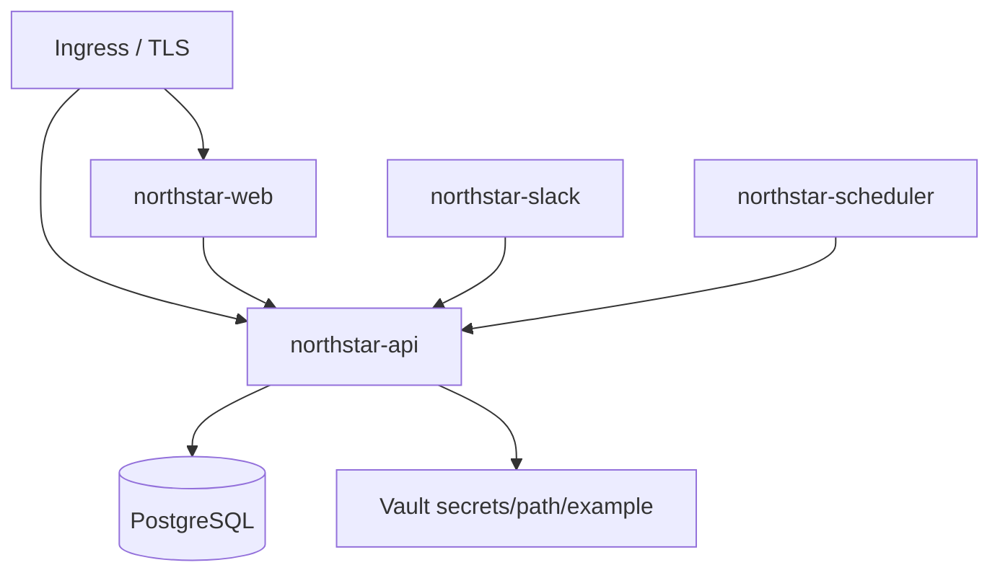

# Infrastructure / deployment (illustrative)

> Language: EN | [Português](../../../pt-BR/docs/infrastructure/deployment.md)
>
> Status: ACCEPTED · Owner: example-team
>
> Documentation Standard v1.0
>
> **SUGGESTED / ILLUSTRATIVE** — container + Helm-style values are **org-specific**, not a Loft or framework mandate.

## Purpose

Sketch how Northstar artifacts may be published: container images, optional Kubernetes workloads, and secret injection via env or Vault path placeholders.

## Artifacts

| Artifact | Contents | Classification |
| --- | --- | --- |
| Web image | Node SSR BFF + static assets | Proposed (example only) |
| API image | Flask app + worker entrypoints | Proposed (example only) |
| Values file | Replicas, URLs, feature flags, `secrets/path/example` | Proposed (example only) |

## Environments (placeholders)

| Env | Frontend | API |
| --- | --- | --- |
| local | `http://localhost:8080` | `http://localhost:5000` |
| staging | `https://docs.staging.example.com` | `https://api.docs.staging.example.com` |
| prod | `https://docs.example.com` | `https://api.docs.example.com` |

## Topology

## Related

- [../operations/deploy-k8s.md](../operations/deploy-k8s.md)
- [../operations/local-dev.md](../operations/local-dev.md)
- [../security/overview.md](../security/overview.md)
