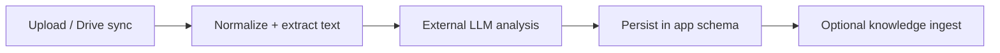

# Análise de documentos (ilustrativa)

> Idioma: pt-BR | [English](../../../en/docs/application/document-analysis.md)
>
> Status: ACCEPTED · Owner: example-team
>
> Documentation Standard v1.0
>
> **SUGERIDO / ILUSTRATIVO** — formato do pipeline; ferramentas e vendors são apenas exemplo.

## Responsabilidade

Aceitar documentos enviados ou sincronizados do drive, normalizar para texto (OCR/conversão conforme necessário), chamar LLM externo para análise estruturada, persistir resultados no grupo do chamador e opcionalmente publicar artefatos no schema knowledge para RAG.

## Pipeline (alto nível)

## Entradas / saídas

| Item | Description | Classification |
| --- | --- | --- |
| Input formats | PDF, Office-like binaries | Confirmed (within example) |
| Job record | Status, model id, summary, errors | Confirmed (within example) |
| Side effect | Knowledge document + chunks | Proposed (example only) |
| Map-reduce for large docs | Split → map → reduce | Inferred |

## Modos de falha

| Failure | Handling sketch | Classification |
| --- | --- | --- |
| LLM timeout | Retry with backoff; mark failed | Proposed (example only) |
| Unreadable file | User-visible error; no silent success | Confirmed (within example) |
| Group quota | Unknown | Unknown |

## Relacionados

- [flask-api.md](flask-api.md)
- [knowledge-platform.md](knowledge-platform.md)
- [scheduler.md](scheduler.md)
