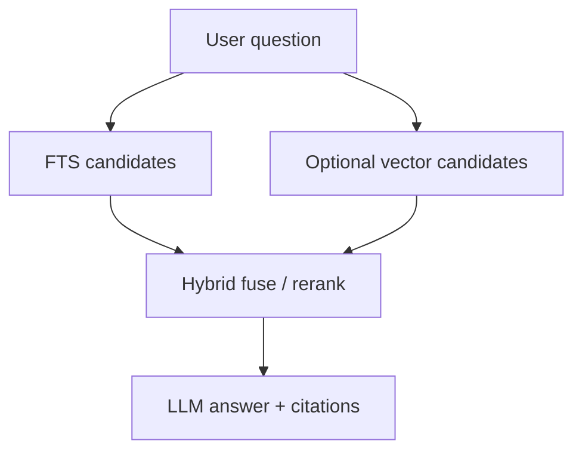

# Plataforma de knowledge (ilustrativa)

> Idioma: pt-BR | [English](../../../en/docs/application/knowledge-platform.md)
>
> Status: ACCEPTED · Owner: example-team
>
> Documentation Standard v1.0
>
> **SUGERIDO / ILUSTRATIVO** — formato RAG / KOC; FTS + vetor opcional é **apenas exemplo**.

## Responsabilidade

Conhecimento corporativo governado: ingerir documentos em `knowledge`, chunkar e indexar para retrieval, gerir prompts/skills e alimentar citações no chat. A busca padrão é full-text; similaridade vetorial é opcional atrás de feature flag.

## Capacidades

| Capability | Notes | Classification |
| --- | --- | --- |
| Ingest / reclassify | From analyses or direct upload | Confirmed (within example) |
| Chunking | Retrieval units | Confirmed (within example) |
| FTS | Always-on baseline | Confirmed (within example) |
| Vector search | Optional extension | Proposed (example only) |
| Hybrid ranking | Fuse FTS + vector scores | Proposed (example only) |
| Prompt / skill governance | Versioned assets | Inferred |

## Esboço de retrieval

## Relacionados

- [architecture/data-model.md](../architecture/data-model.md)
- [operations/rb-hybrid-search.md](../operations/rb-hybrid-search.md)
- [document-analysis.md](document-analysis.md)
