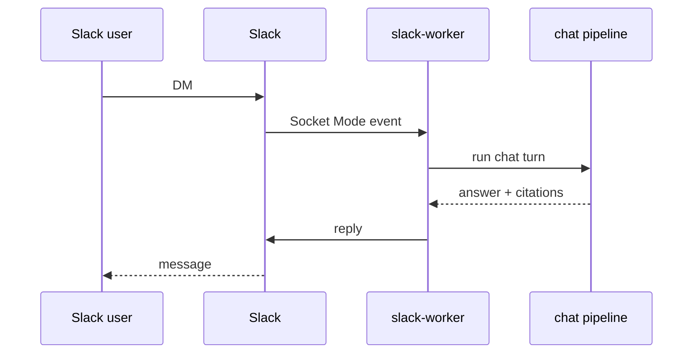

# Ponte Slack (ilustrativa)

> Idioma: pt-BR | [English](../../../en/docs/application/slack-bridge.md)
>
> Status: ACCEPTED · Owner: example-team
>
> Documentation Standard v1.0
>
> **SUGERIDO / ILUSTRATIVO** — worker Slack Socket Mode é **apenas exemplo**.

## Responsabilidade

Rodar um worker de longa duração em **Socket Mode** (mesma imagem da API) que recebe DMs, mapeia usuários Slack para identidades Northstar quando possível, invoca o pipeline compartilhado de chat e publica respostas — sem expor Flask HTTP ao modelo público de webhook do Slack como caminho principal.

## Por que um processo separado

| Concern | Choice | Classification |
| --- | --- | --- |
| Persistent websocket | Dedicated worker replica | Confirmed (within example) |
| Horizontal API scale | API pods stay request-scoped | Confirmed (within example) |
| Secret isolation | Slack app tokens only on worker | Proposed (example only) |

## Fluxo

## Configuração (placeholders)

| Secret / env | Purpose | Classification |
| --- | --- | --- |
| `SLACK_APP_TOKEN` | Socket Mode | Proposed (example only) |
| `SLACK_BOT_TOKEN` | Post messages | Proposed (example only) |
| Vault path | `secrets/path/example` | Proposed (example only) |

## Relacionados

- [adr-002-slack-socket-worker.md](../decisions/adr-002-slack-socket-worker.md)
- [flask-api.md](flask-api.md)
