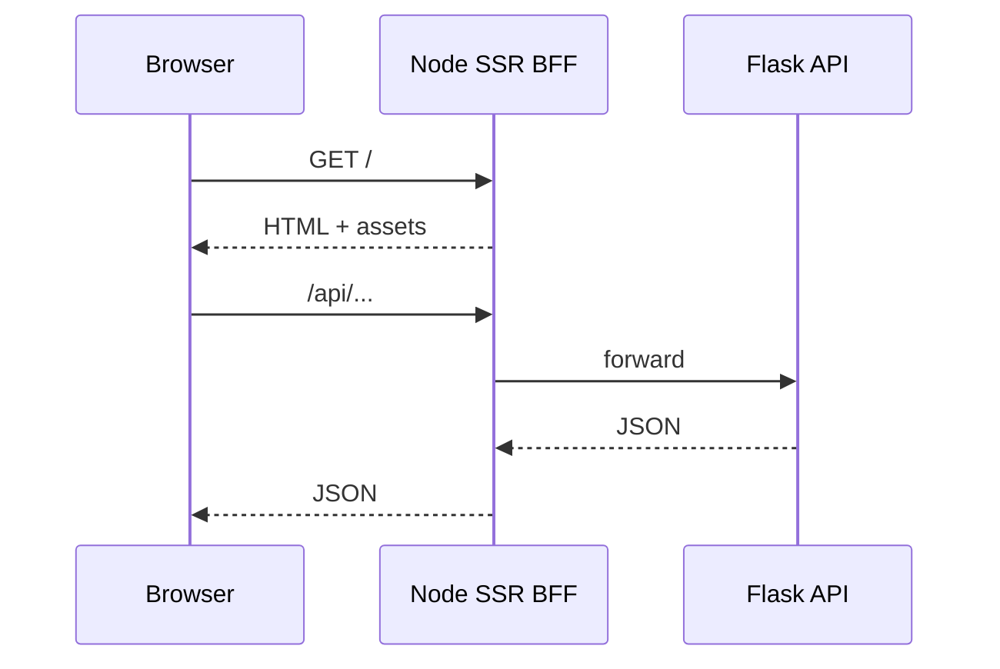

# SSR BFF (ilustrativo)

> Idioma: pt-BR | [English](../../../en/docs/application/ssr-bff.md)
>
> Status: ACCEPTED · Owner: example-team
>
> Documentation Standard v1.0
>
> **SUGERIDO / ILUSTRATIVO** — React + Node SSR é **apenas exemplo**, não mandato do framework.

## Responsabilidade

Servir a UI web da Northstar (copy em português brasileiro), fazer server-side rendering quando útil e **proxiar** `/api` e `/external` para a Flask API, para que o browser nunca precise de hostnames privados da API nem de segredos.

## Fronteiras

| Faz | Não faz |
| --- | --- |
| Renderizar rotas React | Chamar PostgreSQL |
| Proxiar tráfego autenticado da API | Guardar credenciais LLM / Drive / Vault |
| Anexar config pública (placeholders de URL) | Rodar Slack Socket Mode |

## Fluxo de request

## Configuração (placeholders)

| Variable | Purpose | Classification |
| --- | --- | --- |
| `PUBLIC_APP_URL` | `https://docs.example.com` | Proposed (example only) |
| `API_PROXY_TARGET` | Internal API base | Proposed (example only) |
| `NODE_ENV` | Runtime mode | Confirmed (within example) |

## Relacionados

- [adr-001-ssr-bff.md](../decisions/adr-001-ssr-bff.md)
- [flask-api.md](flask-api.md)
