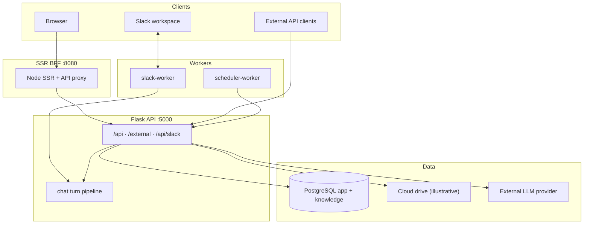

# Visão de arquitetura

> Idioma: pt-BR | [English](../../../en/docs/architecture/overview.md)
>
> Status: ACCEPTED · Owner: example-team
>
> Documentation Standard v1.0
>
> **SUGERIDO / ILUSTRATIVO** — **NÃO** é o Padrão de Documentação AIOps · **NÃO** é mandato de plataforma.

## Resumo

A Northstar Document Platform (ficcional) separa um **SSR BFF** público (React + Node) de uma **Flask API** privada. Workers opcionais reutilizam a imagem da API para Slack Socket Mode e um scheduler interno. Persistência em PostgreSQL nos schemas `app` (operacional) e `knowledge` (RAG).

**Classification:** Confirmed apenas dentro deste exemplo ilustrativo.

## Regra

O frontend React nunca conecta a PostgreSQL, stores de Drive/objeto ou ao provedor LLM. Só chama HTTP (`/api/*`, `/external/*` via proxy do BFF ou URL pública da API). Segredos vivem em variáveis de ambiente ou placeholders de Vault como `secrets/path/example`.

## Topologia de runtime

## Containers (ilustrativos)

| Container | Papel | Classification |
| --- | --- | --- |
| `northstar-web` | SSR + assets + proxy `/api` | Proposed (example only) |
| `northstar-api` | Flask HTTP API | Proposed (example only) |
| `northstar-slack` | Worker Socket Mode (mesma imagem) | Proposed (example only) |
| `northstar-scheduler` | Worker de jobs (mesma imagem) | Proposed (example only) |
| `postgres` | Dual schema | Proposed (example only) |

## Atributos de qualidade (alvos de exemplo)

| Atributo | Abordagem | Classification |
| --- | --- | --- |
| Confidencialidade | Segredos no servidor; segredos de grupo criptografados | Confirmed (within example) |
| Isolamento | RBAC multi-grupo | Confirmed (within example) |
| Operabilidade | Health + modos de processo worker | Confirmed (within example) |
| Relevância de busca | FTS + vetor opcional | Proposed (example only) |
| SLO de disponibilidade | — | Unknown |

## Relacionados

- [system-context.md](system-context.md)
- [data-model.md](data-model.md)
- [adr-001-ssr-bff.md](../decisions/adr-001-ssr-bff.md)
